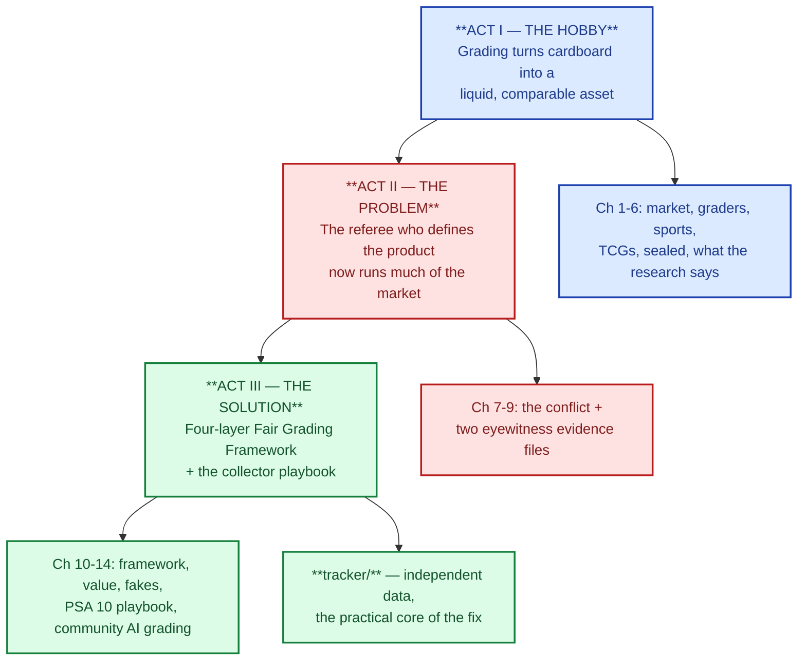

# trading-card-collector

The whole repo at a glance — three acts, fourteen chapters, one instrument.

**One story, three acts: the hobby introduced → the problem defined → the solution
proposed.**

The backbone of this repository is a single argument:

> **Act I — The hobby.** Grading is what turns a piece of cardboard into a tradeable,
> liquid asset: a neutral, published, comparable grade is what lets a stranger trust a
> card's condition without re-inspecting it, and that trust is what creates the price
> premium and the resale liquidity.
>
> **Act II — The problem.** The referee who defines the product is no longer neutral.
> PSA's parent, Collectors, now also owns the other two major graders (BGS, SGC),
> runs vault and sales products, and is reported to own price-data tools. The people
> who assign the grade increasingly operate the market around it — and the rules of
> the game are theirs to change.
>
> **Act III — The solution.** A four-layer Fair Grading Framework: structural
> separation of grading from the market (the long game), transparency standards any
> grader can adopt this year, market mechanisms collectors can use **today**, and
> governance of collectors as a class — plus the complete, practical playbook for
> buying and selling in this market while the long game plays out.

Read the acts in order. Act I is the world you need to understand; Act II is the
turn; Act III is the answer, from what the industry should do to what you can do
this week. Supporting reference chapters (glossary, sources) live in `docs/reference/`
and are open whenever you need them.

## The story in one breath

Trading cards became a market because grading made them comparable. But the industry
consolidated around a single owner — Collectors now holds PSA, BGS and SGC (verified;
`docs/act-2-the-problem/grading-conflict.md`) — the same group that stores cards,
facilitates sales, and is reported to publish price data. The stakes are not
theoretical: in early 2026 the same Pikachu Illustrator card sold for **$16.5 million
as a PSA 10** and **$1,406,250 as a PSA 9**, five weeks apart. The solution has a
short side — independent data, outside-source price checks, full documentation, full
insurance (the playbook and the tracker in this repo) — and a long side — published
gem rates and subgrades, audited consistency, chain of custody, real liability, and
structural separation of grading from the market it prices.

## Reading path

### Act I — The hobby (`docs/act-1-the-hobby/`)

| # | Chapter | What it covers |
|---|---------|----------------|
| 1 | [market-overview.md](docs/act-1-the-hobby/market-overview.md) | History from tobacco cards to the 2020s boom, how the industry is structured (IP licence → manufacturer → distributor → retail → secondary market → grader), segments, and how booms and busts work |
| 2 | [grading-companies.md](docs/act-1-the-hobby/grading-companies.md) | PSA, BGS, SGC, CGC, TAG compared: scales, subgrades, labels, crossovers — and §2.7, who owns which grader (the last section before the story turns) |
| 3 | [sports-cards.md](docs/act-1-the-hobby/sports-cards.md) | Rookies, parallels, numbered cards, autos and relics, hobby vs. retail, case breaks, key cards |
| 4 | [tcg-collecting.md](docs/act-1-the-hobby/tcg-collecting.md) | Pokemon, Magic, Yu-Gi-Oh!, One Piece, Lorcana and friends: rarity systems, reprint risk, language premiums — where Pokemon lives |
| 5 | [sealed-product.md](docs/act-1-the-hobby/sealed-product.md) | Booster boxes, ETBs, cases: holding sealed, reseal detection, storage |
| 6 | [what-research-says.md](docs/act-1-the-hobby/what-research-says.md) | The hobby in the academic world: information economics (lemons, signaling — why grading exists), auction theory, behavioral finance (the 2021 frenzy), consumer behaviour (nostalgia), and the AI-grading literature — with a crosswalk to this repo's claims |

### Act II — The problem (`docs/act-2-the-problem/`)

| # | Chapter | What it covers |
|---|---------|----------------|
| 7 | [grading-conflict.md](docs/act-2-the-problem/grading-conflict.md) | **The backbone chapter.** The problem in five verified parts (consolidation; the referee as market participant; the subjective grade with a non-subjective price — the $16.5M/$1.4M Pikachu cliff; manufactured, opaque scarcity; the accountability gap), why it is specifically unfair to collectors, sources, and a 26-claim verification log |
| 8 | [monopoly-video-notes.md](docs/act-2-the-problem/monopoly-video-notes.md) | Eyewitness evidence (1 of 2): the FOLLOWTHEMONEY commentary on PSA/Collectors — reholder risk, upcharges, cert changes. Each claim labelled checked / claim / opinion |
| 9 | [hobby-documentary-notes.md](docs/act-2-the-problem/hobby-documentary-notes.md) | Eyewitness evidence (2 of 2): "The Hobby" documentary — the boom, grading as the value engine, the one-point swings collectors describe. Speakers' claims, not verified facts |

### Act III — The solution (`docs/act-3-the-solution/`)

| # | Chapter | What it covers |
|---|---------|----------------|
| 10 | [fair-grading-framework.md](docs/act-3-the-solution/fair-grading-framework.md) | **The backbone chapter.** The four-layer fix: (1) structural separation — divest/firewall, independent standards body, regulatory trigger; (2) transparency standards — gem rates, subgrades, agreement audits, honest populations, chain of custody, real liability; (3) market mechanisms you can use today — outside-source rule, dual-grade, cert-history discipline, trend pricing; (4) governance — open data, transparency scorecard, independent escrow, keep the records |
| 11 | [valuation-and-selling.md](docs/act-3-the-solution/valuation-and-selling.md) | The pricing method the framework's Layer 3 runs on: fair value from *sold* comps, at least one source outside the grader's group, walk-away prices; selling channels and fees; taxes and records |
| 12 | [fakes-and-scams.md](docs/act-3-the-solution/fakes-and-scams.md) | Where the money goes wrong: counterfeit raw cards and slabs, trimming and alterations, marketplace scams, and the minimum defence process |
| 13 | [psa10-playbook.md](docs/act-3-the-solution/psa10-playbook.md) | The complete PSA 10 Pokemon playbook: what the grade means precisely, population reports, how PSA 10 prices behave, the grade-your-own-card math, buying online and offline, authentication, condition traps, paying/shipping/insurance, storage, selling later, rookie mistakes, and checklists — every framework rule applied, per purchase |
| 14 | [open-community-ai-grading.md](docs/act-3-the-solution/open-community-ai-grading.md) | The missing middle between the two bad options: why the incumbent referee (staked) and the seller's own claim (zero-cost signal) both fail, and the five requirements a neutral standard must pass — then the design that passes them: a community-owned, open, versioned AI grading pipeline with a tamper-evident public certificate log, the hard problems stated honestly, and what a collector does about it today |

### The instrument

| Chapter | What it covers |
|---|---|
| [tracker/](tracker/README.md) | Your own price data, independent of the grader's corporate group: log sold comps and listing sightings, get buy-signal alerts against your targets, and chart trends. Standard library only, no APIs, no accounts. It is the one source in this repo that Collectors does not own — and the practical core of the solution's Layer 3 and Layer 4. |

### Reference (`docs/reference/`)

| Chapter | What it covers |
|---|---|
| [glossary.md](docs/reference/glossary.md) | The hobby vocabulary across sports and TCGs, in one place |
| [sources.md](docs/reference/sources.md) | Where the facts in every chapter come from, when they were checked, and the video sources behind the evidence layer |

## How the story hangs together

1. **The hobby** — a market built on trust: the neutral grade makes cards liquid and
   comparable. (Act I.)
2. **The problem** — the referee stopped being neutral: one owner now controls three
   of the five major grading brands, plus vaults and sales products, and (reportedly)
   price data. The 9-to-10 cliff means the standard's owner sets prices that move in
   five-figure steps. (Act II.)
3. **The solution** — short side now (independent data, outside-source checks,
   documentation, insurance: the playbook + the tracker), long side later (published
   gem rates and subgrades, audited consistency, chain of custody, real liability,
   structural separation — the framework). (Act III.)

If you only remember one sentence: **the grade is the product, but the number on the
slab is not the whole truth — your independent data is.**

## Ground rules used across every file

1. Price claims carry a date and a source. Anything older than about a year is
   history, not a quote — pull today's number from `tracker/`.
2. Facts that could not be checked against a source say so, in the text and in
   `docs/reference/sources.md`. Reported-but-unverified claims are labelled as such.
3. No chapter is investment advice. Cards are illiquid, carry high fees, and are
   driven by fashion. Buy what you would be happy to keep.