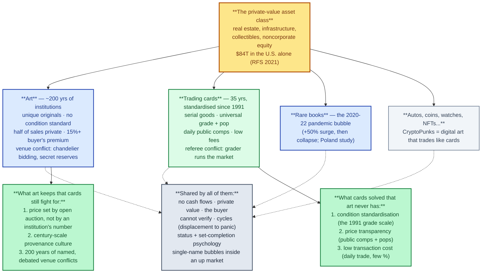
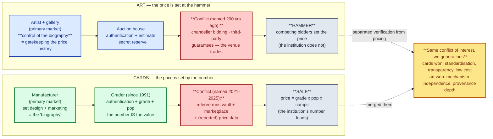

# Cards and the art market — the mature sibling asset class

> **Act I — The hobby · chapter 9 of 17.** The tulip chapter (ch. 8) compared
> cards to a 400-year-old *bubble*. This chapter compares cards to a
> 400-year-old *asset class*: the art market — the only mature,
> institutionally embedded market for non-productive aesthetic objects. The
> comparison earns its place in this repo for two reasons: what the art
> market has done wrong for 200 years is exactly what Act II documents
> happening to cards, and what the card market solved in 1991 is exactly
> what art still has not. Same family, different generations of
> institution-building.

## 1. The shared family

The asset-class frame: art and cards are siblings in the $84T private-value class — and each holds what the other lacks.

The academic frame first: a 2021 *Review of Financial Studies* special
issue defines **"real and private-value assets"** — real estate,
infrastructure, **collectibles**, and noncorporate business equity — as a
single investment class "worth an estimated **$84 trillion in the U.S.
alone**," and notes that "private values can affect pricing in many other
financial markets" [U2]. Collectibles are not a hobby at the edge of
finance; they are a named asset class whose value is *private* — each
buyer's, not a cash flow's.

Art and cards sit in that class together, and so do the others: stamps,
coins, watches, classic cars (a 2016 case study exists for collectible
automobiles [U9]), rare books, and — the obvious bridge — **NFTs like
CryptoPunks, which are digital art that trade like cards** [U10]. The
collectibles market as a whole was **$360 billion in 2020** [U10].

The shared properties:

1. **Non-productive goods.** No cash flows. Art is bought "for values based
   not only on a work's perceived cultural value, but on its past monetary
   value as well as its predicted future value" [U1]. Cards: the same, with
   the set-completion and nostalgia layers on top [U10].
2. **Information asymmetry is the founding problem.** Of the art market:
   "Buyers often have no clear understanding of the value of what they
   buy, and middlemen routinely receive compensation for sales of items they
   have never seen, to buyers they have never interacted with" [U1]. That
   sentence is the art-market version of this repo's Act II, written about
   galleries instead of graders.
3. **Singularity — the valuation problem securities don't have.**
   "Original artworks are not fungible, they have valuation challenges not
   similarly affecting securities, with dynamics of what Karpik calls
   *singularities*" [U1][U11]. Cards occupy the intermediate position:
   serial goods (fungible *as prints*, differentiated *by condition and
   grade*) — a singularity problem, but one a numeric scale can price.
4. **Primary and secondary markets, with the primary setting the story.**
   Art: the gallery (primary) creates the artist's "biography," the auction
   (secondary) prices it — "primary market [valuations] are ... more
   speculative," driven by "gallery, dealer, consultant, and agent
   promotion as well as collectors acting as *alpha consumers* (trend
   setters)" [U1]. Cards: the manufacturer's set design and marketing set
   the story, the secondary market prices it. The "control of the
   biography" gatekeeping Velthuis named in art [U1] is the franchise's
   marketing department in cards.
5. **Cycles, crashes, and single-name bubbles.** The art record: the 1990
   collapse; 2000–2003 auction volume down 36%; November 2008 hammer totals
   at the three big houses down from $1.75B to $803M in one year; Damien
   Hirst set a living-artist world record in 2008 and his annual auction
   sales **shrunk 93% the following year** [U1]. Cards: the 1990s, 2000s,
   and 2020–21 cycles (`market-overview.md` §1.4; ch. 8). The 2021
   displacement was *cross-collectibles*: the Polish rare-books market
   (85%-share auctions, 2018–2022) showed the same pandemic surge —
   "sharp increases (up to 50%) in sales revenues and a subsequent
   collapse" [U6]. One trigger, several collectible markets, same shape.
6. **Status and the practice of collecting.** Collecting as a social
   practice has its own literature (Pearce's *On Collecting*, 1995 — the
   standard reference, 400+ citations [U9]); manufactured collectibles are
   "items made specifically for people to collect," with set-completion an
   explicit marketing mechanism [U10]. Veblen's conspicuous consumption is
   the economics of both (ch. 7, ch. 8 §4.1).
7. **Auctions as the price clock.** The auction system is where art's
   prices are *publicly* formed, and a whole research literature exists on
   how it works and how well it performs [U5]. Cards run the same clock
   slower: Goldin, Heritage, auction archives (ch. 14).

## 2. The structural differences

The differences are not cosmetic — they are institutional engineering, and
they run in *both* directions (cards have solved three things art cannot;
art survived two things cards must manage).

| Dimension | Art market | Card market | Why it matters |
|-----------|-----------|-------------|----------------|
| **Supply** | Unique originals; non-reproducible; supply locks permanently at the artist's death (dead artists' works auction for more — verified in a 37,605-painting hedonic study [U3]) | Serial goods: print runs known, reprints possible, a franchise can close or revive supply | Art's scarcity is *final*; a card's scarcity is *managed*. "A reason to be wanted in 20 years" (ch. 1) is a bet on which kind you hold |
| **The dominant risk** | **Authenticity** — is it really a Rembrandt? Forgeries are 500 years old (Michelangelo's 1496 Cupid [U12]); Thomas Hoving estimated forged art at up to 40% of the market (disputed, cited as such [U12]) | **Condition** — the card is always "real" (it came off a press); the grade is the value | The two markets carry the *two halves* of the information problem. Cards still have authenticity risk at the edges (counterfeits, alterations — ch. 15) |
| **Condition standard** | **None.** Authentication + provenance + the auction house's bespoke condition report; no universal scale [U1][U13] | **Universal since 1991** — PSA 1–10, four subgrades internally, pop reports, cert lookup (ch. 3 audit) | Cards solved in 1991 what art still prices case-by-case. This is the card market's single biggest institutional invention |
| **Price transparency** | "The market is not transparent; private sales data are not systematically available, and **private sales represent about half of market transactions**" [U1]. A 2009 open debate on "the art market is less ethical than the stock market" was *decided in favour* by the audience [U1] | Sold comps public (eBay), pops public, price indices built by outsiders (Card Ladder's 100M-sale database, ch. 3) | Even the consolidated card market is structurally more transparent than a 200-year-old art market |
| **Transaction costs** | Seller commission up to 20% + **buyer's premium ~15%** (both sides pay); "transaction costs, which are considerable in the art market" [U1][U4] | Listing fees + grading fee — a small fraction of price at most levels | Art is a low-turnover asset by construction; cards can be traded daily. That is why British Rail could hold its £40M art portfolio for 25 years and most card collectors cannot imagine it |
| **The venue conflict** | Documented, named, and 200 years old: **chandelier bidding** (the house bidding on its own consignment), secret reserves, undisclosed third-party guarantees [U1][U13] | Documented, named, and new: the grader that runs the vault, the marketplace and (reported) the price data (ch. 10) | **The same conflict of interest, in two generations.** Art's version: the venue facilitates *and trades*. Cards' version: the referee certifies *and operates the market*. Art debated this publicly in 2009; the card market is doing its 2009 right now |
| **How the price is set** | **By competing bidders at auction** — the venue sets the estimate, but the hammer price is market-determined [U5] | **Partly by the standard itself** — the grade (a number the institution assigns) is the largest price determinant (the +339% PSA-10 dummy, ch. 3; the $16.5M/$1.4M cliff, ch. 10) | The deepest difference. Art's pricing mechanism (auction) and its verification institutions (house expertise, provenance) are *separated*; in cards the verification institution *is* the pricing mechanism. Act III's Layer 1 asks for exactly art's separation |
| **Liquidity clock** | Seasonal — major auctions in spring/autumn; "seasonal rather than ongoing" [U1] | Continuous — daily comps, 24/7 marketplaces | Card corrections are faster and sharper (ch. 1 §1.4); art corrections unfold over seasons and years |
| **Index construction** | Built by *researchers*, from auction data, because the market won't publish: hedonic indices (37,605 paintings, 1973–2003 [U3]); "researchers discovered biased price estimates in the auction houses" [U1] | Built by *vendors and outsiders* (Card Ladder, 130point) and, at collector scale, by your own tracker (ch. 16) | Both markets needed a hedonic reconstruction; cards had it earlier and cheaper |
| **Institutional investors** | The 1974–1999 British Rail pension experiment: ~£40M (3% of fund), **11.3% annualized**, then liquidated because it "came to be seen as an illegitimate investment area" [U1] | Vaults and tokenisation are the early stage (Krause 2026, ch. 7) | Art is 30 years ahead on the institutional question — and its answer was a 25-year hold |

## 3. The debate: same or not?

The institutional comparison: art sets the price at the hammer while the venue trades (a 200-year-old named conflict); cards let the institution's number set the price — the same conflict, two generations.

**Same (the family argument).** A 2021 top-journal research program puts
collectibles and art in one class — private-value real assets [U2]. The
cycle physics are identical and documented in both (Hirst −93% ≈ any
franchise bust; the 2021 cross-collectibles displacement ≈ the rare-books
bubble [U6]; the 2000s art crash ≈ the 2000s card slump [U1]). The
information problem is identical: a buyer who cannot verify, a middleman
who profits from the gap [U1]. The status function is identical: Veblen,
set-completion, connoisseurship [U9][U10].

**Different (the engineering argument).** Cards won three wars art never
fought: **standardisation** (the 1991 grade scale vs. no universal
condition language), **transparency** (public comps and pops vs. half the
market in private sales), and **low transaction cost** (daily trade vs.
35% round-trip fees). Art won two wars cards are still fighting: **price
mechanism independence** (the auction sets the price; no institution in
the art market *assigns the number* that moves prices in five-figure
steps) and **authenticity infrastructure maturity** (provenance culture,
connoisseurship, forensic testing — centuries of practice; cards'
equivalent is two decades old and still consolidating).

**Verdict: same family, different generation.** The card market is the art
market's younger sibling that industrialised condition and price
transparency — and in doing so created a new conflict of interest (the
referee who runs the market) that the art market has carried, named and
debated for 200 years under different names: chandelier bidding, secret
reserves, undisclosed guarantees [U1][U13]. The tulip chapter asked "is
this a bubble?" The art chapter answers "is this an asset class?" — and
both answers have the same shape: *the psychology is inherited; the
institutions are what you're actually competing on.*

## 4. What the art market teaches the card market (the reasoning)

1. **The venue conflict is not new — it is 200 years old, and it was named
   in art first.** "Chandelier bidding" (the house bidding on its own
   consignment), secret reserves and undisclosed third-party guarantees
   are the art market's documented conflicts of interest; the 2009 debate
   judged the market "less ethical than the stock market" on this basis
   [U1]. Act II's finding — the grader operating the marketplace — is the
   same structure in cards. The art market's *response* was disclosure
   (Christie's published its commissions in 1995 [U1]; secret reserves
   defended as a cartel-protection measure [U1]) — not separation. The
   framework's Layer 1 (structural separation) is therefore *stricter than
   the art market's own solution*, and the art market is the precedent for
   why a weaker solution (disclosure) may be all the market delivers.
2. **Authentication is not condition.** Art spent centuries building
   authenticity infrastructure (signatures, provenance, connoisseurship,
   forensic testing) because originals can be faked [U12][U13]; cards spent
   1991's infrastructure on *condition* because serial prints cannot be
   faked — only graded. The consequence: the art market's value is in the
   *name* (artist, provenance), the card market's value is in the *number*
   (grade, pop). When a number becomes the value, **who owns the number
   owns the market** — which is why the consolidation in ch. 3 matters
   more for cards than for art, where no single institution owns "what a
   painting is."
3. **"Control of the biography" is the grader's pop report, by another
   name.** Art dealers gatekeep the artist's price history "to protect
   price points from the potential dangers of speculation" (Velthuis, via
   [U1]). The card-market analog is the population report and the grading
   pipeline: the institution that controls the record of what exists
   controls the scarcity narrative. Ch. 10's "manufactured, opaque
   scarcity" is Velthuis's 1990s concept applied to a PSA slab.
4. **The dead-artist premium is the closed-print-run premium — verified.**
   In the 37,605-painting hedonic study, works by artists *deceased at
   auction* carry higher prices, controlling for everything else [U3].
   Death is art's supply-lock event; a closed print run (or a franchise's
   end) is cards' equivalent. The repo's accumulation rule — "buy scarce,
   high-grade, with a reason to be wanted in 20 years" — is the
   dead-artist theorem translated: you are paying for final supply plus
   persistent demand.
5. **The hedonic index is the collector's tracker, at scale.** Art's price
   research exists *because* the market won't publish prices — "researchers
   discovered biased price estimates in the auction houses" [U1]; the
   Australian index was built by hand from 37,605 sales [U3]. The card
   equivalents (Card Ladder's 100M sales, 130point, and this repo's
   `tracker/`) exist for the same reason: the market's own price data is
   owned by someone with a stake in it. The art market's 40-year
   index-construction history is the argument for the tracker (`tracker/`)
   and the valuation method (ch. 14), made by an older, worse-data
   sibling.
6. **The 35% round-trip cost is why art is a 25-year asset — and why cards
   are not automatically one.** British Rail held for 25 years because
   selling sooner paid a 20%-plus commission [U1]; cards can be round-tripped
   for a few percent, so the same card *can* be a speculative position —
   which is exactly what the 2021 crowd did to sealed product. The
   difference in transaction cost is the difference between "collect" and
   "flip," and it is the variable that decides whether a given holding
   period is rational.
7. **The single-name bubble is the unit of risk, not the market.** Hirst:
   world record 2008, −93% in 2009 [U1]; Jeff Koons: $80M offer 2008,
   unsold lot a year later [U1]. In cards the unit is the franchise, the
   character, the player — not "the market." Position sizing per name is
   the art market's oldest lesson: a market that is up can still contain a
   name that is −93% in a year.
8. **The 2021 cross-collectibles displacement confirms ch. 8's leading
   indicator.** Rare books (2022 study): pandemic surge, +50%, collapse
   [U6]; art: 2021 boom, generational inflow (2025: Gen Z average fine-art
   spend $347K vs Gen X $79K [U1]); cards: 2020–21 boom (ch. 1, ch. 7).
   The trigger was shared (lockdown + cheap money + the collectible as
   hedge — "in a financial sense, collectables can be viewed as a hedge
   against inflation" [U10]); the correction came to all of them. Ch. 8's
   rule — watch the displacement, not the price — is now a three-market
   empirical regularity.

## 5. What a collector takes from this

1. **You are in the art market's asset class, with better data.** The $84T
   private-value class [U2] is your real peer group — not stocks, not
   tulips. Price yourself against its lessons, not against the fables.
2. **The grail purchase is a blue-chip art purchase.** Concentrate where
   liquidity concentrates: the top names (dead artists ≈ closed print
   runs), the best condition (the +339% top-grade premium, ch. 3), and the
   longest, best-documented provenance (your cert history, ch. 16).
3. **Reserve the art market's skepticism for your venue.** Chandelier
   bidding, secret reserves, undisclosed guarantees — the art market's
   named conflicts [U1][U13]. When the card market's referee operates the
   marketplace (ch. 10), that is the 200-year-old pattern, not a new
   phenomenon. The outside-source rule (ch. 14) is the buyer's defense in
   both markets.
4. **Price per name, not per market.** Hirst's −93% [U1] is the standing
   warning: hold franchises and characters as separate positions with
   separate walk-away prices (ch. 14).
5. **Your tracker is a hedonic index.** The art market's researchers took
   decades to build one from 37,605 sales [U3]; you can start today with
   your own sold comps — same method, smaller n, zero auction-house bias.
6. **Know which war you're in.** Cards have won standardisation,
   transparency and low cost; art has won price-mechanism independence and
   century-scale provenance. The card collector's job is to *keep* the
   first three while *building* the second two (independent data, verifiable
   history) — which is precisely what Act III's short side (ch. 13–17)
   does.

## 6. Sources (located and fetched 2026-10-12)

| Tag | Source | Status | Used for |
|-----|--------|--------|----------|
| U1 | Wikipedia, "Art market" — full article, fetched | fetched in full | Non-productive valuation; the transparency admission ("less ethical than the stock market" debate, 2009); private sales ≈ half of transactions; chandelier bidding, secret reserves, third-party guarantees; commissions + 15% buyer's premium; 1995 commission publication; 1990/2000–03/2008 cycles; Hirst −93% 2009; Koons 2008–09; British Rail £40M / 11.3% / 25 years; seasonal clock; $347K Gen Z 2025; "control of the biography" (Velthuis); "biased price estimates in the auction houses"; Karpik singularities |
| U2 | Goetzmann, Spaenjers & Van Nieuwerburgh (2021), "Real and Private-Value Assets," *Review of Financial Studies* (10.1093/rfs/hhab035) | located via OpenAlex; abstract fetched | Collectibles named in the $84T private-value asset class; private value and pricing |
| U3 | Higgs & Worthington (2005), "Financial Returns and Price Determinants in the Australian Art Market, 1973–2003," *Economic Record* (10.1111/j.1475-4932.2005.00237.x) | located via OpenAlex; abstract fetched | 37,605 paintings hedonic index; 7% average return, 16% SD; **deceased artists' works auction for more**; Sotheby's/Christie's brand premium; oils premium |
| U4 | Campbell (2008), "Art as a Financial Investment," *Journal of Alternative Investments* (10.3905/jai.2008.705533) | located via OpenAlex; abstract fetched | "Transaction costs, which are considerable in the art market"; low correlation/diversification; art as "an attractive, albeit small addition" |
| U5 | Ashenfelter & Graddy (2003), "Auctions and the Price of Art," *Journal of Economic Literature* (10.1257/002205103322436188) | located via OpenAlex; abstract fetched | The auction literature: price formation, how auction prices index the market, how the mechanism influences prices |
| U6 | Zakonnik, Czerwonka, Podgórski & Zajdel (2022), "Art Market Investment Bubble during COVID-19 — Case Study of the Rare Books Market in Poland," *Sustainability* (10.3390/su141811648) | located via OpenAlex; abstract fetched | Cross-collectibles 2021 displacement: +50% revenue surge then collapse in an 85%-share auction market |
| U7 | Dluhopolska (2025), "Investing in Works of Art," *Journal of European Economy* (10.35774/jee2025.01.113) | located via OpenAlex; abstract fetched | 2020–24 art-market dynamics; determinants (reputation, uniqueness, trends, historical value); 2025 recovery; volatility + macro dependence |
| U8 | Mamarbachi, Day & Favato (2011), "Art as an Alternative Investment Asset," SSRN (10.2139/ssrn.1112630) | located via OpenAlex; no abstract available | The alternative-investment framing of art (field reference) |
| U9 | Pearce (1995), *On Collecting: An Investigation into Collecting in the European Tradition* (416 citations); plus the collectible-automobile asset-class case study (2016, 12c) | located via OpenAlex (title/citation verified) | Collecting as a documented social practice; collectibles as a studied asset class |
| U10 | Wikipedia, "Collectible" — full article, fetched | fetched in full | "Manufactured collectable" (cards are the archetype); $360B market 2020; set-completion as a marketing mechanism; inflation-hedge framing; liquidity + fraud drawbacks; NFTs (CryptoPunks) as digital collectibles |
| U11 | Karpik, L. — "the economics of singularities," as cited in U1 | cited via U1 | The singularity/valuation framework |
| U12 | Wikipedia, "Art forgery" — full article, fetched | fetched in full | Forgery history (Michelangelo 1496; Dürer's imitators); Hoving's up-to-40% estimate (**disputed** — cited as such in U12); photography forgeries after the artists' deaths |
| U13 | Wikipedia, "Authentication" — full article, fetched | fetched in full | Authentication as a distinct discipline with its own market; the Norton/Verisart 2018 quote: art as "the second-largest unregulated market after illicit drugs ... significantly overshadowed by fraudulent activity" |

**Verification note.** U1, U10 and U12 were fetched in full on 2026-10-12
and are stored verbatim in the research working files; U2–U8 rest on
fetched abstracts; U9 on title/citation records (abstracts not fetched);
U11/U13 concepts are cited *via* U1's text. The field's classic
foundations — Thaler (1980) on economic models of art, Cropper & Knight's
*Valuing Art*, Dorn (1983) on natural monopolies of taste, Cawte (1999) on
the economics of authenticity, Michels (1987) on the art market — were
identified by title in this round's CrossRef searches but **no abstracts
were retrieved**, so they are listed here as the field's foundations only,
and no specific claim in this chapter rests on them. The Hoving 40%
forgery figure is a single, disputed estimate and is labelled as such.
No direct academic "art vs trading cards" comparison paper was located in
this round — this chapter's comparison is therefore built from the two
literatures (art-market economics; the card-collectibles literature in
ch. 7), and that gap is itself a finding: the younger asset class has not
yet written its own comparison with the older one.

Card-side facts are the repo's own: the 2020–21 cycle and boom physics
(`market-overview.md` §1.4, ch. 8), the grading audit (ch. 3), the conflict
(`../act-2-the-problem/grading-conflict.md`, ch. 10), valuation (ch. 14)
and the instrument (`tracker/`), the fakes and alterations layer (ch. 15),
and the community-AI answer (ch. 17).
