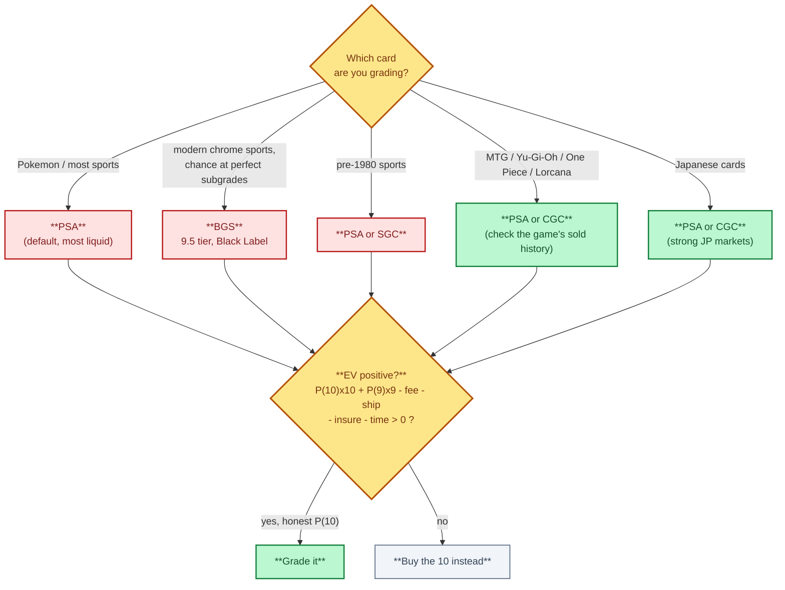

# 2. Grading Companies Compared

> **Act I — The hobby · chapter 2 of 17.** The referees. Who grades the cards and who really owns them. Section 2.7
> is where the neutral referee becomes a market participant — the turn of the whole story.

A grade is one company's opinion of a card's authenticity and condition. The
same card in different slabs sells at different prices because buyers trust
some labels more than others. Choose the grader by where you plan to sell, not
by which company you think grades most generously.

Fees, turnaround times and service tiers change often and are not listed
here. Check each company's site on the day you submit.

## 2.1 The five companies you will see

| Company | Founded / notes | Scale | Subgrades | Top grades | Where it gets the highest price |
|---------|-----------------|-------|-----------|------------|---------------------------------|
| PSA (Professional Sports Authenticator) | 1991, by the founder of PCGS coin grading | 1-10 with half points (1.5-8.5), Authentic (no number), qualifiers (OC, ST, PD, OF, MK, MC) | No | Gem Mint 10 | Highest liquidity overall: vintage and modern sports, Pokemon, most of the US market |
| BGS (Beckett Grading Services) | Beckett Media, known for its price guides | 1-10 in half points | Yes: centering, corners, edges, surface | Pristine 10, Black Label (all four subgrades 10) | Modern sports (especially chrome and refractor cards). The BGS 9.5 Gem Mint is a recognised tier. Black Labels can sell well above a PSA 10 |
| SGC (Sportscard Guaranty) | Known for the black "tuxedo" label | 1-10 with half points | Optional on some services | Pristine 10 (gold label), Gem Mint 10 | Vintage sports, where its record is long and trusted (the $12.6M Mantle was SGC 9.5). Gaining in modern |
| CGC (Certified Guaranty Company) | Comic grading leader. Entered TCGs around 2020, and absorbed the CSG sports brand | 1-10 with half points | Optional | Pristine 10, Gem Mint 10 | TCGs (Pokemon, MTG, Yu-Gi-Oh, Lorcana, One Piece), especially in Europe and Asia. Prices are usually below PSA but the gap varies |
| TAG (Technical Authentication & Grading) | Newer grader using automated imaging | 1-10, plus a detailed numeric score and an imaging report | Reported per-defect | Pristine 10, Gem Mint 10 | Niche but growing. Liquidity is still thin. Check sold comps before using |

Not verified for this repo: exact founding dates and current subgrade policies
for SGC, CGC and TAG. Confirm on each company's site.

These are five brands but not five independent companies: PSA, BGS and SGC now
share one owner. See 2.7.

## 2.2 What each grade means in practice

| Grade | Typical visible condition |
|-------|---------------------------|
| 10 | Looks perfect to the naked eye. Centering within the grader's tolerance (PSA is about 55/45 to 60/40 front, about 75/25 back). Sharp corners, clean edges, no surface marks |
| 9 | One tiny flaw: slight centering shift, a speck of whitening, a light print line |
| 8 | Several small flaws or one minor visible one |
| 7 and below | Visible wear: soft corners, edge chipping, scratches, light creases from 5 down |
| Authentic / A | Genuine but altered, trimmed or too damaged to number. Check the label wording |

The price gap between grades is not linear. For high-demand modern cards and
vintage grails, a 10 often sells for 3-10x a 9, and a 9 sells for 1.5-3x an 8. For common
modern cards the grading fee can exceed the whole premium.

## 2.3 Choosing a grader

Choosing a grader, and the EV test that must come back positive.

1. Look up sold prices for the same card in PSA 10, BGS 9.5 and 10, SGC 10 and CGC 10.
   Choose the grader whose slab sells for the most after fees.
2. Rules of thumb (check against current comps):
   - Pokemon and most sports: PSA is the default.
   - Modern chrome sports with a real shot at perfect subgrades: BGS.
   - Pre-1980 sports: PSA or SGC.
   - MTG, Yu-Gi-Oh!, One Piece, Lorcana: PSA or CGC. Look at the game's sold
     history, because communities differ.
   - Japanese cards: PSA and CGC both have strong Japanese markets.
3. Grade only when the expected value is positive:
   `EV = P(10) x price10 + P(9) x price9 + ... - fee - shipping - insurance - time cost`.
   Be honest about P(10). Many modern cards come out of the pack with
   centering or print defects.

## 2.4 Crossovers, regrades and cracking

- A crossover sends a slab from one grader to another, with a minimum grade.
  If the new grader won't match it, the card comes back in the old slab.
- A regrade or review resubmits to the same company. Results can go up or down.
- Cracking means breaking the slab to resubmit the raw card. It risks damage, and you
  lose the old cert. This happens at scale, so pop reports overstate how many
  physical copies exist at a given grade unless people return their old labels.

## 2.5 Population reports across companies

- Each grader publishes its own population. To estimate total supply at
  a grade you have to add PSA + BGS + SGC + CGC + TAG.
- Watch the trend more than the absolute count. A pop that jumps month after month
  means supply is coming, and prices usually follow it down.
- Low pop is not the same as scarce if few people bother to grade the card.

## 2.6 Slab and cert verification

- Every major grader has a free online cert lookup. Always check the cert, and
  compare the image or description with the card in hand.
- Fake slabs exist for every company. Check the hologram, label font, the
  ultrasonic weld at the case edge, and the case dimensions against a known
  genuine slab from the same period. See `../act-3-the-solution/fakes-and-scams.md`.
- Autograph authentication (PSA/DNA, JSA, Beckett Authentication) is a separate service
  from card grading. An "auto" grade on the label refers to the signature.

## 2.7 Who owns the graders (consolidation)

Who owns which grader — the three Collectors brands vs the independent CGC and TAG.

```mermaid

flowchart TD
classDef act1 fill:#dbeafe,stroke:#1e40af,stroke-width:2px,color:#1e3a8a;
classDef act2 fill:#fee2e2,stroke:#b91c1c,stroke-width:2px,color:#7f1d1d;
classDef act3 fill:#dcfce7,stroke:#15803d,stroke-width:2px,color:#14532d;
classDef key fill:#fde68a,stroke:#b45309,stroke-width:2.5px,color:#78350f;
classDef risk fill:#fecaca,stroke:#991b1b,stroke-width:2px,color:#7f1d1d;
classDef verify fill:#bbf7d0,stroke:#15803d,stroke-width:2px,color:#14532d;
classDef unv fill:#fef3c7,stroke:#b45309,stroke-width:2px,stroke-dasharray:6 4,color:#78350f;
classDef money fill:#fef9c3,stroke:#a16207,stroke-width:2px,color:#713f12;
classDef flow fill:#f1f5f9,stroke:#64748b,stroke-width:1.5px,color:#334155;
classDef endg fill:#e2e8f0,stroke:#475569,stroke-width:2px,color:#1e293b;
  COLLECTORS["**Collectors (Collectors Universe)**<br/>taken private 2021 (Cohen, D1, Nat Turner)"]:::act2
  COLLECTORS --> PSA["**PSA**<br/>1991 · founded by PCGS founder"]:::act2
  COLLECTORS --> BGS["**BGS (Beckett)**<br/>acquired 2025 · keeps brand"]:::act2
  COLLECTORS --> SGC["**SGC**<br/>acquired 2023 · sports merged into PSA"]:::act2
  COLLECTORS --> WATA["**Wata Games**<br/>video games · 2021"]:::act2
  COLLECTORS --> VAULT["**vault + sales +<br/>(reported) price data**"]:::risk

  INDEP["**Independent**"]:::verify
  INDEP --> CGC["**CGC**<br/>Certified Collectibles Group · 2nd in share"]:::verify
  INDEP --> TAG["**TAG**<br/>automated imaging · thin liquidity"]:::verify
```

Ownership was checked against Wikipedia on 2026-10-12 (Collectors Universe
article):

| Brand | Owner | Since |
|-------|-------|-------|
| PSA | Collectors (Collectors Universe), taken private in 2021 by Steve Cohen, D1 Capital and Nat Turner | Founded 1991 |
| SGC | Collectors. Wikipedia says its sports grading was merged into PSA | 2023 |
| BGS (Beckett) | Collectors. Still runs as a separate brand | 2025 |
| Wata Games (video games) | Collectors | 2021 |
| CGC | Independent of Collectors | - |
| TAG | Independent of Collectors | - |

A commentary video claims Collectors also owns Card Ladder (price data) and
that the group has about 80% of card grading. Neither claim is verified here.
Wikipedia (citing GemRate data for 2024) ranks CGC second in market share,
which an "80% PSA" figure leaves out. Notes and discussion are in
`../act-2-the-problem/monopoly-video-notes.md`.

What this means in practice:

- A crossover between PSA, BGS and SGC no longer gives you a second opinion
  from a separate company. CGC and TAG are the independent checks.
- The same group can produce the grade, the population report, some of the
  price data and the vault or instant-sale marketplace. Check prices outside
  that group (eBay sold, 130point, PriceCharting, auction archives, your own
  tracker log). See `../act-3-the-solution/valuation-and-selling.md` 7.1.
- Submission risk is the same whatever the service. Reholders and reviews
  still send the card through handling and shipping. Insure it at full value,
  photograph it before sending, and read the grader's liability and
  claims terms. See `../act-3-the-solution/psa10-playbook.md` sections 3 and 5.
- Declared-value tiers can be upcharged: if the card grades well and its value
  goes over the tier cap, you pay the higher tier. Declare realistically.

(For the deep audit of each of these companies — origins, scale, grading
process, the transparency scorecard, and what is happening at each one right
now — see `grading-company-audit.md`, chapter 3 in this act.)
