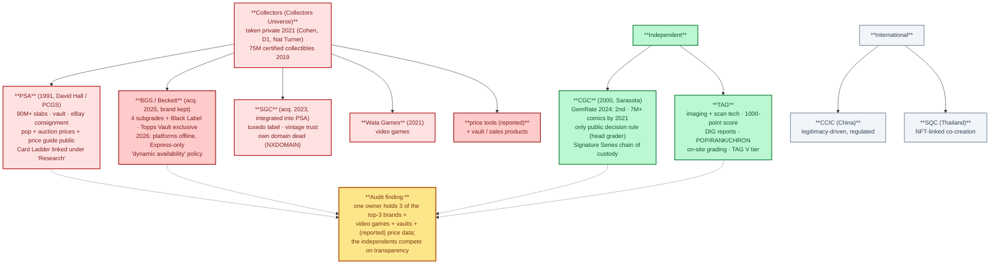
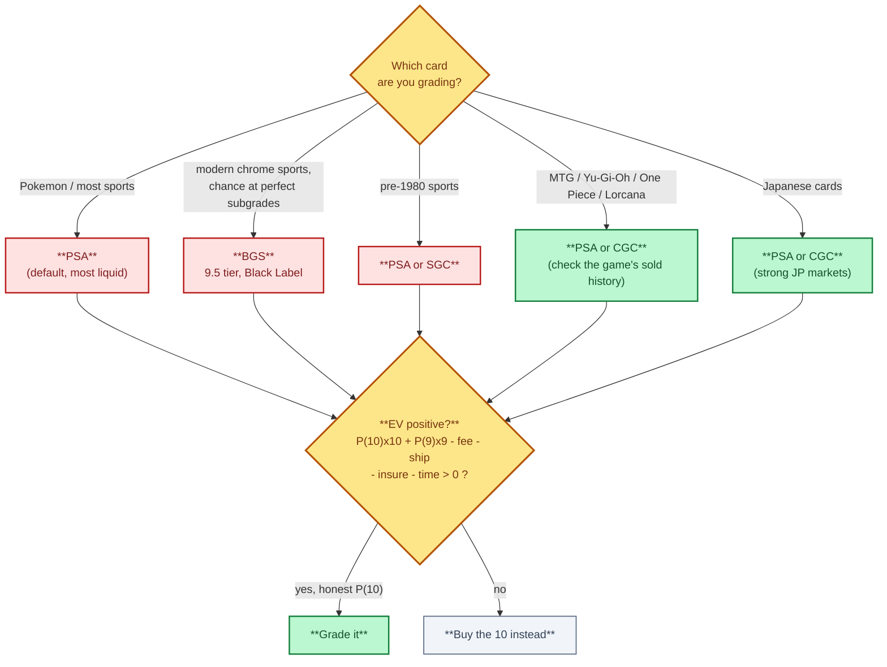
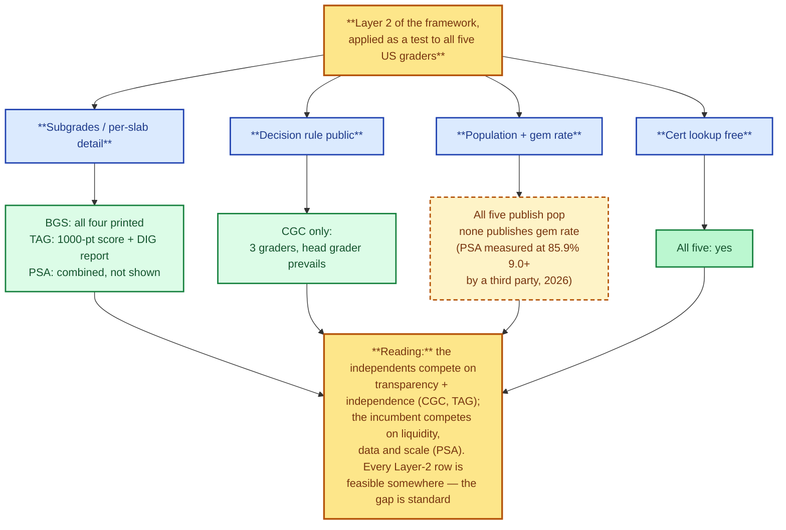

# 2. Grading companies — the referees, compared and audited

> **Act I — The hobby · chapter 2 of 16.** The referees: who grades the
> cards, how each company works, what it publishes and what it won't — and
> who really owns them. The first half is the working comparison (what a
> grade means, choosing a grader, pops, verification); the second half is a
> deep audit built on sources fetched 2026-10-12 — each company from its own
> site, Wikipedia, and the 2025 cross-national case study. The ownership
> section (§2.17) is where the neutral referee becomes a market participant:
> the turn of the whole story.

## 2.1 How to read this chapter

The working rule up front: a grade is one company's opinion of a card's
authenticity and condition. The same card in different slabs sells at
different prices because buyers trust some labels more than others.
**Choose the grader by where you plan to sell, not by which company you
think grades most generously.**

Fees, turnaround times and service tiers change often and are not
hard-coded here: the house rule is to describe the *structure* and check
the numbers on the day you submit.

The audit half of this chapter was built on sources located and fetched
**2026-10-12**: five English Wikipedia articles in full (PSA, CGC,
Collectors Universe, Beckett Media, Sports card) plus the Chinese-language
Wikipedia article on the CCIC group; PSA's own homepage (via a reader
proxy — direct fetches are bot-blocked); TAG's pricing page and Beckett's
grading page (direct fetches, verbatim); Card Ladder's site and its
archived about page; and the 2025 cross-national case study of PSA, CCIC
and SQC (open access, full PDF). What the audit could not do: measure any
company's gem rate independently, see internal grading procedures, or
confirm any claim that has a single source. Those are marked *reported* or
*not verified* in §2.20, the way the repo has always done it.

## 2.2 The companies at a glance

The industry map as audited on 2026-10-12: one owner, three of the top three brands, two independents, and the international field.

| Company | Owner (2026) | Label & subgrades | Scale anchor (verified) | Where it gets the highest price |
|---------|--------------|-------------------|-------------------------|---------------------------------|
| PSA (Professional Sports Authenticator) | Collectors (taken private 2021) | 1-10 with half points (1.5-8.5); Authentic (no number); qualifiers (OC, ST, PD, OF, MK, MC); **no subgrades on the label** | "Over 80 million" — own site [A6]; 1.26M items in Nov 2024 [A15] | Highest liquidity overall: vintage and modern sports, Pokemon, most of the US market |
| BGS (Beckett Grading Services) | Collectors (acquired 2025, brand kept) | 1-10 in half points; **all four subgrades printed** (centering, corners, edges, surface); Black Label (all four 10); 9.5 tier | GemRate 2024: **third** in card-grading share [A3]; ~34,000 items Nov 2024 [A15] | Modern sports (especially chrome and refractor). The BGS 9.5 Gem Mint is a recognised tier. Black Labels can sell well above a PSA 10 |
| SGC (Sportscard Grading Corp.) | Collectors (acquired 2023, integrated into PSA) | 1-10 with half points; Pristine 10 (gold label); black "tuxedo" | Long vintage record (the $12.6M Mantle was SGC 9.5) [A13]; 129,000 items Nov 2024 [A15] | Vintage sports, where its record is long and trusted |
| CGC (Certified Guaranty Company) | Independent (Certified Collectibles Group) | 0.5-10; subgrades optional on cards; colour-coded labels | 7M+ comic books by 2021 [A2]; GemRate 2024: **second** in card share [A3]; 218,000 items Nov 2024 [A15] | TCGs (Pokemon, MTG, Yu-Gi-Oh!, Lorcana, One Piece), especially in Europe and Asia. Prices usually below PSA but the gap varies |
| TAG (Technical Authentication & Grading) | Independent | 1-10 plus a **1000-point score**; per-defect DIG reports; TAG V (authentication without a grade) | 4.9/5 from 885 on-site reviews [A7] | Niche but growing. Liquidity is still thin — check sold comps before using |
| CCIC (China Certification & Inspection Group) | **State-owned** — the only central SOE in the inspection/certification industry, founded 1980 | 1-10 style; "CCIC Gold 10"; bilingual certificates; closed QR digital-certificate system | Group: ~20,000 staff, 500+ labs, 33 countries [A16] | China's domestic market — "CCIC Gold 10" is *perceived* as comparable to a PSA 10 (a perception claim, not a measured one [A15]) |
| SQC (Special Quality Cards) | Independent startup (Thailand) | 1-10; customizable slab artwork; flaw images published online | Small scale, urban-centric demand [A15] | Thai / Southeast Asian TCG community (Pokemon, One Piece, Weiss Schwarz) |

Not verified here and flagged in the source table: SGC's and TAG's founding
years (SGC's legal name and CGC's early-2000 launch *are* verified [A2][A3]);
and exact current subgrade policies — confirm on each company's site.

These are seven companies but not seven independent actors: PSA, BGS and SGC
share one owner, and the state sits behind CCIC. See §2.17.

Market share context: GemRate data for 2024 ranks PSA first, CGC second,
Beckett third [A3]. The "80% of grading" figure that circulates in hobby
videos remains a **claim** — not verified against a primary source in this
repo, and contradicted in shape by CGC ranking second [A13] — though the
2025 case study now corroborates a **75–80%** range from GemRate-era
trackers (§2.15) [A15].

## 2.3 What each grade means in practice

| Grade | Typical visible condition |
|-------|---------------------------|
| 10 | Looks perfect to the naked eye. Centering within the grader's tolerance (PSA is about 55/45 to 60/40 front, about 75/25 back). Sharp corners, clean edges, no surface marks |
| 9 | One tiny flaw: slight centering shift, a speck of whitening, a light print line |
| 8 | Several small flaws or one minor visible one |
| 7 and below | Visible wear: soft corners, edge chipping, scratches, light creases from 5 down |
| Authentic / A | Genuine but altered, trimmed or too damaged to number. Check the label wording |

The price gap between grades is not linear. For high-demand modern cards and
vintage grails, a 10 often sells for 3-10x a 9, and a 9 sells for 1.5-3x an 8. For common
modern cards the grading fee can exceed the whole premium.

## 2.4 Choosing a grader

Choosing a grader, and the EV test that must come back positive.

1. Look up sold prices for the same card in PSA 10, BGS 9.5 and 10, SGC 10 and CGC 10.
   Choose the grader whose slab sells for the most after fees.
2. Rules of thumb (check against current comps):
   - Pokemon and most sports: PSA is the default.
   - Modern chrome sports with a real shot at perfect subgrades: BGS.
   - Pre-1980 sports: PSA or SGC.
   - MTG, Yu-Gi-Oh!, One Piece, Lorcana: PSA or CGC. Look at the game's sold
     history, because communities differ.
   - Japanese cards: PSA and CGC both have strong Japanese markets.
3. Grade only when the expected value is positive:
   `EV = P(10) x price10 + P(9) x price9 + ... - fee - shipping - insurance - time cost`.
   Be honest about P(10). Many modern cards come out of the pack with
   centering or print defects.

## 2.5 Crossovers, regrades and cracking

- A crossover sends a slab from one grader to another, with a minimum grade.
  If the new grader won't match it, the card comes back in the old slab.
- A regrade or review resubmits to the same company. Results can go up or down.
- Cracking means breaking the slab to resubmit the raw card. It risks damage, and you
  lose the old cert. This happens at scale, so pop reports overstate how many
  physical copies exist at a given grade unless people return their old labels.

## 2.6 Population reports across companies

- Each grader publishes its own population. To estimate total supply at
  a grade you have to add PSA + BGS + SGC + CGC + TAG.
- Watch the trend more than the absolute count. A pop that jumps month after month
  means supply is coming, and prices usually follow it down.
- Low pop is not the same as scarce if few people bother to grade the card.

## 2.7 Slab and cert verification

- Every major grader has a free online cert lookup. Always check the cert, and
  compare the image or description with the card in hand.
- Fake slabs exist for every company. Check the hologram, label font, the
  ultrasonic weld at the case edge, and the case dimensions against a known
  genuine slab from the same period. See `../act-3-the-solution/fakes-and-scams.md`.
- Autograph authentication (PSA/DNA, JSA, Beckett Authentication) is a separate service
  from card grading. An "auto" grade on the label refers to the signature.

## 2.8 PSA — the incumbent, audited

**Origins.** Founded **July 1991 by David Hall, owner of PCGS** (the coin
grader started in 1985 by seven coin dealers to standardize coin grading),
as a third-party sports card grader. It "initially struggled because of
limited demand" — some dealers opposed third-party grading and refused to
use it — and grew during the dot-com boom as eBay made card trading
national: a third-party grader "ensured card legitimacy" and let buyers
judge value beyond "often low-resolution images" [A1].

**Scale and positioning.** PSA's own homepage (fetched 2026-10-12) claims
"**Over 80 Million Collectibles Authenticated & Graded**" and "the global
leader in authentication and grading" [A6]. A 2025 business-model study of
the grading industry (30 interviews across PSA, CCIC and SQC) finds that
"**PSA leverages scale and AI technology to enhance efficiency**" [A10] —
the incumbent's stated edge is scale plus automation, not generosity.

**The public data stack.** PSA's site exposes the industry's most complete
public research layer: Cert Verification, Population Report, Auction
Prices, a Price Guide, Card Facts — and a link to **Card Ladder** under
"Research" [A6]. (Card Ladder ownership: see §2.16 — the link is evidence
of affiliation, not of ownership.)

**The economics of the label.** An NBA-card study (2001–2009, eBay + PSA
data) finds the PSA-10 dummy "carries the largest economic impact":
holding everything else constant, **a card graded Gem Mint trades at
roughly 339% above a grade-8 baseline** [A11]. A 2026 comparison of PSA
against an AI grading platform (24 sets, five categories) finds **PSA
grades 85.9% of cards at 9.0+ vs 81.0% for the AI platform** —
"statistically significant but practically small" (Cohen's d = 0.0317),
with the largest category gap in football (16.3 pp) and the opposite
pattern in TCGs [A12]. That 85.9% is effectively a third-party-measured
gem rate for PSA — and it is high. The repo's own 26-claim log documents
what a move of one grade point is worth at the top: **$16.5M (PSA 10) vs
$1,406,250 (PSA 9), same Pikachu Illustrator, five weeks apart** [A13].

**What PSA does not publish.** No subgrades on the label (the four
subgrades — centering, corners, edges, surface — are combined internally;
[A5] notes major graders "provide individual grades ... to eventually
combine for one final grade," and §2.2 records PSA as the one that
shows none) [A5][A13]. No published gem rate. The 9-to-10 cliff — the
single largest price discontinuity in the hobby — is a property of the
standard that the owner of the standard does not quantify [A13].

## 2.9 BGS / Beckett — the price-guide house, and its 2026 incident

**Origins.** Beckett began in **1984, founded by statistician Dr. James
Beckett** as Beckett Publications; in the 1970s he introduced "some of the
initial price guides for the baseball card industry" — more detail than
the newsletters collectors were used to. *Beckett Baseball Card Monthly*
peaked at roughly one million readers. The company passed through Apprise
Media (2005) and Eli Global (2008) before the Collectors acquisition [A4].
The grading lineage is the same story: Beckett's publications "pioneered
an early card grading system" — six levels, mint to poor — before BGS
became the service [A4]. **The house that grades cards started as the
house that prices them** — a fact the audit returns to in §2.19.

**The grading business.** BGS is the only major grader that prints all
four subgrades (centering, corners, edges, surface) on every label; the
**Black Label** (all four subgrades 10) and the **BGS 9.5** tier are
recognised price tiers of their own [A13]. Beckett holds the **exclusive
right to grade and authenticate Topps Vault** cards [A4].

**Ownership and reputation.** Acquired by Collectors in **2025**;
financial terms not disclosed; "Beckett continues to operate as an
independent brand within Collectors, with no immediate changes to pricing
or operations." The deal **included Beckett's Comic Book Certification
Service (CBCS)** — founded by Dr. Michael Bornstein, his son Alec and
Steve Borock — and **excluded** Southern Hobby Distribution and Dragon
Shield [A3]. GemRate-era commentary notes Beckett is "known for its
stringent grading standards" [A3]. The BBB record: **not accredited, F
rating, "identified a pattern in consumer complaints"; the inquiry was
"closed on February 14, 2025, as Failure to Address or Eliminate the
Pattern of Complaints"** [A4] — the repo's claim log verifies the same two
sentences (C15/C16) [A13].

**The 2026 incident (from Beckett's own site, fetched 2026-10-12).**
As of the fetch date, Beckett's **digital platforms were offline**:
beckett.com, beckettmedia.com, beckett-authentication.com and the mobile
app. The company's statement: "During planned updates to modernize our
legacy IT systems, we detected suspicious technical activity and, out of
caution, took our platforms offline," with a forensic investigation that
"has not identified any evidence that sensitive customer information was
impacted" and restoration "in phases" [A8]. Card grading: **Base and
Standard submissions temporarily paused; only Express accepted**, through
a temporary form, shipped to Beckett HQ in Plano, TX [A8]. The company
explains a "**dynamic approach to service availability**": it "may
temporarily pause new submissions when we forecast we can't meet a
service's estimated turnaround time," with a waitlist for reopening [A8].

*Audit finding:* the second-largest player was, on the audit date, running
on a temporary submission form and a waitlist — mid-way through an
ownership transition. For the collector this is not hypothetical: **the
grader can close your preferred tier unilaterally**, and service
continuity during consolidation transitions is a live operational risk.

## 2.10 SGC — the tuxedo, now inside PSA

**Legal and ownership record.** The company behind the brand is the
**Sportscard Grading Corporation** [A3]. Acquired by Collectors in **2023**,
financial terms not disclosed; "**Following the acquisition, SGC's sports
card grading operations were integrated into PSA**" [A3].

**The brand today.** The black "tuxedo" slab and the Pristine 10 gold
label remain; SGC's long-standing trust in vintage (the $12.6M Mantle at
SGC 9.5) is the asset Collectors bought [A13]. The audit's own DNS check
on 2026-10-12: **sgcsportscard.com no longer resolves (NXDOMAIN)** [A14].
The standalone web presence of the brand is gone; what remains is a label
inside PSA's pipeline.

*Audit finding:* a crossover from PSA to SGC no longer gives a second
company's opinion — it is a second run of the same group's process. The
independent vintage checks are now CGC (and, at much thinner liquidity,
TAG) [A13].

## 2.11 CGC — the independent with a published decision rule

**Record.** Launched in **early 2000** in **Sarasota, Florida**; an
"independent member of the Certified Collectibles Group"; **over 7 million
comic books graded by 2021** [A2]. In cards: entered TCGs around 2020 and
absorbed the CSG sports brand [A13]; GemRate 2024 ranks it **second** in
card grading market share [A3].

**The process — and the decision rule.** CGC's published process:
comics "are inspected by one pre-grader for obvious defects (missing
pages, etc.) and are then **graded by three graders** in a temperature- and
humidity-controlled environment. **The grades are not averaged together,
as the Head Grader determines the final grade** — if two graders rate a
book 7.0 and the Head Grader grades it 7.5, the latter prevails" [A2].
That is the **only one of the five whose decision rule is public** — the
"who decides" question, answered in a sentence. The same article
documents the physical security chain: Barex inner well, sonically sealed
tamper-evident holder [A2].

**Signature Series.** CGC's gold-label service **witnesses the signing and
maintains chain of custody until slabbing** — "this mitigates signature
forgery concerns" [A2]. And the purple **"Restored"** label: a marked
restoration "can suffer a significant price reduction" [A2] — disclosure
as a price mechanic.

**Records the label has set.** Action Comics #1: CGC 8.0 sold for $1M
(2010); CGC 8.5 for a then-record $1.5M; CGC 9.0 for $3.2M (2014) [A2].

**Web presence.** cgctcg.com no longer resolves (NXDOMAIN, audit check
[A14]); the business runs out of comicgrading.com.

*Audit finding:* CGC is what framework Layer 1.2 (an independent standards
body) looks like when it already exists: an independent owner, a public
decision rule, a public pop, and a market position (second) large enough
to be a real second opinion.

## 2.12 TAG — the imaging upstart: the transparency prototype

**Company.** Technical Authentication & Grading, LLC [A7]. Its entire
value proposition is the one the framework's transparency layer demands,
delivered per slab:

- **Scan/imaging technology** and a **1000-point grade** — a detailed
  numeric score rather than a single number [A7].
- **DIG reports** — a "detailed digital report" of a card's features and
  defects, attached to the cert; the site markets itself on a dedicated
  **"TAG VS MANUAL GRADING"** page [A7].
- **Public population data per card**: "VIEW ANY TAG'D CARD'S **POP / RANK
  / CHRON** + DIG REPORT", plus a cert search [A7].
- **Service tiers**: Basic, Standard, Express, and **on-site** grading
  (Hall of Fame, CA; the 2026 Bitcoin Conference); **"TAG V — Verified
  Authentic"** is encapsulation *without* a grade — an authentication-only
  tier nobody else at scale offers [A7].
- **Capacity discipline**: a public "TAG Backlog Tracker" and "Limited
  Reopening" messaging — a small operator managing its own bottleneck
  out in the open [A7].

**Customer voice (labelled as such).** On-site review rating 4.9/5 from
885 reviews [A7]; several customers say they chose TAG *because of*
"PSA's recent negative publicity regarding inconsistent grading" and the
"detailed digital report" [A7]. That is customer testimony, not a verified
finding — but it is evidence of where the dissatisfaction from Act II is
flowing.

*Audit finding:* TAG is the market's working proof that per-slab
transparency (numeric sub-scores + imaging + public detail reports) is
buildable and that customers will choose it. Its ceiling is the same one
§2.2 states: thin liquidity. Transparency without a market is a
prototype — and that is exactly the cold-start problem the community AI
grading chapter (ch. 16) designs around.

## 2.13 CCIC — the state-owned referee

**The group.** The card-grading business sits inside the **China
Certification & Inspection (Group) Co., Ltd.** (中检集团) — "the only
centrally-administered state-owned enterprise whose core business is
'inspection, testing, certification and standards'" — created by the State
Council in **1980**, reconstituted as a group in 2003, and re-merged in
2007 to carry the dual CCIC + CQC brands. The group operates in **33
countries**, with roughly **20,000 employees, 400+ branches and 500+
laboratories**, and cooperation agreements with 120 certification bodies
(UL in the US, TÜV in Germany, JET/JQA in Japan, among others) [A16].

**The grading business.** The 2025 case study — ten in-depth interviews
with CCIC staff, from production supervisor to blockchain-services
coordinator to regulatory-affairs liaison — describes a state-backed
entrant that built trust differently from PSA [A15]:

- **Legitimacy, not history.** "As a government-backed entrant, CCIC could
  not simply replicate PSA's model, emphasizing instead authenticity and
  security backed by state authority," using legal protections to address
  "trust issues caused by counterfeits" — in the Chinese hobby the
  dominant risk is the fake card, not the grade [A15].
- **Embedded in commerce.** Through "strategic partnerships with
  e-commerce platforms, CCIC integrated grading into broader verification
  services" — grading attached to the checkout flow rather than a
  standalone service [A15].
- **Digital certificates inside the regulatory perimeter.** China bans
  NFT launches, so "we use a closed digital certificate system to keep it
  safe and transparent": graded cards are linked to **secure digital
  certificates via QR codes on a proprietary platform**, a mobile app lets
  collectors "showcase and virtually trade graded cards within a closed
  system," and a blockchain "digital license card" logs each grading step
  for audit compliance [A15].
- **Technology from inception.** "High-resolution scanners, X-ray
  inspections for fraud detection, and systematic multi-grader
  evaluations"; "ISO-like documentation for rigorous quality management";
  real-time tracking in the dedicated app; "Every card here goes through
  multiple checks with advanced scanners; we won't trade away accuracy for
  speed" [A15].
- **Co-creation for market acceptance.** Collector workshops shaped
  **bilingual certificates, "special local authenticity markers," a
  published detailed grading guide built from user discussions, and top
  collectors cast as brand ambassadors in live-streamed educational
  events** — "their input was baked into our model" [A15].
- **The investment framing.** CCIC "framed the boom as investment-driven —
  collectors treat graded cards like **fine art or jade**, valuing
  official certification and national credibility," with a growing
  "investment mindset" tied to domestic pride; cross-border partnerships
  support travelling collectors between China and other regions [A15].
  On the demand side, China's TCG market is still young and youth-driven
  (a 2025 survey finds ¥5–10 packs and an inadequately regulated
  blind-box economy [A17]), and a 2026 value study of 550 Asian-market
  collectors ranks scarcity (β = 0.367) above speculative investment
  (β = 0.303) as the price-appreciation driver [A18].

*Audit finding:* CCIC is the only major grader owned by a **state** — and
the repo's Act II argument transfers without modification: a referee with
a stake in the outcome is a referee with a stake in the outcome, whatever
the stakeholder's nationality. What changes is the *channel*: in the US it
runs through the marketplace, vault and price data; in China it runs
through the regulatory perimeter itself. The "CCIC Gold 10 ≈ PSA 10"
equivalence is a **perception** claim in the case study ("many collectors
now view" it so) [A15], not a measured equivalence — the gem-rate
comparison between the two standards does not exist in any fetched source.

## 2.14 SQC — the jewelry-precision startup

**The company.** **Special Quality Cards (SQC)** is a Thai local startup
that "has positioned itself as an advanced-technology grader,"
"leverag[ing] its background in precision jewelry manufacturing" with
"laser-assisted inspection and AI analysis to validate cards" [A15].

**The model, from ten staff interviews** [A15]:

- **Community-first, not volume-first.** "We built our business model
  around accessibility and community needs": **pre-grading assessments,
  customizable slab artwork (originating from collector suggestions), and
  affordable pricing directly shaped by customer input** [A15].
- **The most radical digital adoption of the three case firms.** "From
  day one we embraced tech": blockchain-based grading and certification,
  an **NFT-twin pilot for some graded cards** ("bridging the physical card
  with a digital asset for tech-savvy collectors"), digital microscopes,
  automated defect detection and online tracking — feasible because
  "in Thailand NFTs are legal under SEC oversight," the middle-ground
  regulatory position between China's ban and the US's open-but-ambiguous
  regime [A15].
- **Transparency as the wedge.** "We even post images of a card's flaws
  online so customers see exactly why it's not a 10" — per-slab flaw
  evidence, plus **live grading events** and personalized **valuation
  reports**: the same direction as TAG's DIG reports (§2.12), reached from
  the startup side of the world rather than the US side [A15].
- **The known limits.** Market-education costs (the novelty of the
  service), "credibility skepticism" aimed at its radical innovations,
  resource constraints, demand that "remains urban-centric due to
  Thailand's smaller market scale," and constant comparison against global
  brands [A15].

*Audit finding:* SQC and TAG are the same bet on two continents — small,
community-embedded, imaging-forward graders attacking liquid incumbents on
transparency — and both hit the same ceiling: liquidity. (The SQC profile
rests on the case study; the "SQC, n.d." website it cites could not be
fetched, and the archived sqc.co.th page is empty [A19].)

## 2.15 Global scale — and the "80%" question, re-scored

The case study (open access, fetched in full this round) carries the
industry-volume data the US-centric view lacked [A15]:

- The top grading companies "collectively processed **over 20 million
  cards annually** as of 2024" (the Big Four — PSA, CGC, SGC, BGS —
  accounted for that volume).
- Monthly volumes, **November 2024** (Cllct data cited in the study):
  **PSA 1.26M items; CGC 218,000; SGC 129,000; BGS ~34,000**.
- "Industry trackers (like GemRate) confirm PSA usually has roughly
  **75–80% of grading volume**."

That range is the first corroboration of the "80% of grading" figure that
had circulated in this repo as an unverified video claim (§2.2): it is
still a secondary citation (a case study citing a tracker citing a trade
outlet), not a number fetched from GemRate itself — but it is no longer
uncorroborated, and it is consistent with the GemRate 2024 ranking
(PSA 1st, CGC 2nd, Beckett 3rd) already verified in the claim log [A13].

**What the international layer adds to the audit.** (1) The
referee-ownership spectrum is complete: state-owned (CCIC), independent
with a public decision rule (CGC), community startups (SQC, TAG), and a
consolidated private incumbent (PSA) all exist simultaneously in the major
markets — Layer 1's firewall logic must be tested against every one of
them. (2) The transparency tools converge globally: QR/digital
certificates (CCIC), flaw imaging (SQC, TAG), public pops (all) — the
direction is not US-specific. (3) The art chapter's (ch. 8) thesis is
literally spoken by a Chinese referee: graded cards as "fine art or jade"
[A15].

## 2.16 The price-data layer: who owns the numbers

**Card Ladder** (fetched 2026-10-12): "the only price guide with every
public sale in our database **going back to 2000**"; "**100M+ historical
sales** ... from eBay, Goldin, Heritage, Fanatics, and many other
platforms"; "**View population reports from PSA, BGS, SGC and CGC**";
indices "vetted and updated daily" [A9]. Its archived about page
(2026-10-08) describes founders "Chris, Josh, and Kristina" as a hobby
passion project — **no statement of Collectors ownership** [A9].

**The affiliation question.** PSA's own homepage links Card Ladder under
"Research" [A6]; hobby-video commentary claims Collectors *owns* Card
Ladder [A13]. Status in this repo: **affiliation strongly suggested;
ownership reported but not verified** in any fetched source. The tracker
in this repo exists precisely because the answer to "who owns the numbers
I price my cards against" should not depend on a video's claim.

## 2.17 Who owns the graders (consolidation)

The ownership sequence — taken private (2021) → Wata Games (2021) → SGC
(2023, integrated into PSA, own domain dead) → Beckett (2025, brand kept,
CBCS included) — put three of the three largest card brands, the
video-game grader, vaults and sales products under one owner in four years
[A3][A14]. CGC and TAG are the independent alternatives; CCIC is
state-backed; SQC is a startup (per-company detail in §2.8–2.14; the map
in §2.2 shows it at a glance).

A commentary video claims Collectors also owns Card Ladder (price data) —
affiliation is strongly suggested, ownership *reported but not verified*
(§2.16) — and that the group has about 80% of card grading, a figure now
corroborated as a 75–80% secondary range (§2.15). Notes and discussion of
the video's claims are in `../act-2-the-problem/monopoly-video-notes.md`
(ch. 10).

What this means in practice:

- The same group can produce the grade, the population report, some of the
  price data and the vault or instant-sale marketplace. Check prices
  outside that group (eBay sold, 130point, PriceCharting, auction
  archives, your own tracker log). See
  `../act-3-the-solution/valuation-and-selling.md` §7.1.
- A crossover inside the group is not a second opinion (§2.10): CGC and
  TAG are the independent checks.
- Submission risk is the same whatever the service. Reholders and reviews
  still send the card through handling and shipping. Insure it at full
  value, photograph it before sending, and read the grader's liability and
  claims terms. See `../act-3-the-solution/psa10-playbook.md` sections 3
  and 5.
- Declared-value tiers can be upcharged: if the card grades well and its
  value goes over the tier cap, you pay the higher tier. Declare
  realistically.

## 2.18 The transparency scorecard

The framework's Layer 2 applied as a test to all five US companies — and what each dimension shows.

The framework's Layer 2, applied as a test to all five US companies:

| Test | PSA | BGS | SGC | CGC | TAG |
|------|-----|-----|-----|-----|-----|
| Subgrades on the label | No (combined internally) | **Yes — all four** | Optional | Optional | **1000-point score** |
| Per-slab detail report | Qualifiers only | Subgrades | — | — | **DIG report** |
| Population report public | Yes | Yes | Yes | Yes | **Yes (+ rank/chron)** |
| Decision rule public | No | No | No | **Yes (head grader prevails)** | Rubric page public |
| Gem rate published | No | Not published (computable) | No | No | Not published (computable) |
| Cert lookup free | Yes | Yes | Yes | Yes | Yes |
| Market-side assets (vault / sales / price data) | **Vault, eBay consignment; group owns price tools (reported)** | Group (2025); Topps Vault exclusive | Group (integrated into PSA) | None — independent | None — independent |

Reading the table: **the two independents compete on transparency and
independence; the incumbent competes on liquidity, data and scale.** Every
row the framework's Layer 2 demands, at least one player now demonstrates
is feasible — and the gap between "feasible" and "standard" is what Act
III is for.

## 2.19 What the audit shows

1. **Consolidation is structural, not incidental.** The sequence — taken
   private (2021) → Wata Games (2021) → SGC (2023, now integrated, domain
   dead) → Beckett (2025, brand kept, CBCS included) — put three of the
   three largest card brands, the video-game grader, vaults and sales under
   one owner in four years [A3][A14].
2. **The grader's house was originally a price guide.** Beckett started as
   the price-guide house [A4]; PSA's site now links the price-data service
   Card Ladder under "Research" [A6]. The group that sets the grade is
   surrounded by the businesses that monetize the numbers. That is the
   conflict in one paragraph (Act II develops it with the 26-claim log).
3. **The independents are differentiating exactly where the framework
   points.** CGC: a public decision rule + independence [A2]. TAG: per-slab
   transparency + imaging [A7]. Both are small; neither has the liquidity
   moat. The direction is proven; the scale is the problem.
4. **The gem rate is the number to watch — and the third-party measurement
   says it is high.** PSA at 85.9% of cards at 9.0+ (2026, Krause) [A12]
   against a 339% PSA-10 premium [A11] and a $16.5M/$1.4M cliff [A13]: the
   standard's generosity and the market's premium are two sides of the
   same coin, and neither is published by the owner of the standard.
5. **Operational risk is now visible, not hypothetical.** The 2026 Beckett
   incident — platforms offline, Base/Standard paused, "dynamic
   availability" — shows that during ownership transitions a major grader
   can unilaterally close service tiers [A8]. Photograph before you ship;
   insure at full value; check service status the day you submit.
6. **The data layer is consolidating around the group's orbit.** Card
   Ladder's 100M-sale database [A9] sits behind a link on the incumbent's
   homepage [A6] while its ownership remains unconfirmed. The
   independent-data instrument (this repo's `tracker/`) is now an
   evidenced position, not just a principle.
7. **The referee-ownership spectrum is now global.** State-owned (CCIC),
   independent (CGC), community startup (SQC, TAG) and consolidated
   private incumbent (PSA) all exist simultaneously in the major markets,
   and the transparency tools (QR certificates, flaw imaging, public pops)
   are converging across all of them — the framework's Layer 1 firewall
   logic must be tested against every ownership form, and Layer 2 is
   already being demonstrated outside the US (§2.13–2.15).

## 2.20 Sources (located and fetched 2026-10-12)

| Tag | Source | Status | Used for |
|-----|--------|--------|----------|
| A1 | Wikipedia, "Professional Sports Authenticator" — full article | fetched in full | PSA origins (July 1991, David Hall/PCGS), early dealer resistance, eBay-era growth |
| A2 | Wikipedia, "Certified Guaranty Company" — full article | fetched in full | CGC: 2000 founding, Sarasota, 7M+ comics by 2021, 3-grader + head-grader decision rule, Signature Series chain of custody, Restored label, Action Comics #1 records |
| A3 | Wikipedia, "Collectors Universe" — full article (fetched again this round; twice overall) | fetched in full | 75M certified (2019), PCGS 42.5M coins; Nov 2020 announcement of the $700M Cohen/D1/Nat Turner take-private (closed Q1 2021); Wata 2021; SGC 2023 + integration into PSA; Beckett 2025 (brand kept, CBCS in, Dragon Shield/SHD out); GemRate 2024: PSA 1st, CGC 2nd, Beckett 3rd; Beckett "stringent grading standards" |
| A4 | Wikipedia, "Beckett Media" — full article | fetched in full | 1984 founding (Dr. James Beckett), 1970s price guides, Apprise 2005 / Eli Global 2008, ~1M readers, early 6-level grading system, Topps Vault exclusive, 2016 Beckett Authentication, BBB F + 2025-02-14 inquiry close, CBCS founders |
| A5 | Wikipedia, "Sports card" — full article | fetched in full | Condition = centering/corners/edges/surface; "PSA, Beckett, SGC" as the 1–10 majors; subgrades combined into a final grade; 20,000 PSA 10s of the 2018 Luka Dončić Prizm |
| A6 | psacard.com homepage | fetched via reader proxy (direct fetch bot-blocked, 403) | "Over 80 Million" claim; "global leader"; research stack (cert, pop, auction prices, price guide, card facts); **Card Ladder link under "Research"**; vault + eBay consignment |
| A7 | taggrading.com/pricing (and site nav) | fetched direct, verbatim | 1000-point grade, DIG reports, "TAG VS MANUAL GRADING", POP/RANK/CHRON + cert search, service tiers incl. on-site (HOF CA, Bitcoin 2026), TAG V, backlog tracker, 4.9/5 (885 reviews), customer testimonials re: PSA |
| A8 | beckett.com/grading | fetched direct, verbatim | 2026 platform outage + statement; Base/Standard paused, Express-only temporary form; Plano TX HQ; "dynamic approach to service availability"; 60-day price-guide subscription extension |
| A9 | cardladder.com + archived /about (2026-10-08) | fetched direct + via Wayback | 100M+ sales since 2000; eBay/Goldin/Heritage/Fanatics; PSA/BGS/SGC/CGC pop reports; founders' story; **no ownership statement** |
| A10 | Shen & Wei (2025), "Business Model Innovation in the Trading Card Grading Industry: Cross-National Insights from Pokémon TCG and NFTs", AJBSP 2(2): 217–234 (10.70122/ajbsp.v2i2.37) | located via OpenAlex; **full text fetched (open-access PDF, 18 pages)** | All CCIC and SQC profile material (§2.13, §2.14); industry volumes: 20M+ cards/yr 2024, Nov-2024 monthly by grader, the 75–80% PSA volume range (§2.15); PSA submission freeze; CCIC "fine art or jade" framing |
| A11 | Langelett & Wang (2025), "Third-Party Grading as a Useful Measure of Demand: Evidence from NBA Cards", Atlantic Economic Journal (10.1007/s11293-025-09835-1) | located via OpenAlex; abstract fetched | PSA-10 dummy ≈ **+339%** over grade-8 baseline (2001–2009 data) |
| A12 | Krause (2026), "Grading the Graders" (10.2139/ssrn.7202040) | located via OpenAlex; abstract fetched | PSA 9.0+ = 85.9% vs AI 81.0% (d = 0.0317); football gap 16.3 pp, TCG opposite; 339% premium context |
| A13 | Repo-verified claims | `../act-2-the-problem/grading-conflict.md` §4–5 (26-claim log); §2.2 | $16.5M/$1.4M cliff; BBB F + inquiry close (C15/C16); GemRate ranking; SGC 2023 / Beckett 2025; BGS subgrades & Black Label; "80% share" = claim; Card Ladder ownership = reported |
| A14 | DNS resolution checks performed 2026-10-12 | performed in this audit | sgcsportscard.com → NXDOMAIN; cgctcg.com → NXDOMAIN; comicgrading.com → resolves |
| A15 | Shen & Wei (2025), AJBSP 2(2) case study — full text (see A10) | fetched in full (PDF) | The CCIC interview findings (state legitimacy, X-ray + dual-grader + closed QR certificates, bilingual labels, e-commerce partnerships, investment framing) and the SQC interview findings (jewelry-precision background, NFT twins, flaw images, live grading, market-education limits) quoted in §2.13–2.14 |
| A16 | zh.wikipedia, "中国检验认证集团" (China Certification & Inspection Group) — full article | fetched in full | CCIC group background: founded 1980 by the State Council; the only central SOE in inspection/certification; 33 countries; ~20,000 staff, 400+ branches, 500+ labs; 120 partner certification bodies |
| A17 | Cai (2025), "Youth Consumption of Trading Card Games in China", Advances in Economics Management and Political Sciences (10.54254/2754-1169/2025.cau28474) | located via OpenAlex; abstract fetched | Chinese youth TCG consumption: ¥5–10 packs, 25% willing to pay ¥50, blind-box regulation gaps |
| A18 | Leow, Chan, Leow & Chong (2026), "Economic Value Creation in the Pokémon Card Market", IMRJR (10.17148/imrjr.2026.030907) | located via OpenAlex; abstract fetched | n=550 Asian-market collectors: scarcity β=0.367 > speculation β=0.303 > trading β=0.289; R²=0.506 |
| A19 | Wayback Machine checks on sqc.co.th (2019/2022 snapshots) + the "SQC, n.d." site cited in A10 | performed in this audit | Archived pages empty/parked; the SQC profile rests on A10/A15 alone — flagged, not papered over |

**Verification note.** A1–A7, A9, A16 and A10/A15 (full PDF) were fetched
in full on 2026-10-12 and are stored verbatim in the research working
files; every tag in this chapter traces to one of them. A11–A12 and A17–A18
rest on fetched abstracts; A19 is this audit's own check. **Not verified
here and marked accordingly:** SGC's founding year; Card Ladder's
ownership (reported claim, §2.16, corroborated as an orbit-link only); the
"80% of grading" figure (now corroborated as a 75–80% secondary range,
§2.15 — not fetched from GemRate itself); the "CCIC Gold 10 ≈ PSA 10"
equivalence (a perception claim in A15, not a measured one — no gem-rate
comparison exists in any fetched source); the SQC profile (single source,
A10/A15, its cited site unreachable, A19); and exact current fees and
turnaround times at every company (structure described; numbers left to
the day-of-submission check, per the house rule). The case study's own
interview count is internally inconsistent (abstract: 30, ten per firm;
limitations: 15 total) — flagged here; no claim in this chapter depends on
which figure is right. A12 gem-rate figures stand as the only third-party
measurements fetched.

Cross-references: the problem this chapter feeds
(`../act-2-the-problem/grading-conflict.md`, ch. 9), the framework the
scorecard belongs to (`../act-3-the-solution/fair-grading-framework.md`,
ch. 12, Layer 2), the tulip comparison (ch. 7) and the art-market
comparison (ch. 8) that both draw on this audit, the transparency
prototype's ceiling (`../act-3-the-solution/open-community-ai-grading.md`,
ch. 16), and the independent instrument (`../../tracker/`).
