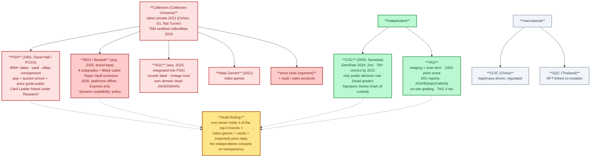
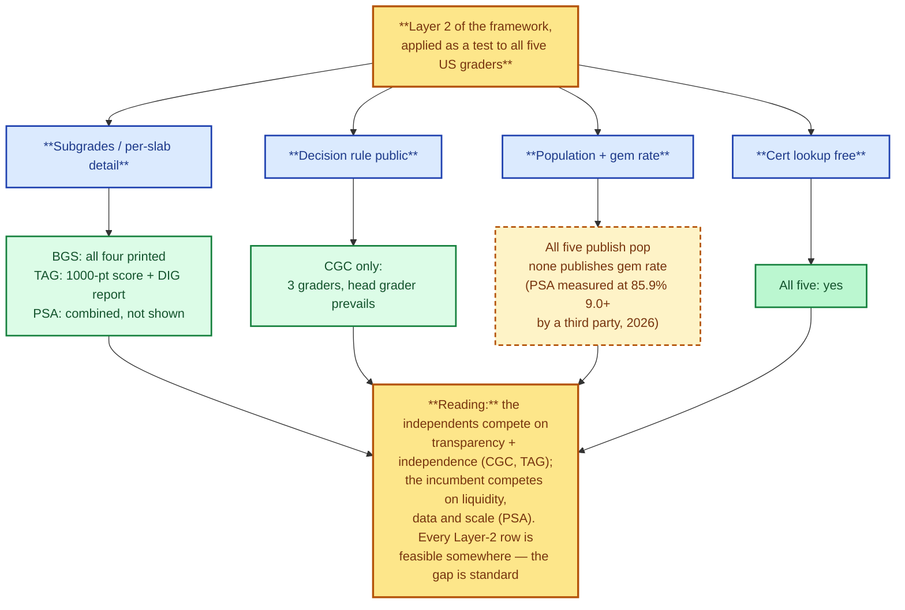

# 3. Grading Companies, Audited

> **Act I — The hobby · chapter 3 of 16.** Chapter 2 tells you who the
> referees are. This chapter audits them: what each company is, how big it
> is, how it grades, what it publishes — and, from the companies' own sites
> fetched on 2026-10-12, what is actually happening at each company *right
> now*. The findings feed Act II (the problem) and the framework's
> transparency layer (Act III).

## 3.1 How this audit was done

All sources were located and fetched **2026-10-12**: five Wikipedia articles
in full (PSA, CGC, Collectors Universe, Beckett Media, Sports card); PSA's
own homepage (via a reader proxy — direct fetches are bot-blocked); TAG's
pricing page and Beckett's grading page (direct fetches, verbatim); Card
Ladder's site and its archived about page; and three academic abstracts via
OpenAlex. Company fee schedules are intentionally not hard-coded here: they
change often, and the house rule is to describe the *structure* and check
the numbers on the day you submit.

What the audit could not do: measure any company's gem rate independently,
see internal grading procedures, or confirm any claim that has a single
source. Those are marked *reported* or *not verified* in the source table
below, the way the repo has always done it.

## 3.2 The industry at a glance

The industry map as audited on 2026-10-12: one owner, three of the top three brands, two independents, and the international field.

| Company | Owner (2026) | Base | Scale anchor (verified) | Signature |
|---------|--------------|------|-------------------------|-----------|
| PSA | Collectors (taken private 2021) | Costa Mesa, CA | "Over 80 million collectibles authenticated & graded" — PSA's own site [A6]; parent group hit 75M certified collectibles in 2019 [A3] | Default in US market; vault + eBay consignment; largest pop base |
| BGS (Beckett) | Collectors (acquired 2025) | Plano, TX | GemRate 2024: **third** in card-grading market share [A3] | The only major grader that *always* prints all four subgrades; Black Label; Topps Vault exclusive |
| SGC | Collectors (acquired 2023) | (integrated into PSA) | Long vintage record (the $12.6M Mantle was SGC 9.5) [A13] | Black "tuxedo" label; Pristine 10 gold label; **its own domain no longer resolves** [A14] |
| CGC | Independent (Certified Collectibles Group) | Sarasota, FL | 7M+ comic books graded by 2021 [A2]; GemRate 2024: **second** in card share [A3] | The only major grader with a *published decision rule*; Signature Series chain of custody |
| TAG | Independent | (US) | 4.9/5 from 885 on-site reviews [A7] | Imaging + scan technology, a 1000-point score and per-card DIG reports |
| CCIC | (China) | China | Case-studied 2025 [A10] | Legitimacy-driven growth under local regulation |
| SQC | (Thailand) | Thailand | Case-studied 2025 [A10] | NFT-linked, community co-creation experiments |

Market share context: GemRate data for 2024 ranks PSA first, CGC second,
Beckett third [A3]. The "80% of grading" figure that circulates in hobby
videos remains a **claim** — it is not verified in any source fetched for
this repo, and it is contradicted in shape by CGC ranking second [A13].

## 3.3 PSA — the incumbent, audited

**Origins.** Founded **July 1991 by David Hall, owner of PCGS** (the coin
grader started in 1985 by seven coin dealers to standardize coin grading),
as a third-party sports card grader. It "initially struggled because of
limited demand" — some dealers opposed third-party grading and refused to
use it — and grew during the dot-com boom as eBay made card trading
national: a third-party grader "ensured card legitimacy" and let buyers
judge value beyond "often low-resolution images" [A1].

**Scale and positioning.** PSA's own homepage (fetched 2026-10-12) claims
"**Over 80 Million Collectibles Authenticated & Graded**" and "the global
leader in authentication and grading" [A6]. A 2025 business-model study of
the grading industry (30 interviews across PSA, CCIC and SQC) finds that
"**PSA leverages scale and AI technology to enhance efficiency**" [A10] —
the incumbent's stated edge is scale plus automation, not generosity.

**The public data stack.** PSA's site exposes the industry's most complete
public research layer: Cert Verification, Population Report, Auction
Prices, a Price Guide, Card Facts — and a link to **Card Ladder** under
"Research" [A6]. (Card Ladder ownership: see §3.9 — the link is evidence
of affiliation, not of ownership.)

**The economics of the label.** An NBA-card study (2001–2009, eBay + PSA
data) finds the PSA-10 dummy "carries the largest economic impact":
holding everything else constant, **a card graded Gem Mint trades at
roughly 339% above a grade-8 baseline** [A11]. A 2026 comparison of PSA
against an AI grading platform (24 sets, five categories) finds **PSA
grades 85.9% of cards at 9.0+ vs 81.0% for the AI platform** —
"statistically significant but practically small" (Cohen's d = 0.0317),
with the largest category gap in football (16.3 pp) and the opposite
pattern in TCGs [A12]. That 85.9% is effectively a third-party-measured
gem rate for PSA — and it is high. The repo's own 26-claim log documents
what a move of one grade point is worth at the top: **$16.5M (PSA 10) vs
$1,406,250 (PSA 9), same Pikachu Illustrator, five weeks apart** [A13].

**What PSA does not publish.** No subgrades on the label (the four
subgrades — centering, corners, edges, surface — are combined internally;
[A5] notes major graders "provide individual grades ... to eventually
combine for one final grade," and chapter 2 records PSA as the one that
shows none) [A5][A13]. No published gem rate. The 9-to-10 cliff — the
single largest price discontinuity in the hobby — is a property of the
standard that the owner of the standard does not quantify [A13].

## 3.4 BGS / Beckett — the price-guide house, and its 2026 incident

**Origins.** Beckett began in **1984, founded by statistician Dr. James
Beckett** as Beckett Publications; in the 1970s he introduced "some of the
initial price guides for the baseball card industry" — more detail than
the newsletters collectors were used to. *Beckett Baseball Card Monthly*
peaked at roughly one million readers. The company passed through Apprise
Media (2005) and Eli Global (2008) before the Collectors acquisition [A4].
The grading lineage is the same story: Beckett's publications "pioneered
an early card grading system" — six levels, mint to poor — before BGS
became the service [A4]. **The house that grades cards started as the
house that prices them** — a fact the audit returns to in §3.11.

**The grading business.** BGS is the only major grader that prints all
four subgrades (centering, corners, edges, surface) on every label; the
**Black Label** (all four subgrades 10) and the **BGS 9.5** tier are
recognised price tiers of their own [A13]. Beckett holds the **exclusive
right to grade and authenticate Topps Vault** cards [A4].

**Ownership and reputation.** Acquired by Collectors in **2025**;
financial terms not disclosed; "Beckett continues to operate as an
independent brand within Collectors, with no immediate changes to pricing
or operations." The deal **included Beckett's Comic Book Certification
Service (CBCS)** — founded by Dr. Michael Bornstein, his son Alec and
Steve Borock — and **excluded** Southern Hobby Distribution and Dragon
Shield [A3]. GemRate-era commentary notes Beckett is "known for its
stringent grading standards" [A3]. The BBB record: **not accredited, F
rating, "identified a pattern in consumer complaints"; the inquiry was
"closed on February 14, 2025, as Failure to Address or Eliminate the
Pattern of Complaints"** [A4] — the repo's claim log verifies the same two
sentences (C15/C16) [A13].

**The 2026 incident (from Beckett's own site, fetched 2026-10-12).**
As of the fetch date, Beckett's **digital platforms were offline**:
beckett.com, beckettmedia.com, beckett-authentication.com and the mobile
app. The company's statement: "During planned updates to modernize our
legacy IT systems, we detected suspicious technical activity and, out of
caution, took our platforms offline," with a forensic investigation that
"has not identified any evidence that sensitive customer information was
impacted" and restoration "in phases" [A8]. Card grading: **Base and
Standard submissions temporarily paused; only Express accepted**, through
a temporary form, shipped to Beckett HQ in Plano, TX [A8]. The company
explains a "**dynamic approach to service availability**": it "may
temporarily pause new submissions when we forecast we can't meet a
service's estimated turnaround time," with a waitlist for reopening [A8].

*Audit finding:* the second-largest player was, on the audit date, running
on a temporary submission form and a waitlist — mid-way through an
ownership transition. For the collector this is not hypothetical: **the
grader can close your preferred tier unilaterally**, and service
continuity during consolidation transitions is a live operational risk.

## 3.5 SGC — the tuxedo, now inside PSA

**Legal and ownership record.** The company behind the brand is the
**Sportscard Grading Corporation** [A3]. Acquired by Collectors in **2023**,
financial terms not disclosed; "**Following the acquisition, SGC's sports
card grading operations were integrated into PSA**" [A3].

**The brand today.** The black "tuxedo" slab and the Pristine 10 gold
label remain; SGC's long-standing trust in vintage (the $12.6M Mantle at
SGC 9.5) is the asset Collectors bought [A13]. The audit's own DNS check
on 2026-10-12: **sgcsportscard.com no longer resolves (NXDOMAIN)** [A14].
The standalone web presence of the brand is gone; what remains is a label
inside PSA's pipeline.

*Audit finding:* a crossover from PSA to SGC no longer gives a second
company's opinion — it is a second run of the same group's process. The
independent vintage checks are now CGC (and, at much thinner liquidity,
TAG) [A13].

## 3.6 CGC — the independent with a published decision rule

**Record.** Launched in **early 2000** in **Sarasota, Florida**; an
"independent member of the Certified Collectibles Group"; **over 7 million
comic books graded by 2021** [A2]. In cards: entered TCGs around 2020 and
absorbed the CSG sports brand [A13]; GemRate 2024 ranks it **second** in
card grading market share [A3].

**The process — and the decision rule.** CGC's published process:
comics "are inspected by one pre-grader for obvious defects (missing
pages, etc.) and are then **graded by three graders** in a temperature- and
humidity-controlled environment. **The grades are not averaged together,
as the Head Grader determines the final grade** — if two graders rate a
book 7.0 and the Head Grader grades it 7.5, the latter prevails" [A2].
That is the **only one of the five whose decision rule is public** — the
"who decides" question, answered in a sentence. The same article
documents the physical security chain: Barex inner well, sonically sealed
tamper-evident holder [A2].

**Signature Series.** CGC's gold-label service **witnesses the signing and
maintains chain of custody until slabbing** — "this mitigates signature
forgery concerns" [A2]. And the purple **"Restored"** label: a marked
restoration "can suffer a significant price reduction" [A2] — disclosure
as a price mechanic.

**Records the label has set.** Action Comics #1: CGC 8.0 sold for $1M
(2010); CGC 8.5 for a then-record $1.5M; CGC 9.0 for $3.2M (2014) [A2].

**Web presence.** cgctcg.com no longer resolves (NXDOMAIN, audit check
[A14]); the business runs out of comicgrading.com.

*Audit finding:* CGC is what framework Layer 1.2 (an independent standards
body) looks like when it already exists: an independent owner, a public
decision rule, a public pop, and a market position (second) large enough
to be a real second opinion.

## 3.7 TAG — the imaging upstart: the transparency prototype

**Company.** Technical Authentication & Grading, LLC [A7]. Its entire
value proposition is the one the framework's transparency layer demands,
delivered per slab:

- **Scan/imaging technology** and a **1000-point grade** — a detailed
  numeric score rather than a single number [A7].
- **DIG reports** — a "detailed digital report" of a card's features and
  defects, attached to the cert; the site markets itself on a dedicated
  **"TAG VS MANUAL GRADING"** page [A7].
- **Public population data per card**: "VIEW ANY TAG'D CARD'S **POP / RANK
  / CHRON** + DIG REPORT", plus a cert search [A7].
- **Service tiers**: Basic, Standard, Express, and **on-site** grading
  (Hall of Fame, CA; the 2026 Bitcoin Conference); **"TAG V — Verified
  Authentic"** is encapsulation *without* a grade — an authentication-only
  tier nobody else at scale offers [A7].
- **Capacity discipline**: a public "TAG Backlog Tracker" and "Limited
  Reopening" messaging — a small operator managing its own bottleneck
  out in the open [A7].

**Customer voice (labelled as such).** On-site review rating 4.9/5 from
885 reviews [A7]; several customers say they chose TAG *because of*
"PSA's recent negative publicity regarding inconsistent grading" and the
"detailed digital report" [A7]. That is customer testimony, not a verified
finding — but it is evidence of where the dissatisfaction from Act II is
flowing.

*Audit finding:* TAG is the market's working proof that per-slab
transparency (numeric sub-scores + imaging + public detail reports) is
buildable and that customers will choose it. Its ceiling is the same one
ch. 2 states: thin liquidity. Transparency without a market is a
prototype — and that is exactly the cold-start problem the community AI
grading chapter (ch. 16) designs around.

## 3.8 International players — the market left the US

The 2025 case study (Shen & Wei) grades the three companies it studies —
**PSA (US), CCIC (China), SQC (Thailand)** — on 30 interviews and finds
"divergent strategies shaped by both dynamic capabilities and institutional
contexts": PSA on scale + AI; **CCIC "focuses on legitimacy and
incremental improvements under regulatory constraints"**; SQC "pursues
exploratory digital initiatives (e.g., NFT-linked trials) to co-create
value with its community" [A10]. On the demand side, TAG's category list
already includes **Weiß Schwarz (Japan)** and prices in JPY [A7].

*Audit finding:* "grading" is now a multinational standard-competition,
and the standard-setter's home country is a variable — a dimension the
fairness framework (Act III) must keep in view, because "independent"
means something different in each institutional setting [A10].

## 3.9 The price-data layer: who owns the numbers

**Card Ladder** (fetched 2026-10-12): "the only price guide with every
public sale in our database **going back to 2000**"; "**100M+ historical
sales** ... from eBay, Goldin, Heritage, Fanatics, and many other
platforms"; "**View population reports from PSA, BGS, SGC and CGC**";
indices "vetted and updated daily" [A9]. Its archived about page
(2026-10-08) describes founders "Chris, Josh, and Kristina" as a hobby
passion project — **no statement of Collectors ownership** [A9].

**The affiliation question.** PSA's own homepage links Card Ladder under
"Research" [A6]; hobby-video commentary claims Collectors *owns* Card
Ladder [A13]. Status in this repo: **affiliation strongly suggested;
ownership reported but not verified** in any fetched source. The tracker
in this repo exists precisely because the answer to "who owns the numbers
I price my cards against" should not depend on a video's claim.

## 3.10 The transparency scorecard

The framework's Layer 2 applied as a test to all five US companies — and what each dimension shows.

The framework's Layer 2, applied as a test to all five US companies:

| Test | PSA | BGS | SGC | CGC | TAG |
|------|-----|-----|-----|-----|-----|
| Subgrades on the label | No (combined internally) | **Yes — all four** | Optional | Optional | **1000-point score** |
| Per-slab detail report | Qualifiers only | Subgrades | — | — | **DIG report** |
| Population report public | Yes | Yes | Yes | Yes | **Yes (+ rank/chron)** |
| Decision rule public | No | No | No | **Yes (head grader prevails)** | Rubric page public |
| Gem rate published | No | Not published (computable) | No | No | Not published (computable) |
| Cert lookup free | Yes | Yes | Yes | Yes | Yes |
| Market-side assets (vault / sales / price data) | **Vault, eBay consignment; group owns price tools (reported)** | Group (2025); Topps Vault exclusive | Group (integrated into PSA) | None — independent | None — independent |

Reading the table: **the two independents compete on transparency and
independence; the incumbent competes on liquidity, data and scale.** Every
row the framework's Layer 2 demands, at least one player now demonstrates
is feasible — and the gap between "feasible" and "standard" is what Act
III is for.

## 3.11 What the audit shows

1. **Consolidation is structural, not incidental.** The sequence — taken
   private (2021) → Wata Games (2021) → SGC (2023, now integrated, domain
   dead) → Beckett (2025, brand kept, CBCS included) — put three of the
   three largest card brands, the video-game grader, vaults and sales under
   one owner in four years [A3][A14].
2. **The grader's house was originally a price guide.** Beckett started as
   the price-guide house [A4]; PSA's site now links the price-data service
   Card Ladder under "Research" [A6]. The group that sets the grade is
   surrounded by the businesses that monetize the numbers. That is the
   conflict in one paragraph (Act II develops it with the 26-claim log).
3. **The independents are differentiating exactly where the framework
   points.** CGC: a public decision rule + independence [A2]. TAG: per-slab
   transparency + imaging [A7]. Both are small; neither has the liquidity
   moat. The direction is proven; the scale is the problem.
4. **The gem rate is the number to watch — and the third-party measurement
   says it is high.** PSA at 85.9% of cards at 9.0+ (2026, Krause) [A12]
   against a 339% PSA-10 premium [A11] and a $16.5M/$1.4M cliff [A13]: the
   standard's generosity and the market's premium are two sides of the
   same coin, and neither is published by the owner of the standard.
5. **Operational risk is now visible, not hypothetical.** The 2026 Beckett
   incident — platforms offline, Base/Standard paused, "dynamic
   availability" — shows that during ownership transitions a major grader
   can unilaterally close service tiers [A8]. Photograph before you ship;
   insure at full value; check service status the day you submit.
6. **The data layer is consolidating around the group's orbit.** Card
   Ladder's 100M-sale database [A9] sits behind a link on the incumbent's
   homepage [A6] while its ownership remains unconfirmed. The
   independent-data instrument (this repo's `tracker/`) is now an
   evidenced position, not just a principle.

## 3.12 Sources (located and fetched 2026-10-12)

| Tag | Source | Status | Used for |
|-----|--------|--------|----------|
| A1 | Wikipedia, "Professional Sports Authenticator" — full article | fetched in full | PSA origins (July 1991, David Hall/PCGS), early dealer resistance, eBay-era growth |
| A2 | Wikipedia, "Certified Guaranty Company" — full article | fetched in full | CGC: 2000 founding, Sarasota, 7M+ comics by 2021, 3-grader + head-grader decision rule, Signature Series chain of custody, Restored label, Action Comics #1 records |
| A3 | Wikipedia, "Collectors Universe" — full article (fetched again this round; twice overall) | fetched in full | 75M certified (2019), PCGS 42.5M coins; Nov 2020 announcement of the $700M Cohen/D1/Nat Turner take-private (closed Q1 2021); Wata 2021; SGC 2023 + integration into PSA; Beckett 2025 (brand kept, CBCS in, Dragon Shield/SHD out); GemRate 2024: PSA 1st, CGC 2nd, Beckett 3rd; Beckett "stringent grading standards" |
| A4 | Wikipedia, "Beckett Media" — full article | fetched in full | 1984 founding (Dr. James Beckett), 1970s price guides, Apprise 2005 / Eli Global 2008, ~1M readers, early 6-level grading system, Topps Vault exclusive, 2016 Beckett Authentication, BBB F + 2025-02-14 inquiry close, CBCS founders |
| A5 | Wikipedia, "Sports card" — full article | fetched in full | Condition = centering/corners/edges/surface; "PSA, Beckett, SGC" as the 1–10 majors; subgrades combined into a final grade; 20,000 PSA 10s of the 2018 Luka Dončić Prizm |
| A6 | psacard.com homepage | fetched via reader proxy (direct fetch bot-blocked, 403) | "Over 80 Million" claim; "global leader"; research stack (cert, pop, auction prices, price guide, card facts); **Card Ladder link under "Research"**; vault + eBay consignment |
| A7 | taggrading.com/pricing (and site nav) | fetched direct, verbatim | 1000-point grade, DIG reports, "TAG VS MANUAL GRADING", POP/RANK/CHRON + cert search, service tiers incl. on-site (HOF CA, Bitcoin 2026), TAG V, backlog tracker, 4.9/5 (885 reviews), customer testimonials re: PSA |
| A8 | beckett.com/grading | fetched direct, verbatim | 2026 platform outage + statement; Base/Standard paused, Express-only temporary form; Plano TX HQ; "dynamic approach to service availability"; 60-day price-guide subscription extension |
| A9 | cardladder.com + archived /about (2026-10-08) | fetched direct + via Wayback | 100M+ sales since 2000; eBay/Goldin/Heritage/Fanatics; PSA/BGS/SGC/CGC pop reports; founders' story; **no ownership statement** |
| A10 | Shen & Wei (2025), "Business Model Innovation in the Trading Card Grading Industry", AJBSP (10.70122/ajbsp.v2i2.37) | located via OpenAlex; abstract fetched | PSA/CCIC/SQC case findings: scale + AI; legitimacy under regulation; NFT-linked co-creation |
| A11 | Langelett & Wang (2025), "Third-Party Grading as a Useful Measure of Demand: Evidence from NBA Cards", Atlantic Economic Journal (10.1007/s11293-025-09835-1) | located via OpenAlex; abstract fetched | PSA-10 dummy ≈ **+339%** over grade-8 baseline (2001–2009 data) |
| A12 | Krause (2026), "Grading the Graders" (10.2139/ssrn.7202040) | located via OpenAlex; abstract fetched | PSA 9.0+ = 85.9% vs AI 81.0% (d = 0.0317); football gap 16.3 pp, TCG opposite; 339% premium context |
| A13 | Repo-verified claims | `../act-2-the-problem/grading-conflict.md` §4–5 (26-claim log); ch. 2 | $16.5M/$1.4M cliff; BBB F + inquiry close (C15/C16); GemRate ranking; SGC 2023 / Beckett 2025; BGS subgrades & Black Label; "80% share" = claim; Card Ladder ownership = reported |
| A14 | DNS resolution checks performed 2026-10-12 | performed in this audit | sgcsportscard.com → NXDOMAIN; cgctcg.com → NXDOMAIN; comicgrading.com → resolves |

**Verification note.** A1–A7 and A9 were fetched in full on 2026-10-12 and
are stored verbatim in the research working files; every tag in this
chapter traces to one of them. A10–A12 rest on fetched abstracts. **Not
verified here and marked accordingly:** SGC's founding year; Card Ladder's
ownership (reported claim, §3.9); the "80% of grading" figure; exact
current fees and turnaround times at every company (structure described;
numbers left to the day-of-submission check, per the house rule); and any
gem-rate figure beyond the third-party measurement in A12.

Cross-references: the comparison this audits
(`grading-companies.md`, ch. 2), the problem it feeds
(`../act-2-the-problem/grading-conflict.md`, ch. 9), the framework the
scorecard belongs to (`../act-3-the-solution/fair-grading-framework.md`,
ch. 12, Layer 2), the transparency prototype's ceiling
(`../act-3-the-solution/open-community-ai-grading.md`, ch. 16), and the
independent instrument (`../../tracker/`).
