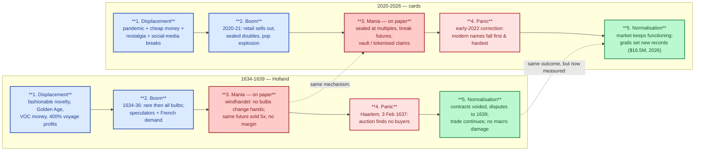

# Is this tulip mania? — the 400-year-old question, answered with data

> **Act I — The hobby · chapter 8 of 17.** Every time the market surges, the
> oldest objection in finance gets raised: *this is tulip mania* — said of
> cards in 2021, of Bitcoin in 2013, of NFTs in 2021. This chapter takes the
> question seriously, and the sources seriously: it reconstructs what actually
> happened in the Netherlands between 1634 and 1639 from the surviving record,
> presents the two competing readings (the Mackay fable, the modern
> revision), and then runs the 2020–21 card boom through the same test
> bench. The verdict: **same behavioral kernel, different structural
> machine — and an aftermath the legend gets wrong.** That verdict changes
> what the analogy is *for*: it is a timing and information lesson, not a
> doomsday prophecy.

## 1. What actually happened (the verified record)

The tulip business began when the recently introduced flower (Leiden, 1593;
first Dutch flowering, spring 1594) became a status symbol of the Dutch
Golden Age [T1]. The prized multicolour "broken" petals — the Rosen,
Violetten and rarest Bizarden — turned out to be the work of a
tulip-specific mosaic virus that "breaks" a single petal colour into
streaks; less conspicuously, the same virus progressively impairs the bulb's
production of daughter bulbs [T1]. The most expensive variety of the mania,
the Semper Augustus, was in fact a virus-affected tulip, and its peak holder
— Adriaan Pauw, a director of the Dutch East India Company — is believed to
have *refused to sell* despite wildly escalating offers [T1].

The market's structure is the part most retellings skip, and it is the part
that matters for the comparison:

- **Forward contracts, not spot.** Tulips bloomed for about a week in
  April–May; bulbs could only move in the dormant season (June–September),
  so "actual purchases" were spot sales in those months, and for the rest of
  the year traders signed **forward contracts before a notary** for delivery
  at season's end [T1].
- **The trading floor was a tavern.** Traders met in "colleges" at taverns,
  paid a 2.5% "wine money" fee per trade, posted **no margin**, and took all
  contracts with the individual counterparty — not with any exchange. The
  Dutch called it *windhandel*, "air trade," because **no bulbs changed
  hands** [T1].
- **The paper could be re-traded endlessly.** At the winter 1636–37 peak,
  "some contracts were changing hands five times" — the same future bulb
  sold and resold before it was ever delivered [T1].
- **Shorting was illegal, and the contracts were unenforceable anyway.**
  Edicts of 1610, 1621, 1630 and 1636 banned short selling; the forward
  contracts were deemed unenforceable, so a trader facing a loss could
  simply repudiate the deal [T1].

The timeline: the slow rise ran through the 1620s; **acceleration began in
1634**, partly on French demand; contract prices for rare bulbs climbed
through 1636, and **by November even common "unbroken" bulbs were fetching
hundreds of guilders** [T1]. At the peak, certain bulbs sold for **more than
ten times the annual income of a skilled artisan**; the Semper Augustus hit
ƒ10,000 (≈ €130,000 in 2024) [T1]; one variety was worth upwards of five
times the cost of an average house [T1]. The Mackay-era numbers (5 hectares
of land offered for a Semper Augustus bulb; 40 bulbs for ƒ100,000) are the
1841 fable, not the record — flagged as such below [T1].

The crash: a contemporary satire places the unraveling on **3 February 1637
in Haarlem**, where an auctioneer failed to find buyers despite repeatedly
lowering the price; the collapse was done "by the end of the first week of
February 1637" [T1]. The aftermath was legal, not financial: growers met in
Amsterdam in February; the compromise was that contracts before December
1636 stayed binding and later ones could be cancelled for a 10% fee; the
court declined to rule; the legislature cancelled all contracts; in Haarlem
buyers could cancel at 3.5% (May 1637); **the courts stayed busy with tulip
disputes throughout 1639; most contracts were simply never honoured** [T1].

Two more facts frame everything that follows:

- **The data is thin, and the record is self-interested.** The bulk of
  available price data comes from an anonymous satirical dialogue;
  economist Peter Garber collected **161 bulb sales of 39 varieties between
  1633 and 1637**, and on the last bubble date (5 February 1637) he found 98
  sales "at wildly varying prices" — "a blend of apples and oranges," in his
  words [T1].
- **There was no macro damage.** The tulip mania "had no critical influence
  on the prosperity of the Dutch Republic," which held the world's highest
  per-capita income from circa 1600 to 1720; it is "generally considered the
  first recorded speculative bubble" and "in many ways more of a
  socio-economic phenomenon than a significant economic crisis" [T1].

## 2. The two readings — the debate inside the sources

**Reading A — the fable (Mackay, 1841).** Charles Mackay's *Extraordinary
Popular Delusions* made tulip mania the template for all bubbles: the whole
population "even to its lowest dregs" in the trade, investors ruined, a
"widely" felt economic chill for years after. His vivid account was sourced
through a 1797 history that itself drew heavily on the *satirical* dialogues
written to mock the speculators [T1].

**Reading B — the revision (1980s → now).**
- **Goldgar (2007):** the trade was limited to "a fairly small group" —
  merchants and wealthy skilled craftsmen, not the nation; most period
  accounts rest on "one or two contemporary pieces of propaganda and a
  prodigious amount of plagiarism"; she identifies **fewer than half a dozen
  buyers or sellers who experienced financial trouble**, and even those not
  clearly tulip-caused. The key mechanics: "money had not changed hands
  between buyers and sellers" — profits were never realised, so a price fall
  alone did not make anyone lose [T1].
- **Garber (1989):** the common-bulb trade was "no more than a meaningless
  winter drinking game"; and the rise-then-fall is what *flowers do* —
  19th-century hyacinths, when fashionable, peaked and then fell to **1–2%
  of their peak value within 30 years** as they were propagated. "Because
  the rise in prices occurred after bulbs were planted for the year, growers
  would not have had an opportunity to increase production in response to
  price" [T1].
- **Thompson (2006):** the price drop was a **99.999% annualised rate**,
  versus an average ~40% for other flowers — no supply or demand story
  explains that; the legal one does. In late 1636 a decree was pending that
  would let buyers of forward contracts walk away for a small fixed fee; on
  24 February 1637 the florists' guild (later ratified by Parliament)
  reinterpreted all futures written after 30 November 1636 as **options** —
  buyers freed from the obligation, compensating sellers a small percentage.
  When the information entered the market in late November, "contract
  prices soared" — the "bubble" was a bet on the option conversion, and
  "the real victims" were investors who had bought forwards *before*
  November 30, 1636, assuming they would benefit. His conclusion: tulip
  contract prices "appear to provide a remarkable illustration of efficient
  market prices" [T1].
- **2026 restatement (Adisurya):** read carefully, the public record "shows
  the money was made on paper contracts among a confined circle of
  dealers," and the modern reflex — "this time the asset is real" — "is the
  same trick read forward, because the mania was never about whether the
  asset was real. When a price detaches from what a thing does and attaches
  to what the next buyer will pay, the reality of the underlying asset stops
  mattering" [T6].
- **The psychology is real even where the scale is not.** The bandwagon
  mechanism — "many people involved in this movement can not be wrong" —
  operated as advertised, 1634–1637 [T7].

**The synthesis this repo adopts:** the spike in *paper* contract prices is
real, documented, and well-described — that is the event. What the record
does **not** support is (a) whole-nation participation, (b) damage to the
Dutch economy, or (c) a collapse of the physical tulip trade itself — tulips
remained a normal flower industry, and the trade in bulbs continued. The
dispute among scholars is about **scale and damage, not about the
psychology** [T1, T6, T7].

## 3. The card boom, on the same test bench

The 2020–21 card cycle, as established in this act: the trigger set
(pandemic lockdown, cheap money, nostalgia, social-media breaks), retail
sell-outs, flippers, a grading backlog and pop explosion, a supply response
from manufacturers, and a correction in which modern and mid-tier names fell
first and hardest while true grails and low-pop vintage held
(`market-overview.md` §1.4). The behavioural reading of the 2021 frenzy is
documented in the academic literature (Zhang 2026) and the boom-bust data
are measured (Sharma 2026) — both in `what-research-says.md` §3. And the
aftermath fact that matters: the correction did not kill the market — top
grails kept setting records, the same Pikachu Illustrator card selling for
**$16.5M as a PSA 10 in February 2026** (repo-verified,
`../act-2-the-problem/grading-conflict.md`).

## 4. The debate: same or not?

The argument in diagram form: the shared behavioral kernel, the structural differences, the verdict.

```mermaid

flowchart TD
classDef act1 fill:#dbeafe,stroke:#1e40af,stroke-width:2px,color:#1e3a8a;
classDef act2 fill:#fee2e2,stroke:#b91c1c,stroke-width:2px,color:#7f1d1d;
classDef act3 fill:#dcfce7,stroke:#15803d,stroke-width:2px,color:#14532d;
classDef key fill:#fde68a,stroke:#b45309,stroke-width:2.5px,color:#78350f;
classDef risk fill:#fecaca,stroke:#991b1b,stroke-width:2px,color:#7f1d1d;
classDef verify fill:#bbf7d0,stroke:#15803d,stroke-width:2px,color:#14532d;
classDef unv fill:#fef3c7,stroke:#b45309,stroke-width:2px,stroke-dasharray:6 4,color:#78350f;
classDef money fill:#fef9c3,stroke:#a16207,stroke-width:2px,color:#713f12;
classDef flow fill:#f1f5f9,stroke:#64748b,stroke-width:1.5px,color:#334155;
classDef endg fill:#e2e8f0,stroke:#475569,stroke-width:2px,color:#1e293b;
  Q["**Same or different?**<br/>Tulip mania vs the 2020-21 card boom"]:::key
  Q --> K["**Shared behavioral kernel — SAME**"]:::act1
  K --> K1["Displacement by a new<br/>fashionable good (Kindleberger)"]:::act1
  K --> K2["Bandwagon: 'many people involved<br/>can not be wrong'"]:::act1
  K --> K3["Paper in front of the asset:<br/>windhandel / sealed & break futures"]:::act1
  K --> K4["Greater-fool pricing;<br/>'this time the asset is real'"]:::act1
  Q --> M["**Different structural machine — NOT SAME**"]:::act3
  M --> M1["**Supply**: 1637 could not respond<br/>(planted, 1-yr lag, virus reduces output)<br/>vs 2021: prints, reprints, grading pop"]:::act3
  M --> M2["**Verification**: 1637 — dormant, unseen<br/>bulb; no cert, no comps (pure lemons)<br/>vs 2021 — grade, pop, comps all public"]:::act3
  M --> M3["**Enforcement**: 1637 contracts<br/>unenforceable, courts dissolve the dispute<br/>vs 2021: payment rails & escrow work"]:::act3
  M --> M4["**Aftermath**: 1637 — legend says ruin,<br/>record says none; 2021 — measured<br/>correction, then new record highs"]:::act3
  K --> V
  M --> V
  V["**Verdict: same story, different machine**<br/>right about timing (never buy mania-stage),<br/>wrong as prophecy (the asset class survives)"]:::verify
```

### 4.1 The case for "same" — the shared kernel

1. **Displacement by a new fashionable good.** Kindleberger's first bubble
   stage is a new thing with a status halo. Tulips in 1620s–30s Holland: a
   40-year-old novelty at the height of the Golden Age, with VOC voyages
   yielding 400% profits and money to spend [T1, T8]. Cards in 2020: a TCG
   culture riding a global shutdown with cheap money [ch. 7].
2. **Bandwagon dynamics.** Both markets ran on the "can't be wrong"
   mechanism — prices rising daily is the cheapest argument there is [T7].
3. **New money at the peak.** 1634: speculators and foreign (French) demand
   arriving late [T1]. 2020–21: investors, influencers, first-time buyers
   chasing a story they'd heard of, not a game they play [ch. 7].
4. **Paper in front of the asset — the strongest structural rhyme.**
   *Windhandel*: no bulbs changing hands, the same future bulb resold five
   times [T1]. 2021: sealed product at multiples, break futures, vault and
   tokenised claims, buying "before it lands" (`sealed-product.md`,
   `what-research-says.md`, `open-community-ai-grading.md` §4.3). In both
   eras the speculative layer was trading *delivery rights on things not yet
   seen*.
5. **Price detaching from use value.** A tulip is a flower that blooms for a
   week; a trading card is a game card. At the peak, both are priced on what
   the *next buyer* pays [T6] — and "this time the asset is real" was said
   of bulbs (real flowers!) and is said of cards (real cards, real
   nostalgia). Adisurya's point is that the asset's reality is irrelevant
   once price has detached from what a thing *does* [T6].
6. **Media amplification.** 17th-century satirical pamphlets and the
   sailor-eating-the-bulb anecdote [T1] ↔ record-sale headlines, break
   streams, and the boom coverage in the documentary evidence
   (`../act-2-the-problem/hobby-documentary-notes.md`).
7. **The full sequence.** Displacement → boom → mania → panic: both markets
   show it, including the panic leg (Haarlem, 3–5 February 1637; the early
   2022 correction) [T8, ch. 7].

### 4.2 The case for "different" — the structural machine

1. **Supply could not respond — then; supply *does* respond — now.** This is
   the biggest difference, and it is structural, not incidental. Garber: the
   1630s rise came after planting, "growers would not have had an
   opportunity to increase production in response to price" [T1] — plus a
   ~1-year biological lag and a virus that *reduced* daughter-bulb output.
   Cards have the opposite property: `market-overview.md` §1.4 stage 4 is
   real — manufacturers print more, reprints arrive, graders add population
   within months. **The card boom deflates partly through supply; the tulip
   boom could only deflate through demand.** The tulip cycle literally never
   had a stage 4.
2. **The verification layer — this repo's own thesis, applied to 1637.**
   A tulip forward buyer paid for a **dormant, unverified bulb they had
   never seen**, with delivery (and first look) in spring. Variety, health
   and value were unverifiable until bloom — the purest lemon market in
   hobby history: no grading, no population, no comparable sales, no cert.
   The 2020–21 card boom ran on *public* price data: sold comps, population
   reports, price indices, and a certificate when the card was graded.
   **Same psychology, different epistemology**: in the card market the
   greater-fool buyer can at least check the numbers; in 1637 nobody could
   check anything. That is not a detail — it is the difference between a
   market where the buyer can verify and one where the buyer can't, which is
   exactly the difference Act I of this repo is built on (the grade is what
   makes the market work).
3. **Depth of financialization — in opposite directions.** Tulips: a true
   forward market with five-fold resale, no margin, no clearinghouse, and
   *unenforceable* contracts [T1]. Cards: vaults and tokenised claims
   (Krause 2026, ch. 7) and break futures are real, but most boom-era buying
   was cash spot. So: **deeper paper in 1637, broader cash participation in
   2021** — each era has the other's worst feature, but the tulip paper
   layer was deeper.
4. **The enforcement environment.** 1637: courts declined to rule,
   legislatures voided contracts, most were simply never honoured — the
   contract system *dissolved under the bubble* [T1]. 2021: payment rails,
   escrow and consumer-protection law kept working. A tulip buyer's
   downside was a *legal* one; a card buyer's downside is a *market* one.
5. **Scale and systemic reach.** Tulips: 161 recorded sales in four years,
   "a fairly small group," conducted "on the margins of Dutch economic
   life, not in the exchange" [T1]. Cards: a global, multi-billion-dollar
   hobby with an institutional participation layer (ch. 1 §1.5 for
   magnitudes). **Small and local in 1637; broad and shallow in 2021 — but
   neither was systemic.**
6. **The aftermath — and the myth.** The Mackay legend says ruin and a
   chill; the record says no macro damage, normalised trade, a continuing
   flower industry [T1]. The card record says a measured correction (Sharma
   2026), a market that kept functioning, and absolute record highs *after*
   the bust ($16.5M, Feb 2026). **Both asset classes survived.** The
   difference is that the tulip aftermath is still *argued* (thin data,
   satirical sources), while the card aftermath is *measured*.

### 4.3 Verdict: same story, different machine

- **Same:** the behavioral kernel — displacement, bandwagon, paper in front
  of the asset, greater-fool pricing, media amplification, the panic leg.
  If you blur the data, 1637 and 2021 are the same species (Kindleberger's
  sequence [T8]; the bandwagon [T7]).
- **Different:** the structural machine — the card market has an industrial
  supply response, a public verification layer (grades, populations,
  comps), working legal and payment rails, and a broader, shallower
  participant base. The tulip market had none of those: no supply response,
  no verification, unenforceable paper.
- **Therefore the analogy is right about timing and wrong as prophecy.** It
  is a fable about *when* — do not buy in the mania stage; the correction
  is where value enters (§1.4's lesson, 1637–39 ≈ 2022–24) — not a fable
  about *whether*: the asset class survives, as the Dutch economy did. The
  "it's tulip mania, you'll all be ruined" objection confuses the two. It
  is evidence that *euphoric prices* are unsupportable — and it says nothing
  about the hobby dying. The record says the opposite: after the panic leg,
  the market matures, the information layer deepens, and absolute record
  prices keep being set.
- **The deepest difference, and this repo's contribution:** the 1637 buyer
  had no way to verify; the 2021 buyer had more ways than ever. The
  information layer is what separates a bubble from a crisis — and that is
  the whole argument of this repository: Act I (the grade is what makes the
  market), Act II (the referee who owns the information is the problem), Act
  III (the verification layer is the collector's hedge). A tulip buyer was
  buying a lemon by definition; a card buyer *can* buy a verifiable asset.
  The tulip lesson for the collector is not "don't buy" — it is **"buy only
  what you can verify, and buy after the mania stage."**

The same five stages, both eras side by side: the mechanism matches, the aftermath is now measured.

## 5. What to take from this (wired into the playbook)

1. **The displacement is the leading indicator, not the price.** Watch the
   trigger, not the chart: 1634 (war lull + French demand) [T1]; 2020
   (pandemic + cheap money + nostalgia) [ch. 7]. When the trigger set is
   gone or reversing, the panic leg is near.
2. **Paper in front of the asset is where the tulip damage actually was.**
   The victims were *contract* holders [T1, T3]; in 2021 the parallel
   exposure is sealed and break product at euphoric multiples. Prefer
   physical, verifiable cards; treat a premium on the paper layer as a
   speculative position, not a card purchase (`sealed-product.md`).
3. **The verification layer is your hedge.** The tulip buyer's fatal gap —
   you cannot see inside the bulb — is precisely the gap this repo's Act III
   closes (grade, population, comps, full documentation). The 1637 record is
   the argument for why the Layer 2 transparency standards matter, in one
   sentence: *the buyer who cannot verify pays the mania price.*
4. **"This time the asset is real" is the mania-stage argument.** At mania
   prices, the reality of the asset stops mattering [T6] — so do not let
   "it's a *real* card, with *real* history" be the reason you pay a
   top-of-cycle entry.
5. **The correction is the buying window, not the end of the world.**
   1637–39 (contracts voided, prices resetting, disputes running their
   course) ≈ 2022–24 (modern names falling first and hardest, true grails
   holding — `market-overview.md` §1.4 stage 5). The playbook's
   "buy scarce, high-grade, with a reason to be wanted in 20 years" is the
   1637 lesson translated to cards.

(The bubble comparison was against a fable; for the comparison against the
mature sibling asset class — the art market — see
`cards-and-the-art-market.md`, chapter 9 in this act.)

## 6. Sources (located and fetched 2026-10-12)

| Tag | Source | Status | Used for |
|-----|--------|--------|----------|
| T1 | Wikipedia, "Tulip mania" — full article extract, 27.5K chars, fetched via the Wikipedia REST API, saved verbatim in the research working files | fetched in full | All §1 facts; both readings in §2 (Goldgar 2007, Garber 1989, Thompson 2006 characterisations, Mackay 1841, the 161-sale record, the legal aftermath, the no-macro-damage finding) |
| T3 | Thompson, E. A. (2006). "The tulipmania: Fact or artifact?" *Public Choice* (10.1007/s11127-006-9074-4), 101 citations | located via OpenAlex; characterised via T1 | The option-conversion reading; "real victims" = pre-Nov-30 contract holders |
| T6 | Adisurya, B. (2026). "Tulips Were Never the Point" (10.5281/zenodo.20765822) | fetched (abstract) | "Money was made on paper contracts among a confined circle of dealers"; "this time the asset is real" is the same trick read forward; price detaches from what a thing does |
| T7 | Altun & Çıldırım Koçabıyık (2025). "Explaining the Tulip Mania Period Through the Bandwagon Effect" (10.36880/c17.03026) | fetched (abstract) | The bandwagon mechanism: "many people involved in this movement can not be wrong" |
| T8 | Kindleberger, C. P. (1978). *Manias, Panics, and Crashes*; "Speculative Manias" chapter (1,100+ citations) | located via CrossRef | The displacement → boom → mania → panic sequence used as the comparison scaffold |
| T9 | Posthumus, N. W. (2024). "The Tulip Mania in Holland in the Years 1636 and 1637," in *Great Bubbles* vol. 1 (10.4324/9781003550464-8) — companion chapter to De Vries, *The Embarrassment of Riches* (1988), "I invest, he speculates, they gamble" | located via CrossRef; cited via T1's framing | The Dutch economic-cultural framing of the boom |
| — | Garber, P. M. (1989). "Tulipmania in the Dutch Republic," *JPE* 97(5) — and Goldgar, A. (2007). *Tulipmania* (Oxford UP) | **not fetched in full** — their positions are cited *as characterised by T1*; this is said rather than papered over | The revision readings in §2 |

Card-side facts in this chapter are the repo's own verified claims: the
2020–21 cycle model (`market-overview.md` §1.4), the boom-era academic
literature (`what-research-says.md` §3), the $16.5M / $1,406,250 Pikachu
Illustrator pair (`../act-2-the-problem/grading-conflict.md`, 26-claim log),
and the sealed/break financialization (`sealed-product.md`).

## Verification note

- **T1** was fetched in full (the complete "Tulip mania" article extract)
  and is stored verbatim in the research working files; every T1-tagged
  claim above is traceable to that text, including the direct quotations
  ("windhandel", "a blend of apples and oranges", "money had not changed
  hands", "a fairly small group", "no more than a meaningless winter
  drinking game", the 99.999% annualised figure, "a remarkable illustration
  of efficient market prices").
- **T6, T7, T8, T9** claims rest on fetched abstracts or on the works'
  standard characterisations as presented in T1; where a full text was not
  fetched, the tag says so in the table.
- **Deliberately not claimed:** that tulip bulbs (the physical flowers)
  crashed to zero, that the Dutch economy was damaged, or that Mackay's
  specific anecdotes (the sailor, the 12 acres) are factual — the record
  says otherwise on all three [T1].
