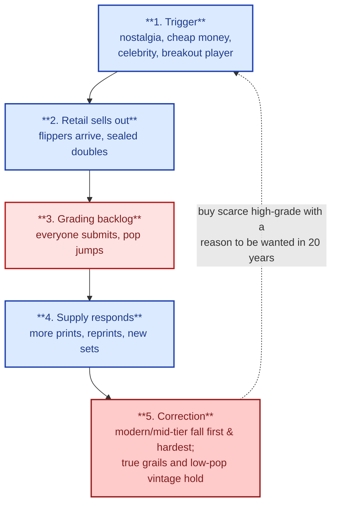

# 1. Market Overview

> **Act I — The hobby · chapter 1 of 12.** The world. How the hobby got here and how the industry is built. The
> first thing to understand before any price, grade, or purchase.

## 1.1 A short history

| Era | What happened | Why it matters to a buyer today |
|-----|---------------|---------------------------------|
| 1860s-1880s | Trade cards: advertising inserts. Early baseball cards (Peck & Snyder, Cincinnati Red Stockings) | Pre-1900 cards are rare, and many survivors are damaged or restored |
| 1886-1915 | Tobacco cards (T206 and others), then candy and Cracker Jack (1914-15) | T206 Honus Wagner is the hobby's most famous card. A copy sold for $451,000 in 1991 (to Wayne Gretzky and Bruce McNall), $1.27M in 2000 and $2.35M in 2007 |
| 1933 | Goudey Gum set | The first big gum-era baseball set |
| 1952 | Topps baseball, designed by Sy Berger: player photo, stats on the back, larger size | Defines the "modern" card. Topps famously dumped unsold 1952 stock at sea. A 1952 Topps Mickey Mantle #311 (SGC 9.5) sold for $12.6M in August 2022, the modern-era record |
| 1956-1980 | Topps near-monopoly in baseball. Fleer sues, and in 1981 Fleer and Donruss enter | Licensing decides who can make cards. It still does |
| 1986-1994 | Junk wax era: mass overproduction | Most cards from this period are near-worthless raw. Value lives only in high-grade key rookies (for example PSA had certified over 4,000 copies of the 1989 Upper Deck Ken Griffey Jr. by 2022) |
| 1989 | Upper Deck launches with thick glossy stock and anti-counterfeit holograms | First premium card brand. The start of tiered pricing |
| 1991 | PSA founded (by David Hall of PCGS coin grading) | Third-party grading begins. Over time it turned cards into tradeable, comparable assets |
| 1993 | Magic: The Gathering (Wizards of the Coast). The CCG genre is born | Alpha, Beta and Unlimited printings, the Power Nine and the Reserved List (no reprints of certain 1993-1999 cards) |
| 1990s | Inserts, serial numbering, autographs and game-used relics added to sports cards to create scarcity | The parallel and short-print system that still drives modern sports cards |
| 1996-1999 | Pokemon TCG launched in Japan (Oct 1996) and the US (Wizards of the Coast, 1998-2003). Yu-Gi-Oh! OCG launched in 1999 | The vintage TCG grails: 1st Edition Base Set Charizard, Pikachu Illustrator, Blue-Eyes and Dark Magician LOB 1st Ed |
| 2009 | Panini takes the exclusive NBA licence | Panini dominates basketball and football through the 2010s |
| 2020-2021 | COVID boom: stimulus money, nostalgia, lockdown free time, breakers and influencers. Grading backlogs of months. Target pulls cards from shelves after fights | Record prices across sports and Pokemon. Pikachu Illustrator (PSA 10) bought by Logan Paul for $5.275M in July 2021 |
| 2021-2025 | Grader consolidation. PSA's parent Collectors is taken private (2021) and acquires Wata Games (2021), SGC (2023) and Beckett/BGS (2025) | Three of the five main card-grading brands now have one owner. CGC and TAG are the independent alternatives. See `grading-companies.md` 2.7 |
| 2022 | Fanatics wins the MLB, NBA and NFL licences and acquires Topps | The licence landscape changes over 2022-2026 as old deals expire |
| 2022-2023 | New TCGs: One Piece (Bandai, global Dec 2022) and Disney Lorcana (Ravensburger, Aug 2023) | New-game hype cycles. Early sets and top rarities spike, then often correct |
| 2023-2026 | The market cools then recovers by segment. Pokemon sealed demand drives scalping, bots and sell-outs | In February 2026 the PSA 10 Pikachu Illustrator sold for $16.5M (per Wikipedia) |
| 2025-2026 | US tariffs on printed goods and the end of the de minimis exemption raise costs and slow imports. In May 2026 Fanatics signs an exclusive FIFA licence (effective 2031) | Factor in import costs and delays for Japanese and other non-US product |

## 1.2 How the industry is structured


The industry chain, end to end — and how the grader's standard flows back to price.

```mermaid

flowchart LR
classDef act1 fill:#dbeafe,stroke:#1e40af,stroke-width:2px,color:#1e3a8a;
classDef act2 fill:#fee2e2,stroke:#b91c1c,stroke-width:2px,color:#7f1d1d;
classDef act3 fill:#dcfce7,stroke:#15803d,stroke-width:2px,color:#14532d;
classDef key fill:#fde68a,stroke:#b45309,stroke-width:2.5px,color:#78350f;
classDef risk fill:#fecaca,stroke:#991b1b,stroke-width:2px,color:#7f1d1d;
classDef verify fill:#bbf7d0,stroke:#15803d,stroke-width:2px,color:#14532d;
classDef unv fill:#fef3c7,stroke:#b45309,stroke-width:2px,stroke-dasharray:6 4,color:#78350f;
classDef money fill:#fef9c3,stroke:#a16207,stroke-width:2px,color:#713f12;
classDef flow fill:#f1f5f9,stroke:#64748b,stroke-width:1.5px,color:#334155;
classDef endg fill:#e2e8f0,stroke:#475569,stroke-width:2px,color:#1e293b;
  IP["IP / league /<br/>players' union"]:::flow --> LIC["**Licence**"]:::key
  LIC --> MFR["Manufacturer<br/>(Topps, Panini, Pokemon Co, WotC...)"]:::flow
  MFR --> DST["Distributor"]:::flow
  DST --> RET["Retail<br/>(LCS, big-box, official, online)"]:::flow
  RET --> COL["Collectors / players /<br/>breakers / flippers"]:::flow
  COL --> SEC["**Secondary market**<br/>(eBay, TCGplayer, Cardmarket,<br/>auction houses, Whatnot, vaults)"]:::money
  SEC --> GRD["**Graders**<br/>PSA, BGS, SGC, CGC, TAG"]:::act2
  GRD -. "sets the price standard " .-> COL
```



```
IP / league / players' union  ->  licence
  Manufacturer (Topps/Fanatics, Panini, Upper Deck, Leaf; The Pokemon Company,
  Wizards of the Coast, Konami, Bandai, Ravensburger, Bushiroad)
     -> Distributor (hobby distributors, mass-market)
        -> Retail: local card shops (LCS), big box (Target, Walmart, Best Buy),
           official stores (Pokemon Center), online
           -> Collectors / players / breakers / flippers
              -> Secondary market: eBay, TCGplayer, Cardmarket, auction houses
                 (Goldin, Heritage, PWCC/Fanatics Collect, REA), Whatnot,
                 card shows, vault platforms
                 -> Graders: PSA, BGS, SGC (all owned by Collectors), CGC, TAG
```

Points to understand:

- Licences decide what exists. Without a players' union licence a company can
  show logos but not current players' names, or the other way round. Cards
  without a licence (for example Leaf, or Panini baseball after 2022) feature
  only retired players, prospects or airbrushed uniforms and usually trade at a
  discount.
- Hobby product is built for the case-and-box buyer and carries guaranteed
  autos and relics. Retail product is cheaper with lower odds. Some
  retail-exclusive parallels are chase cards in their own right.
- Graders are a parallel market. A grader's brand premium (PSA usually
  highest, then BGS for modern sports and SGC for vintage) is part of the card's
  price.
- Graders are also market participants. The group that owns PSA, BGS and SGC
  also runs a vault and sales products, and is reported to own price-data tools.
  Critics call this a conflict of interest
  (`../act-2-the-problem/monopoly-video-notes.md`). Whatever you think of that argument,
  take price checks from outside the group.

## 1.3 Segments and what drives each

| Segment | Main value drivers | Main risks |
|---------|--------------------|------------|
| Vintage sports (pre-1980) | Hall of Famers, grade scarcity, eye appeal | Trimming, alteration, fakes, very high prices |
| Modern sports (1980-present) | Rookie cards, numbered parallels, on-card autos, player performance | Player injury or decline, overproduction, big pop counts in PSA 10 |
| Vintage TCG (Pokemon WOTC, MTG pre-2000, Yu-Gi-Oh LOB-era) | Fixed supply, nostalgia, 1st Edition and shadowless variants | Fakes, reseals, grade sensitivity |
| Modern TCG | Alt arts, special illustration rares, serialized cards, playability | Reprints, set fatigue, print-run expansion |
| Sealed product | Supply that shrinks as boxes get opened | Reseals, storage damage, reprint waves |
| Non-sport (Marvel, Star Wars, Garbage Pail Kids, celebrity) | Pop culture moments, low print runs | Thin markets, wide bid/ask |

## 1.4 Cycles: how booms and busts work in cards


The five stages of a boom-and-correction cycle.



1. Trigger: nostalgia (a documentary, an anniversary), cheap money, celebrity
   buyers, a breakout player.
2. Retail sells out and flippers arrive. Sealed product doubles. Breaks
   and live streams grow.
3. Grading backlog: people submit everything and pop counts jump. A
   PSA 10 that was scarce in 2019 can have thousands of copies by 2022 (Wikipedia
   cites more than 20,000 PSA 10 copies of the 2018 Luka Doncic Prizm base rookie).
4. Supply responds: manufacturers print more, and reprints and new sets arrive.
5. Correction: modern and mid-tier cards fall first and hardest. True grails
   and low-pop vintage hold up best.

What to take from this: in a boom, buy below the top only what you
would keep anyway. In a correction, the best buys are scarce, high-grade copies of
cards that have a reason to be wanted in 20 years.

## 1.5 Market size (orders of magnitude only)

- Magic: The Gathering reported more than $1B of annual revenue for Hasbro's
  2022 fiscal year, and about 50 million players by 2023 (Wikipedia).
- Pokemon TCG: more than 85 billion cards produced worldwide by March 2026 (Wikipedia).
- Yu-Gi-Oh!: Guinness named it the top-selling TCG in 2009 (22 billion cards).
  It had sold about 35 billion by January 2021 (Wikipedia).
- Sports cards: frequently quoted forecasts (for example about $14B in 2019 to about
  $100B in 2027) come from marketing reports and are not reliable. Treat any
  single market-size figure with suspicion.
