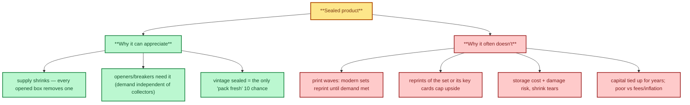
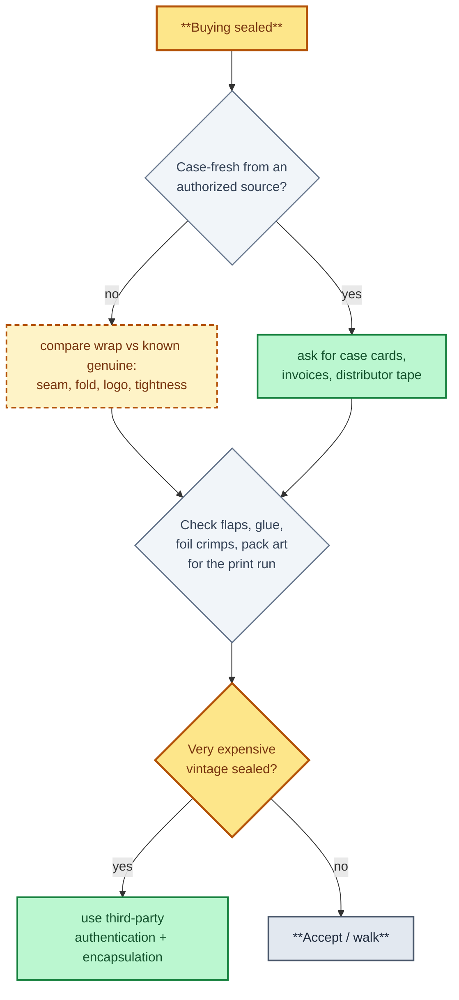

# 5. Sealed Product

> **Act I — The hobby · chapter 5 of 12.** The cards you can buy (3 of 3). Sealed boxes: a different asset with
> its own risks (reseals, storage, reprint waves).

## 5.1 Product types

| Product | What it is | Notes |
|---------|-----------|-------|
| Booster pack | Single randomized pack | Easy to search (weigh, bend, light); loose packs from untrusted sellers are suspect |
| Booster box / display | 18-36 packs, factory sealed | The standard "sealed investment" unit |
| Case | Multiple boxes in manufacturer packaging | Case-fresh provenance is the best protection against tampering |
| ETB / collection boxes | Pokemon Elite Trainer Box, premium collections | Mass-market; Pokemon Center exclusives carry a premium |
| Hobby / jumbo / blaster / hanger | Sports formats | Hobby boxes hold guaranteed hits; retail does not |
| Starter / structure decks, bundles | Fixed contents | Low upside unless out-of-print and iconic |

## 5.2 Why sealed appreciates (when it does)

- Supply only shrinks after print ends: every opened box removes one.
- Openers (breakers, content creators) need sealed product, creating demand
  independent of collectors.
- Vintage sealed is often the only way to get a chance at a "pack fresh" 10.

## 5.3 Why it often does not

Why sealed can appreciate — and why it often doesn't.

- Print waves: modern sets are reprinted until demand is met.
- Reprints of a set or of its key cards in a new set cap upside.
- Storage cost and damage risk, shrink tears, crushed corners.
- Capital is tied up for years; returns versus fees and inflation are often
  poor except for the few iconic sets.

## 5.4 Reseal and tamper detection

The reseal-detection decision path.

1. Buy case-fresh from authorized distributors or reputable shops where
   possible; ask for case cards, invoices, distributor tape.
2. Compare wrap with known genuine examples: seam pattern, fold style, logo
   printed on the wrap (many manufacturers use branded shrink), tightness.
3. Check box flaps and glue, foil pack crimps (vertical vs horizontal crimp,
   width), pack art versions for the print run.
4. Weighing packs (to find heavier hit packs) is a known practice in some
   products; avoid buying loose packs from sources that had the chance.
5. For very expensive vintage sealed, use third-party authentication and
   encapsulation (e.g. graders/authenticators offering sealed-product services;
   check which ones are accepted for the product you buy).

## 5.5 Storage

- Same environment as graded cards: cool, dark, stable, about 40-50% relative
  humidity, off the floor, away from exterior walls.
- Acrylic cases for high-value boxes; UV-protective acrylic for display.
- Keep cases sealed if you have them; photograph serials and labels.
- Record purchase price, date, source and photos in your records and log
  market sightings in the tracker (grader `RAW`, grade `sealed`).
