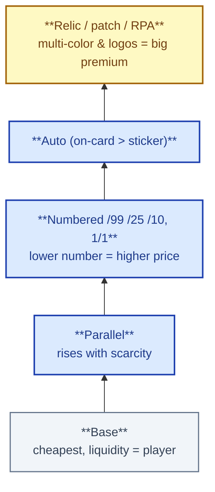

# 3. Sports Cards

> **Act I — The hobby · chapter 3 of 16.** The cards you can buy (1 of 3). The vocabulary and value logic of
> sports cards; the segment thinking the deep dive re-uses for Pokemon.

## 3.1 Vocabulary that drives price

The price ladder: from base card up to relic / RPA.

| Term | Meaning | Price impact |
|------|---------|--------------|
| RC (rookie card) | A player's first licensed card in a major set, marked with an RC logo in modern products | The single biggest premium for a player |
| Base | The standard card in a set | Cheapest. Liquidity depends on the player |
| Parallel | Same card with a different color or finish (Silver, Refractor, Gold, Black...) | Rises with scarcity. Common parallels add little |
| Serial numbered (/99, /25, /10, 1/1) | Card stamped with its print run | Lower number, higher price. 1/1 cards are unique and priced by the player |
| SP / SSP | Short print / super short print (unnumbered but scarce) | Hard to verify scarcity. Check odds on the sell sheet |
| Insert | Special subset card (Downtown, Kaboom, Color Blast...) | Case hits can be worth more than the parallels |
| Case hit | Roughly one per case of boxes | Built-in scarcity. Popular designs run five figures |
| Auto (on-card vs. sticker) | Autograph signed directly on the card, or on a sticker applied to it | On-card autos usually carry a premium |
| Relic / patch / RPA | Piece of game-worn or event-used material. RPA = rookie patch auto | Multi-color patches and logos command big premiums |
| Prospect / 1st Bowman | Baseball pre-rookie cards (Bowman Chrome 1st autos) | Speculative and swings on minor league performance |
| Prizm / Chrome / Optic | Chromium card-stock brands | Most graded and most liquid modern brands |

## 3.2 Hobby vs. retail vs. breaks

- Hobby boxes are sold through card shops and distributors. They are expensive,
  with guaranteed hits (autos and relics) and hobby-exclusive parallels.
- Retail product (blaster, hanger, mega, cello) is cheap with low odds, but has
  some retail-only parallels.
- A break is a live-streamed opening of whole cases. Buyers purchase spots (a
  team or a player) and receive the cards that come out for them.
  - Random team breaks are a lottery. Pick-your-team breaks are priced by
    demand.
  - Understand the breaker's margin: spot sales often total much more than the
    case price.
  - Only use breakers with a long public track record, published case
    sourcing and real shipping history.
- Expected value of opening: on average, opening sealed product loses money
  against buying the singles you want. Open for fun, buy singles to collect.

## 3.3 Who makes what (2026, check current status)

| League | Licence situation |
|--------|-------------------|
| MLB | Topps (owned by Fanatics since 2022) has the exclusive MLB and MLBPA licence. Bowman, Topps Chrome, Topps Series 1/2 and Update are the core products. Panini makes unlicensed baseball |
| NBA, NFL | Panini licences run out and move to Fanatics/Topps: NBA from late 2025, NFL from 2026, per public announcements. Expect a transition period with both brands in the market |
| NHL | Upper Deck (Young Guns are the key rookies) |
| Soccer | Topps (UEFA, MLS) and Panini (FIFA/World Cup stickers and cards, plus Prizm World Cup). Fanatics takes the FIFA licence from 2031 |
| F1, UFC, WWE, golf, tennis | Mostly Topps/Fanatics and Panini. Check the exact property |

Not verified here: exact dates of the NBA and NFL licence switch. Check current news before buying.

Why this matters: when a licence moves, the old manufacturer's last
licensed cards can rise or fall. New brands need years to build collector loyalty. Base
rookies from transition years are hard to value.

## 3.4 Valuing a modern sports card

The five inputs that drive a modern sports card's price.

```mermaid

flowchart LR
classDef act1 fill:#dbeafe,stroke:#1e40af,stroke-width:2px,color:#1e3a8a;
classDef act2 fill:#fee2e2,stroke:#b91c1c,stroke-width:2px,color:#7f1d1d;
classDef act3 fill:#dcfce7,stroke:#15803d,stroke-width:2px,color:#14532d;
classDef key fill:#fde68a,stroke:#b45309,stroke-width:2.5px,color:#78350f;
classDef risk fill:#fecaca,stroke:#991b1b,stroke-width:2px,color:#7f1d1d;
classDef verify fill:#bbf7d0,stroke:#15803d,stroke-width:2px,color:#14532d;
classDef unv fill:#fef3c7,stroke:#b45309,stroke-width:2px,stroke-dasharray:6 4,color:#78350f;
classDef money fill:#fef9c3,stroke:#a16207,stroke-width:2px,color:#713f12;
classDef flow fill:#f1f5f9,stroke:#64748b,stroke-width:1.5px,color:#334155;
classDef endg fill:#e2e8f0,stroke:#475569,stroke-width:2px,color:#1e293b;
  P["**Player**<br/>performance, age, HOF<br/>trajectory, injury"]:::act1 --> C
  C["**Card**<br/>rookie year, flagship brand,<br/>parallel scarcity, auto"]:::act1 --> G
  G["**Condition & grade**<br/>chrome centering/surface<br/>chips out of pack"]:::act1 --> POP
  POP["**Population**<br/>base rookies can have<br/>10,000s of PSA 10s"]:::act2 --> SEAS
  SEAS["**Season timing**<br/>peaks in-season/playoffs,<br/>softer in off-season"]:::act1 --> PRICE
  PRICE["**Landed price**"]:::money
```

1. Player: on-field performance, age, position and market (big-market teams
   and quarterbacks sell best), injury history, Hall of Fame trajectory.
2. Card: rookie year, flagship brand, parallel scarcity, auto quality.
3. Condition and grade: chrome cards often have centering, surface and edge
   chips straight out of the pack.
4. Population: base Prizm rookies of stars can have tens of thousands of PSA 10s.
   Numbered parallels have a hard cap.
5. Season timing: prices peak in season and in the playoffs, and soften in the off-season.
   Buying in the off-season is a common strategy.

## 3.5 Vintage sports buying notes

- Most of the value sits in Hall of Famer rookies (Mantle, Aaron, Clemente, Koufax,
  Jordan 1986 Fleer, Gretzky 1979 O-Pee-Chee, Brady 2000 Playoff Contenders auto).
- High grades are rare. Centering and print quality vary wildly in vintage, so an
  8 can be a premium card.
- Trimming and recoloring are common. Only buy expensive vintage in slabs
  from PSA or SGC, and check the cert.
- Eye appeal matters: a well-centered 6 can outsell an off-center 7.

## 3.6 Records for context (not for pricing)

- 1952 Topps Mickey Mantle #311, SGC 9.5: $12.6M (August 2022).
- 1952 Topps Mickey Mantle, PSA 9: $2.88M (2018).
- T206 Honus Wagner (the "Gretzky" copy): $451K (1991), $500K (1995), $1.27M (2000), $2.35M (2007).

Source: Wikipedia, checked October 2026. See `../reference/sources.md`.
