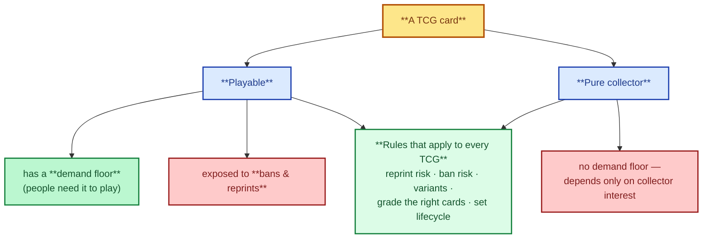
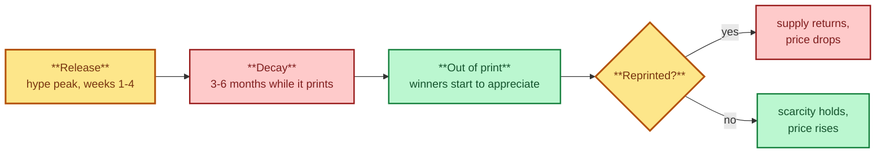

# 4. Collectible Card Games (TCGs)

> **Act I — The hobby · chapter 4 of 16.** The cards you can buy (2 of 3). The card games. This is where Pokemon
> lives; the deep dive assumes this vocabulary.

TCG cards have two kinds of demand: players need the card to play, and
collectors want it. A card that sees play gets a demand floor but is exposed to
bans and reprints. A pure collector card depends only on collector interest.

## 4.1 Comparison at a glance

Two kinds of TCG demand, and the rules that apply to every game.

| Game | Publisher | Launched | Collector focus | Main risks |
|------|-----------|----------|-----------------|------------|
| Pokemon TCG | The Pokemon Company (Wizards of the Coast in the US 1998-2003) | Japan Oct 1996, US 1998-99 | WOTC vintage (Base, Jungle, Fossil, Neo, e-Card), 1st Edition, shadowless, Japanese promos, modern alt arts and SIRs | Fakes, reseals, modern print waves, scalping-driven sealed spikes |
| Magic: The Gathering | Wizards of the Coast (Hasbro) | 1993 | Alpha, Beta and Unlimited. Power Nine. Reserved List cards. Serialized and Secret Lair cards. Old-border Legends and Arabian Nights | Reprints (except the Reserved List), very high fakes risk on Power cards, ban list |
| Yu-Gi-Oh! | Konami (Upper Deck in North America until 2009) | Japan 1999, NA 2002 | LOB and MRD 1st Edition, Ghost Rares, Starlight Rares, Quarter Century Secret Rares, tournament prize cards | Reprints, Asian vs. TCG print differences, counterfeit 1st Editions |
| One Piece Card Game | Bandai | Japan Jul 2022, global Dec 2022 | Manga rares, alt arts, Japanese special prints, early sets | Young game. Prices follow anime and manga hype and Bandai reprint policy |
| Disney Lorcana | Ravensburger with Disney | Aug 2023 | Enchanted rares, The First Chapter, promos | Young game with large print runs. A reprint can drop a set fast |
| Digimon Card Game | Bandai | 2020 (current version) | Alt arts, special rares, Japanese promos | Smaller market. Lower liquidity |
| Weiss Schwarz | Bushiroad | 2007-2008 | Signed SP cards, anime crossover sets, Japanese-only prints | Mostly a Japanese market. Thin overseas liquidity |

Dates and publishers checked against Wikipedia (October 2026). See `../reference/sources.md`.

## 4.2 Pokemon outside PSA 10 English vintage

- Japanese cards: often better print quality and centering, and frequently
  released before English. Japanese-exclusive promos (CoroCoro, tournament prizes,
  trophy cards) are some of the rarest Pokemon cards. Pikachu Illustrator (41
  copies, a 1997-98 CoroCoro illustration contest prize) is the top grail: Logan
  Paul paid $5.275M for the PSA 10 in 2021, and it sold for $16.5M in February 2026
  (Wikipedia).
- Modern chase cards: Special Illustration Rares, alt arts, gold and hyper
  rares, trainer gallery cards. Prices depend on the character (Charizard,
  Pikachu, Umbreon, Eeveelutions and Rayquaza lead) and on the artwork.
- Language premiums: English usually commands the highest price for WOTC vintage.
  Japanese leads for some promos and modern art cards. Korean, Chinese and European
  languages trade at a discount except for rare oddities.

## 4.3 Magic: The Gathering specifics

- Printings: Alpha (1993, black border, rounded corners), Beta (black border),
  Unlimited (white border), then Revised and later. Collector's Edition and
  International Edition have square corners and gold borders, are not
  tournament legal and are much cheaper.
- Power Nine: Black Lotus, Ancestral Recall, Time Walk, Timetwister and the five
  Moxen. About 22,800 Black Lotus were printed overall: about 1,100 Alpha and about 3,300 Beta
  (Wikipedia).
- Reserved List: Wizards' promise not to reprint certain cards from Alpha to
  Urza's Destiny (1994-1999). Supply of these is fixed. Prices on the list are
  sensitive to any hint of a policy change.
- Modern collectibles: serialized cards (since 2021), Secret Lair drops,
  Universes Beyond crossovers, foil and borderless variants. Many are produced
  in large numbers, so check the print run first.
- Grading: PSA, BGS and CGC are all active. For Alpha and Beta, always buy graded
  or authenticated. Check corner shape, the rosette print pattern under a loupe,
  and the light test (see `../act-3-the-solution/fakes-and-scams.md`).

## 4.4 Yu-Gi-Oh! specifics

- 1st Edition matters most for early sets (Legend of Blue Eyes White Dragon,
  Metal Raiders, Spell Ruler, Pharaoh's Servant). Check the "1st Edition" stamp and
  set code, and compare with known printings: EU, NA and Asian English variants
  differ in value.
- Rarity ladder (simplified): Common < Rare < Super < Ultra < Secret < Ultimate
  < Ghost < Starlight < Quarter Century Secret. Specific prize cards (tournament
  trophies, Tournament Black Luster Soldier) are one-off grails.
- Ghost Rares have been included in some sets since Tactical Evolution (2007).
- Asian English (OCG English) prints are a separate market. Don't confuse their
  comps with TCG prints.

## 4.5 Rules that apply to every TCG

The set lifecycle — and the reprint fork that decides the outcome.

1. Reprint risk: check the publisher's reprint policy. The Reserved List is the
   only formal no-reprint guarantee. Everything else can come back.
2. Ban and play risk: a playable card's price can fall overnight on a ban or
   a format shift.
3. Variants: 1st Edition, shadowless, stamps, borders, language and set code all
   change the price, so confirm every detail of the exact print before comparing comps.
4. Grade the right cards: modern bulk rares rarely justify grading fees.
   Vintage holos, alt arts and promos often do.
5. Set lifecycle: prices typically spike at release, fall during the print
   run, and rise after the set goes out of print. Supply returns if the set is
   reprinted.
