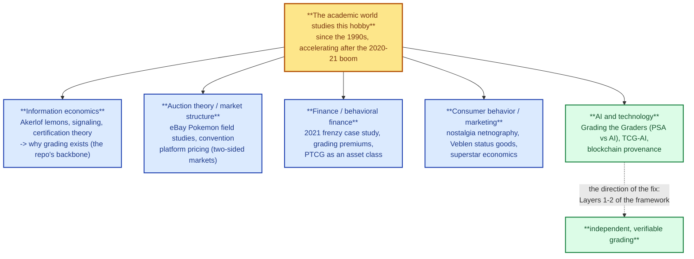

# What the research says — the hobby in the academic world

> **Act I — The hobby · chapter 7 of 17.** Does the academic world study this
> hobby? Yes — and it has since the 1990s, with a sharp acceleration after the
> 2020–21 boom. Five research communities now touch it, and what they found
> independently supports the backbone of this repo: grading exists to solve an
> information problem, the premium is real and measurable, and the 2020–21 boom
> behaved like a textbook asset bubble. All works below were located 2026-10-12
> via the OpenAlex, CrossRef and Semantic Scholar scholarly APIs; where a work
> is a preprint or working paper, that is said.

## The five research communities

The five communities, and what each contributes to this repo.

### 1. Information economics — why grading exists at all

This is the theoretical foundation of the entire repo, and it is also the
oldest strand of the literature:

- **Akerlof (1970), "The Market for Lemons"** — the foundational result: with
  information asymmetry, buyers assume the worst, good quality exits, and the
  market can collapse (QJE; Nobel Memorial Prize 2001, shared with Spence and
  Stiglitz "for their analyses of markets with asymmetric information"). A
  card you cannot inspect is a used car.
- **Signaling theory (Spence 1973)** — signals are credible only when they are
  *differentially costly*: cheap for the high-quality type to send, expensive to
  fake. A sealed tamper-evident slab with a published cert number is exactly
  such a signal; a seller's word is not (see `../act-3-the-solution/open-community-ai-grading.md`
  for the design that passes the credibility tests the seller's claim fails).
- **Quality signaling through certification** (2000/2003, 25–43 cites) and
  **Dranove & Jin (2010, NBER, "Quality Disclosure and Certification: Theory
  and Practice", 41 cites)** — the literature on why *third parties* certify:
  sellers don't voluntarily unravel to full disclosure, and "do certifiers
  necessarily report unbiased and accurate information?" is an open question the
  repo's Act II answers with the Consolidation conflict.
- **Jin, Kato & List (2006, NBER, "That's News to Me! Information Revelation in
  Professional Certification Markets")** — the founding academic study of the
  card-grading market itself, built on field experiments: the incumbent
  certifier's grade "offers new information to inexperienced traders but adds
  little information to experienced dealers" — certification measurably reduces
  the information asymmetry — and "new entrants adopt more precise signals and
  use finer grading cutoffs to differentiate from the incumbent." That sentence
  is the academic origin of BGS subgrades and the whole transparency
  argument.
- **Rare Coin Grading: A Case of Market-Based Regulation** (2014) — coin
  grading (PSA's direct ancestor) treated as a self-regulated market standard.
- **High Population Grade (HPG) Coins as a Distinctive Asset Segment** (2026,
  Zenodo) — high-population graded coins now trade as a separately classifiable
  asset segment: the population/pop dynamics this repo warns about are now
  formal market categories.

### 2. Auction theory and market structure

The hobby's marketplaces are a classic field laboratory:

- **Ward & Clark (2002), "Bidding Behavior in On-line Auctions: An Examination
  of the eBay Pokemon Card Market"** (IJEC, 50 cites) — the first field study
  of the Pokémon card market, on bidding strategy and revenue.
- **Katkar & Reiley (2001, NBER WP 8183, "Public Versus Secret Reserve Prices
  in eBay Auctions: Results from a Pokemon Field Experiment", 131 cites)** —
  Pokémon cards as the experimental subject for auction design.
- **Cawley, Interlandi & Rysman (2007), "Pennies from eBay: The Determinants of
  Price in Online Auctions"** (557 cites) — price determinants in eBay
  collectibles.
- **Jin & Rysman (2012, NBER, "Platform Pricing at Sports Card Conventions")** —
  card shows as two-sided markets: consumer pricing falls with competition,
  dealer pricing doesn't — the economics of the offline playbook chapter.

### 3. Finance and behavioral finance

The 2020–21 boom is now a studied event:

- **Zhang (2026), "The Frenzy in the Sports Card Market from the Perspective of
  Behavioral Finance"** — the frenzy case-studied on a PSA-graded Zion
  Williamson rookie: "the sports card market has gradually transformed from a
  traditional sports collectibles market into an alternative high-risk
  financial market," and the rational-agent model "struggles to offer a
  reasonable explanation."
- **Sharma (2026, SSRN), "Grading Premiums and Price Volatility in the Pokémon
  Card Secondary Market: A 2020–2022 Boom-Bust Case Study"** — the grading
  premium, measured.
- **"Pokémon Trading Card Game as an Alternative Investment Asset Class"**
  (2026, Zenodo) — quantitative price data 1996–2026; formalizes a "Triadic
  Value Framework" (scarcity, condition, popularity) for an industry it sizes
  at ~$9B.
- **Leow et al. (2026), "Economic Value Creation in the Pokémon Card Market"** —
  550 collectors surveyed; scarcity, trading behaviour and speculative
  investment drive price appreciation.

### 4. Consumer behaviour and marketing

Why do people collect? The literature says: nostalgia, identity, and status.

- **Sotelo Duarte (2022), "Collecting nostalgic pieces of plastic: the journey
  of toy collectors and the effects of nostalgia"** (Qualitative Market
  Research, 8 cites) — a netnography of 40,000+ comments from 9,028 users in a
  vintage-toy collecting community; nostalgia operates at three stages of the
  collecting journey.
- **Veblen goods / conspicuous consumption** — the classic economics concept:
  demand that rises with price because the asset is a status symbol and a
  positional good. Grail slabs behave this way (the "icon premium" in the
  playbook).
- **Gergaud & Verardi (2020, "Untalented but successful? Rosen and Adler
  superstar Pokemons", Empirical Economics)** — applies superstar-economics
  models to Pokémon cards: the "icon premium" as a measurable phenomenon.

### 5. AI and technology — where the field is heading

This is the fastest-growing strand, and it is aimed directly at Act II's
problem:

- **Krause (2026, SSRN), "Grading the Graders: A Comparative Analysis of
  AI-Driven and Human-Based Sports Card Authentication"** — compares an
  AI grading platform (Arena Club) against PSA across 24 sets: PSA grades a
  higher share of cards at 9.0+ (85.9% vs 81.0%), a statistically significant
  but practically small difference (Cohen's d ≈ 0.03) with *substantial
  category-level variation*. Subjectivity is real, measurable, and small on
  average but large in pockets — the empirical basis for Layer 2.3 (audited
  consistency).
- **TCG-AI (2026, Research Square)** and **"A Multistage Hybrid AI Framework
  for Explainable Automated Trading Card Grading" (2026)** — automated
  grading pipelines for TCGs and sport cards.
- **Shen & Wei (2025), "Business Model Innovation in the Trading Card Grading
  Industry"** — 30 interviews across PSA (US), CCIC (China) and SQC
  (Thailand): the incumbent leverages "scale and AI technology," challengers
  pursue legitimacy or digital (NFT-linked) co-creation.
- **Blockchain provenance in the closest mature market**: "Enhancing Diamond
  Grading and Certification Through Blockchain Technology" (2024) and "NFT
  Certificates and Proof of Delivery for Fine Jewelry and Gemstones" (2022) —
  the custody-chain idea this repo's Layer 2.5 proposes for cards already
  exists in diamonds and jewelry.

## What researchers found vs what this repo says

| Repo claim (where) | Academic support |
|---|---|
| The neutral grade is what makes cards liquid and comparable (Playbook §1) | Jin, Kato & List (2006): certification measurably reduces information asymmetry; Akerlof (1970) |
| The 9-to-10 cliff and grading premium are real (Playbook §7; problem ch. 2.3) | Sharma (2026) measures grading premiums in the Pokémon market; Lee, Caudill & Mixon (2014) measure grader-brand premiums over 169,483 diamond offers |
| Pop growth and scarcity drive price (Playbook §4, §7) | "PTCG as an Alternative Investment Asset Class" (2026) — Triadic Value Framework: scarcity, condition, popularity; HPG coins (2026) |
| The 2020–21 boom was a bubble with behavioural drivers (Market overview §1.4) | Zhang (2026); Sharma (2026) boom-bust case study |
| The tulip comparison: the mania ran on paper contracts, the macro damage was minor, and supply could not respond (ch. 8) | Goldgar (2007); Garber (1989); Thompson (2006); Kindleberger (1978); Adisurya (2026) — full source table in `is-this-tulip-mania.md` §6 |
| Cards and art are one private-value asset class, and the 2021 displacement was cross-collectibles (ch. 9) | Goetzmann, Spaenjers & Van Nieuwerburgh (2021, RFS); Higgs & Worthington (2005); Zakonnik et al. (2022, rare-books bubble); Campbell (2008); Ashenfelter & Graddy (2003) — full source table in `cards-and-the-art-market.md` §6 |
| Collectors are driven by nostalgia and status (documentary notes) | Sotelo Duarte (2022); Veblen-goods literature; Gergaud & Verardi (2020) |
| The grader's subjectivity is a real, measurable problem (Problem ch. 2.3) | Krause (2026): systematic differences across graders and categories |
| Card shows are a two-sided market (Playbook ch. 10) | Jin & Rysman (2012) |
| The fix is verification, not trust (Solution, Layers 1–2) | Quality signaling through certification (2000/2003); Dranove & Jin (2010); the AI/blockchain grading literature |

## Honest limitations

- The card-specific literature is **young**: the foundational works are from
  1994–2012, and most of the boom-era and grading-economics work is
  **2025–2026 preprints and working papers** (SSRN, Zenodo, Research Square)
  with few or no citations and not yet peer-reviewed.
- This chapter's location of the literature is via scholarly citation APIs
  (OpenAlex, CrossRef, Semantic Scholar) on 2026-10-12; abstracts are as
  published by the sources.
- The theoretical anchors (Akerlof, Spence, Veblen) are textbook-level
  consensus — the safest facts in this chapter.
- Where a repo claim has *no* academic support (the Consolidation conflict's
  market-participant side, the Deoxys incident), the repo still says so — see
  the unverified labels in `../act-2-the-problem/grading-conflict.md` §2.2.