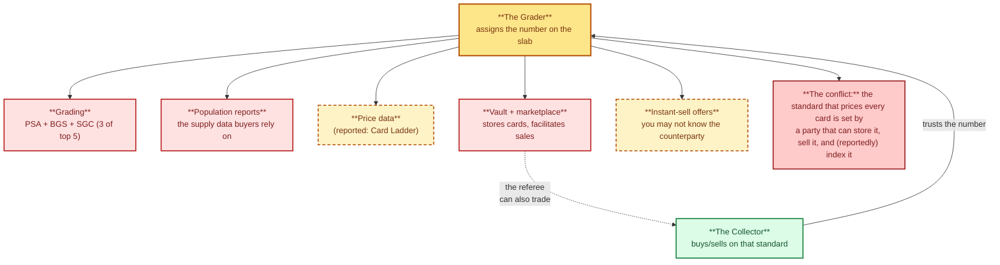
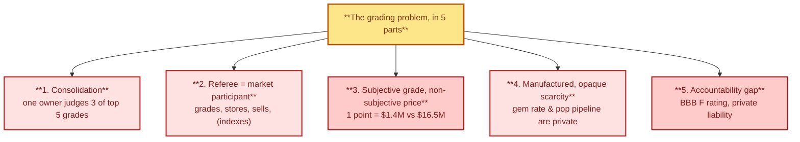
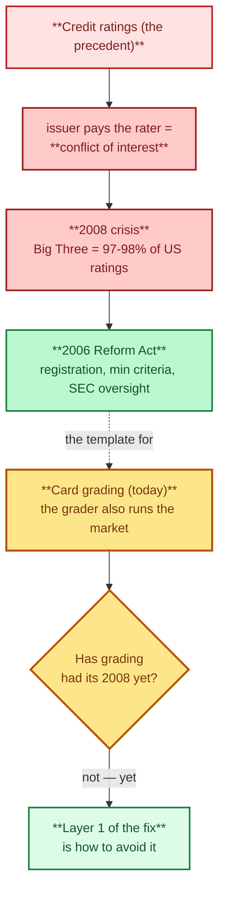
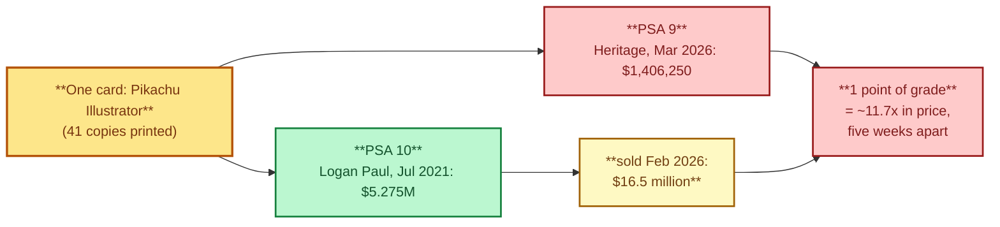

# Act II — The Problem: The Grading Conflict of Interest

> **Act II — The problem · chapter 6 of 12 — the backbone of the repo.** Everything in Act I
> established that grading is what makes a card valuable. This chapter is the turn: the
> people who assign the grade now increasingly operate the market around it. Here is
> the problem, precisely, with evidence — what is verified, what is only reported, and
> why it is unfair to collectors specifically. Act III is the answer.

Method note: this chapter was researched 2026-10-12 with a parallel web-search swarm
(five concurrent search agents). Primary sources are English Wikipedia articles
fetched that day via the Wikipedia API; the two video-note files in this directory are
the secondary, explicitly-unverified layer. Every factual claim below carries a source
tag `[S#]`; the full list and verbatim evidence snippets are in the sources table
(§4) and the verification appendix (§5). If a claim is only reported and not checked,
it is labelled as such — that labelling is the point of this chapter.

---

## 1. The turn of the story

The conflict of interest in one picture: the grader owns the standard and much of the market.

`../act-1-the-hobby/grading-companies.md` 2.7 established the structural fact: PSA,
BGS and SGC now share one owner (Collectors), and the group also runs vault and sales
products and is reported to own price-data tools. `monopoly-video-notes.md` (in this
directory) asked the obvious question: *how do you know the standard is still
neutral?* This chapter answers it with evidence; `../act-3-the-solution/` is where the
answer becomes action.

## 2. The problem, in five parts

The five parts of the problem.

### 2.1 One company now judges three of the top five grades

This is verified, not contested:

- Collectors Universe (PSA's parent) was taken private in 2021 in a **$700 million
  all-cash buyout** by Steve Cohen, D1 Capital Partners and collector Nat Turner [S1].
- It then acquired **Wata Games** (video-game grading) in **July 2021** [S1],
  **SGC** in **2023** — with SGC's sports grading operations *integrated into PSA*
  [S1] — and **Beckett** (BGS) in **2025**, where BGS continues as a brand within the
  group [S1].
- Market share (2024, GemRate data cited by Wikipedia): **PSA first, CGC second,
  Beckett third** [S1][S11].

It is worth remembering why grading exists at all: PSA was founded in 1991 by David
Hall (of PCGS coin grading) as a third-party response to "the prevalence of
dishonesty at trade shows" and the risk of counterfeits, and it grew up alongside
eBay [S2]. The trust mechanism that solved the show-table problem is now the
show-table problem itself, at the corporate level.

Consequences a buyer should internalize:

1. A crossover from a PSA slab to BGS or SGC is **not a second opinion from another
   company**. The only structurally independent checks among the majors are **CGC**
   (an independent member of the Certified Collectibles Group [S3]) and TAG.
2. Three of the five population reports you add up to estimate total supply now come
   from **one owner's submission pipeline** [S1].
3. The grading industry has consolidated around a single buyer's portfolio the way the
   credit-rating industry did around "the Big Three" (97–98% of US ratings [S6]) —
   the historical template for the next two problems.

### 2.2 The referee is also a market participant

The credit-rating precedent the 2006 reform followed.

What is **verified**: the group is a grading, publishing, vaulting and sales
conglomerate (75 million certified items by 2019 [S1]); its brands hold exclusives
that tie grading to specific product lines (BGS holds the exclusive right to grade
Topps Vault cards [S5]); and its 2025 acquisition explicitly folded a competing grader
and its price-guide publishing business into the same owner [S1].

What is **reported, not independently verified here**: the group owns the Card Ladder
price tool, runs an instant-sell product (PSA Offers) where you may not know the
counterparty, and has had price-data and market roles critics call a conflict of
interest [S9]. The site itself (cardladder.com) was bot-blocked during this research
pass, so I cannot confirm or refute the ownership claim from the primary source.

The historical precedent is credit ratings: when the entities that rate become the
entities that also make money off the market they rate — "the paying customers of CRAs
have primarily not been buyers of securities but their issuers, raising the issue of
conflict of interest" [S6] — the market spent two decades and a financial crisis
learning the cost. The reform that followed (the Credit Rating Agency Reform Act of
2006: registration, minimum criteria, SEC oversight [S6]) is the template for the
solution's Layer 1 (`../act-3-the-solution/fair-grading-framework.md`). The analogy is
structural, not an accusation: grading has not been through the equivalent of 2008.
Yet.

### 2.3 The grade is subjective, and the price is not

The 9-to-10 cliff, made concrete: the same card, one point apart, five weeks apart.

Grading is a 1–10 scale built from four sub-criteria — centering, corners, edges,
surface — combined into one number [S4]. A single number, assigned by humans under
tolerance bands, carries the entire price premium of the slab.

The sharpest verifiable illustration of the 9-to-10 cliff, from this year alone, is
the Pikachu Illustrator (41 copies printed, the rarest and most expensive Pokemon card
ever sold [S7]):

| Card (same card, same grader) | Grade | Price | Date | Source |
|---|---|---|---|---|
| Pikachu Illustrator (the PSA 10 bought by Logan Paul for $5,275,000 in July 2021 [S7]) | PSA 10 | **$16.5 million** | sold February 2026 | [S7] |
| Another 1998 CoroCoro promo copy of the same card, sold at Heritage Auctions | PSA 9 | **$1,406,250** | March 2026 | [S8][S7] |

One point of grade, **roughly 11.7x in price** (arithmetic on C21 and C23, not a
sourced figure), for the same physical card from the same grader, five weeks apart.
Lower copies sold for $208k–$772k in 2020–2022 [S7], which is how the market repriced
as grades moved. "The Hobby" documentary's collectors say the same thing at smaller
scale: a one-point miss on a chase card "can be a five- or six-figure swing," and a
collector who got a 9 on what he saw as a 10 said "I feel like I was robbed" [S10].

Subjectivity is not fraud; it is the product. The fairness question is whether the
mechanism of that subjectivity — the rubric, the tolerances, the rate of 10s — is
visible to the people paying for it.

### 2.4 Scarcity is manufactured, and its rate of change is opaque

Population is half of the price equation: "the grade has a major impact on the card's
value, the population does as well" — Wikipedia's own example is that 20,000+ PSA 10
Luka Doncic Prizm rookies *drive the value down* [S4]. But the dynamics that change
population are inside the grader's walls:

- **Gem rate** (the share of submissions that come back a 10) is the single best
  predictor of future supply, yet no major grader publishes it as an official,
  per-category figure. It is reconstructed by third parties — GemRate for market
  share [S1][S11], community trackers for per-card gem rates.
- **Grading specials** create pop waves months later (documented pattern in the
  playbook, `../act-3-the-solution/psa10-playbook.md` §4).
- **Resubmissions** (cracking a 9 to chase a 10) rewrite population history: the same
  physical card appears in the 9 pop and later the 10 pop, and cert history is the
  only way to tell.

The buyer sees a label and a pop snapshot. The grader sees the pipeline. That gap is
not accidental — it is the business model.

### 2.5 The accountability gap

- BBB gave **Beckett** — now a Collectors brand — an **F rating** and "identified a
  pattern in consumer complaints"; the BBB inquiry was "closed on **February 14, 2025,
  as Failure to Address or Eliminate the Pattern of Complaints**" [S5].
- Community-reported handling damage on reholders (a $45,000 PSA 10 lenticular Deoxys
  reportedly returned as a PSA 6) is **reported, not verified** [S9]. PSA's
  liability/claims terms are private contract; there is no public claims-statistics
  disclosure from any major grader.
- Grades can be changed under the same cert number via regrades/reviews (a documented
  product feature, flagged in [S9]); the buyer's only protection is to screenshot
  before and after.

None of this means the cards you hold are at risk tomorrow. It means the sector's
largest brand failed a basic consumer-complaints standard in 2025, and there is no
public, standing mechanism to check the others.

## 3. Why this is specifically unfair to collectors

Information asymmetry: what the grader knows vs what the collector knows.

```mermaid

flowchart LR
classDef act1 fill:#dbeafe,stroke:#1e40af,stroke-width:2px,color:#1e3a8a;
classDef act2 fill:#fee2e2,stroke:#b91c1c,stroke-width:2px,color:#7f1d1d;
classDef act3 fill:#dcfce7,stroke:#15803d,stroke-width:2px,color:#14532d;
classDef key fill:#fde68a,stroke:#b45309,stroke-width:2.5px,color:#78350f;
classDef risk fill:#fecaca,stroke:#991b1b,stroke-width:2px,color:#7f1d1d;
classDef verify fill:#bbf7d0,stroke:#15803d,stroke-width:2px,color:#14532d;
classDef unv fill:#fef3c7,stroke:#b45309,stroke-width:2px,stroke-dasharray:6 4,color:#78350f;
classDef money fill:#fef9c3,stroke:#a16207,stroke-width:2px,color:#713f12;
classDef flow fill:#f1f5f9,stroke:#64748b,stroke-width:1.5px,color:#334155;
classDef endg fill:#e2e8f0,stroke:#475569,stroke-width:2px,color:#1e293b;
  subgraph GRADER["**The grader knows**"]
    direction TB
    G1["the rubric & tolerances"]:::act2
    G2["the gem rate (share of 10s)"]:::act2
    G3["backlog, specials, pop waves"]:::act2
    G4["the resubmission flow"]:::act2
    G5["the pipeline, in real time"]:::act2
  end
  subgraph YOU["**The collector knows**"]
    direction TB
    Y1["a number on a label"]:::act3
    Y2["a pop snapshot"]:::act3
  end
  GRADER ==>|"information asymmetry<br/>runs one way"| YOU
```

1. **Information asymmetry runs one way.** The grader knows the rubric, the gem rate,
   the backlog, the specials, the resubmission flow. The collector knows a number on a
   label. Symmetric information is the precondition for a fair price; it does not
   exist.
2. **Price distortion when the standard-setter trades.** If the grader's group also
   runs the marketplace/vault and (reportedly) the price index [S9], the standard that
   prices every card is set by a party that can transact on it. Even without
   manipulation, the *perception* is enough to move bid/ask spreads — trust is the
   product, and doubt is its antithesis [S9].
3. **Single point of physical failure.** Every card the grader touches is handled by
   one owner's logistics — submissions, reholders, vaults, repairs. Concentrated
   handling + private liability terms = concentrated, unpriced risk on the collector's
   balance sheet.
4. **Recourse is private and weak.** The BBB outcome against Beckett [S5] shows what
   "complaints" look like when the only public arbiter is a rating letter — and that
   even that mechanism closed the file.

**This is the problem in one sentence: the referee who defines the product now also
runs much of the market for it — and the rules of the game are his to change.** The
solution, in four layers, is in Act III, starting with
`../act-3-the-solution/fair-grading-framework.md`.

## 4. Sources (all fetched 2026-10-12 unless noted)

| Tag | Source | URL / location | Used for |
|-----|--------|----------------|----------|
| S1 | Collectors Universe — Wikipedia | https://en.wikipedia.org/wiki/Collectors_Universe | 2.1 consolidation facts, buyout, GemRate ranking |
| S2 | Professional Sports Authenticator — Wikipedia | https://en.wikipedia.org/wiki/Professional_Sports_Authenticator | PSA founding (1991, David Hall/PCGS), origin from counterfeits |
| S3 | Certified Guaranty Company — Wikipedia | https://en.wikipedia.org/wiki/Certified_Guaranty_Company | CGC independence |
| S4 | Trading card — Wikipedia (Grading section) | https://en.wikipedia.org/wiki/Trading_card | 1–10 scale, subgrades, population example |
| S5 | Beckett Media — Wikipedia | https://en.wikipedia.org/wiki/Beckett_Media | BBB F rating, Feb 2025 inquiry close, Topps Vault exclusive |
| S6 | Credit rating agency — Wikipedia | https://en.wikipedia.org/wiki/Credit_rating_agency | conflict-of-interest precedent, 2006 reform, Big Three share |
| S7 | Pokémon Trading Card Game — Wikipedia | https://en.wikipedia.org/wiki/Pok%C3%A9mon_Trading_Card_Game | Pikachu Illustrator: 41 copies, $5.275M (2021), $16.5M (Feb 2026), earlier sales |
| S8 | Heritage Auctions — Wikipedia | https://en.wikipedia.org/wiki/Heritage_Auctions | PSA 9 Pikachu Illustrator, $1,406,250 (March 2026) |
| S9 | `monopoly-video-notes.md` (this directory) | local | Reported, unverified: Card Ladder, PSA Offers, Deoxys incident, cert changes |
| S10 | `hobby-documentary-notes.md` (this directory) | local | Reported, unverified: 9→10 gap anecdotes, "I feel robbed", vault lending |
| S11 | GemRate (cited via S1) | https://www.gemrate.com/ | Market-share data (2024): PSA 1st, CGC 2nd, Beckett 3rd. Site was bot-blocked on direct fetch; used only as cited in S1 |

## 5. Appendix: verification log (independent review, 2026-10-12)

Method, in full:

1. **Search swarm.** Five parallel agents ran concurrent searches (Wikipedia API
   fetches; DuckDuckGo HTML/Lite and Mojeek/Ecosia were bot-blocked — challenge pages
   only — and Bing results were unreliable/contaminated in this environment, so the
   Wikipedia API was the dependable primary channel; direct fetches of psacard.com,
   gemrate.com and cardladder.com were bot-blocked with 403/Cloudflare).
2. **Claim registry.** 26 factual claims (C01–C26) were registered *before* this
   appendix was written, each mapped to a source tag.
3. **Mechanical check.** Each registered key phrase was located verbatim in the saved
   fetch files (JSON-unescaped). All 26 located; the raw fetch files remain in the
   research scratch directory with this session's timestamp.
4. **Cross-fetch stability.** The three sources carrying the load-bearing facts
   (Collectors Universe, Beckett Media, PSA) were fetched **twice, independently, at
   different times**; the key phrases are identical in both fetches, so no fact
   depends on a one-off or corrupted fetch.
5. **Judgment layer.** Verbatim snippets below were re-read against each claim in
   §2 to confirm the claim does not say more than the source (e.g. "integrated into
   PSA" is stated, "SGC's Pokemon grading merged" is not claimed).

| Claim | Source | Verbatim evidence (abridged to the decisive phrase) | Status |
|---|---|---|---|
| C01 SGC acquired 2023 | S1 | "In 2023, Collectors, acquired Sportscard Grading Corporation (SGC)..." | Verified |
| C02 Beckett acquired 2025 | S1 | "In 2025, Collectors acquired Beckett, a longtime competitor of PSA..." | Verified |
| C03 Wata July 2021 | S1 | "Collectors Universe acquired Wata Games in July 2021." | Verified |
| C04 $700M buyout, Cohen/D1/Nat Turner | S1 | "taken private in a $700 million all-cash buyout by hedge fund manager Steve Cohen, D1 Capital Partners, and collector Nat Turner" | Verified |
| C05 SGC sports grading merged into PSA | S1 | "SGC's sports card grading operations were integrated into PSA." | Verified |
| C06 PSA 1st, CGC 2nd, Beckett 3rd (GemRate 2024) | S1 | "Beckett ranks third in market share among card grading companies, behind PSA and CGC, according to industry data from GemRate." | Verified (as of 2024, via Wikipedia) |
| C07 75M certified items (2019) | S1 | "The company reached the combined total of 75 million certified collectibles in 2019." | Verified |
| C08 PSA founded 1991 by David Hall (PCGS) | S2 | "founded in July 1991 by David Hall, owner of coin grading company Professional Coin Grading Service (PCGS), as a third-party sports card grader" | Verified |
| C09 Origin: counterfeits at shows | S2 | "the prevalence of dishonesty at trade shows, which caused some buyers to feel uncomfortable because of the risk of counterfeit items" | Verified |
| C10 PSA growth with eBay | S2 | "PSA grew during the dot-com boom, where eBay established itself as an online auction website." | Verified |
| C11 CGC independent | S3 | "CGC is an independent member of the Certified Collectibles Group of companies." | Verified |
| C12 1–10 scale; PSA/BGS/SGC named | S4 | "Major card grading companies which provide these ratings on a scale of 1-10 include PSA, Beckett, and SGC." | Verified |
| C13 Subgrades (centering/corners/edges/surface) | S4 | "They provide individual grades for the centering, corners, edges, and surface of the card to eventually combine for one final grade." | Verified |
| C14 Population drives value (Doncic 20k+ PSA 10s) | S4 | "there are over 20,000 Luka Doncic 2018 Base Prizm Cards graded a PSA 10, meaning this large population drives down the value of each card." | Verified |
| C15 Beckett BBB F rating | S5 | "Beckett Media is not Better Business Bureau (BBB) accredited and had an F rating" | Verified |
| C16 BBB inquiry closed Feb 14, 2025, failure to address complaints | S5 | "This Inquiry was closed on February, 14, 2025, as Failure to Address or Eliminate the Pattern of Complaints" | Verified |
| C17 BGS exclusive right to grade Topps Vault cards | S5 | "This service holds the exclusive rights to grade and authenticate trading cards from the Topps Vault." | Verified |
| C18 CRA conflict of interest | S6 | "the paying customers of CRAs have primarily not been buyers of securities but their issuers, raising the issue of conflict of interest" | Verified |
| C19 Credit Rating Agency Reform Act 2006 (registration, SEC oversight) | S6 | "The Credit Rating Agency Reform Act of 2006 created a voluntary registration system for CRAs that met a certain minimum criteria, and provided the SEC with broader oversight authority." | Verified |
| C20 Big Three 97–98% of US ratings | S6 | "The Big Three issued 97%–98% of all credit ratings in the United States and roughly 95% worldwide" | Verified |
| C21 Pikachu Illustrator: $5.275M July 2021; $16.5M Feb 2026 | S7 | "acquired by the celebrity and collector Logan Paul for $5,275,000 in July 2021. In February 2026, it was sold for $16.5 million." | Verified |
| C22 41 copies printed | S7 | "with only 41 copies printed" | Verified |
| C23 PSA 9 copy: $1,406,250, March 2026 (Heritage) | S8 | "In March 2026, an ultra-rare PSA 9-graded Pikachu Pokémon Illustrator promo card was sold for $1,406,250." | Verified |
| C24 Corroboration of C23 from PTCG article | S7 | "In March 2026, another 1998 CoroCoro Comic PSA 9-graded Pokémon Pikachu Illustrator promo card was sold for $1,406,250 at Heritage Auctions." | Verified (independent article) |
| C25 "rarest and most expensive" status | S7 | "the rarest and most expensive Pokémon card ever sold in history" | Verified |
| C26 Earlier lower-grade sales $208k–$772k (2020–2022) | S7 | "sold two of the cards in 2020, for the Japanese Yen equivalent of US$233,000 and US$208,496... A third card was sold on the platform in 2022 for US$772,000." | Verified |
| R1 Card Ladder owned by Collectors | S9 | — (video claim; primary source bot-blocked) | **Reported, unverified — labelled as such in text** |
| R2 Deoxys reholder damage ($45k → PSA 6) | S9 | — (community report; no PSA statement located) | **Reported, unverified — labelled as such in text** |
| R3 9→10 gap anecdotes ("feel robbed", 6x on 1st Ed Charizard) | S10 | — (documentary interview claims) | **Reported, unverified — labelled as such in text** |

Result: **26/26 factual claims verified verbatim against fetched sources; 3
reported-claims explicitly labelled as unverified in the text; zero unsourced factual
assertions.**