# Notes: "The Hidden Monopoly Controlling Card Prices..." (FOLLOWTHEMONEY)

> **Act II — The problem · chapter 7 of 12 (eyewitness evidence 2 of 2).** The PSA/Collectors conflict-of-interest
> case: reholder risk, upcharges, and why your price checks must come from outside the
> group. Read this before the deep dive — it is *why* several guide rules exist.

- Source: https://www.youtube.com/watch?v=auEzxrJyNBE (FOLLOWTHEMONEY, 9:42,
  uploaded 2026-04-13)
- Method: notes taken from the video's auto-generated English captions, not
  from watching the footage. Timestamps are approximate (m:ss).
- Nature of the video: an opinion and commentary piece. It argues that PSA's
  parent company has a conflict of interest. It mixes facts that can be checked,
  incidents that circulated in the community, and the narrator's interpretation.
  Each claim below is labelled as one of these:
  - **Checked:** confirmed against Wikipedia on 2026-10-12. See
    `../reference/sources.md`.
  - **Claim:** stated in the video and not verified here.
  - **Opinion:** the narrator's argument.
- Why it matters to this repo: nearly everything here assumes the number on a PSA
  label is neutral. This video questions that assumption. You don't have to
  accept its conclusion to take its practical warnings seriously.

## 1. What the video says

| Time | Point | Status |
|------|-------|--------|
| 0:00-0:30 | One number on a slab can turn a $50 card into a $5,000 card, and most of those numbers come from one company. | Opinion, framed around a real fact (PSA's market share) |
| 0:30-1:00 | The grader now also tracks prices, stores cards (vault), facilitates sales and can help buy them. The grader is inside the market it judges. | Claim. The structure is broadly consistent with Collectors' acquisitions (see section 2) |
| 1:00-1:30 | Recent "PSA drama": grading altered cards, 9s turned into 10s under the same cert number, and class-action lawsuits. | Claim. Not verified here. No case names or court filings are given |
| 2:00-2:30 | Grading turned cards from opinions into standardised, comparable, liquid assets. The system rests on trust. | Opinion. It matches this repo's own framing (guide section 1) |
| 2:30 | PSA started in 1991 and is the largest third-party grading service. | Checked |
| 2:30-3:00 | By 2025, PSA graded 19 million cards in a single year, a 72% share, and its parent company is valued at over $4 billion. | Claim (figures not verified) |
| 3:00-3:30 | PSA's parent company, Collectors, owns BGS and SGC as well as PSA, giving it about 80% of grading. | Ownership checked. Collectors bought SGC in 2023 and Beckett in 2025. The 80% share is a claim. Wikipedia (citing GemRate, 2024) ranks CGC second, which the 80% framing leaves out |
| 3:30-4:00 | Collectors also owns Card Ladder (price data) and Wata Games (video-game grading). | Wata (2021) checked. Card Ladder is a claim, not on Wikipedia |
| 4:00 | "Grade, data, platform, all connected." The real product is the standard, and whoever controls it shapes prices. | Opinion |
| 4:30-5:30 | A collector sent a 2004 Japanese lenticular Deoxys, already PSA 10 and valued at about $45,000, in for a reholder only (a new case, no regrade). It came back as a PSA 6, about 90% less value, because the card was reportedly damaged in handling. | Claim (community-reported incident) |
| 5:30 | At the same time, the same card was reportedly listed at about $45,000 on PSA's own platform (the last sale came from the PSA vault). The compensation offer reportedly required a confidentiality agreement. | Claim |
| 6:00 | PSA Offers lets you sell a card before it comes back from grading, but you don't know who the buyer is. | Claim about how the product works. The concern about the buyer is opinion |
| 6:30-7:00 | Prices keep rising: $5 increases on several tiers, described as the fourth increase in about 14 months. | Claim. Check PSA's current price list |
| 7:00-7:30 | Every tier has a value cap. If the card grades higher than expected and its value goes over the cap, PSA moves it to a higher tier and charges again (an "upcharge"). | Claim, consistent with how declared-value tiers work. Check the current terms |
| 7:30-8:00 | Waits of 4-5 months or longer. Collectors pay more, wait longer and carry more risk. | Claim. Turnaround varies by tier |
| 8:00-8:30 | Graders know which cards are rare and which grades are about to spike before collectors do. That is an information asymmetry. | Opinion. The data access itself is real: pop data is collected at grading time |
| 8:30-9:00 | Comparison with the credit rating agencies in 2008: when the referee also plays, nothing needs to be proven for trust to erode. Doubt is enough. | Opinion |
| 9:00-9:42 | "PSA didn't break the market, it built it." How do you know the standard is still neutral? | Opinion |

## 2. Ownership, checked

The consolidation timeline, checked against Wikipedia (2026-10-12).

```mermaid

flowchart LR
classDef act1 fill:#dbeafe,stroke:#1e40af,stroke-width:2px,color:#1e3a8a;
classDef act2 fill:#fee2e2,stroke:#b91c1c,stroke-width:2px,color:#7f1d1d;
classDef act3 fill:#dcfce7,stroke:#15803d,stroke-width:2px,color:#14532d;
classDef key fill:#fde68a,stroke:#b45309,stroke-width:2.5px,color:#78350f;
classDef risk fill:#fecaca,stroke:#991b1b,stroke-width:2px,color:#7f1d1d;
classDef verify fill:#bbf7d0,stroke:#15803d,stroke-width:2px,color:#14532d;
classDef unv fill:#fef3c7,stroke:#b45309,stroke-width:2px,stroke-dasharray:6 4,color:#78350f;
classDef money fill:#fef9c3,stroke:#a16207,stroke-width:2px,color:#713f12;
classDef flow fill:#f1f5f9,stroke:#64748b,stroke-width:1.5px,color:#334155;
classDef endg fill:#e2e8f0,stroke:#475569,stroke-width:2px,color:#1e293b;
  T21["**2021**<br/>taken private<br/>$700M (Cohen, D1, Nat Turner)"]:::act2
  T21W["**2021**<br/>acquires Wata Games<br/>(video games)"]:::act2
  T23["**2023**<br/>acquires SGC<br/>sports merged into PSA"]:::act2
  T25["**2025**<br/>acquires Beckett (BGS)<br/>keeps the brand"]:::act2
  T21 --> T21W --> T23 --> T25
  T25 --> R["**Result: 3 of the top 5<br/>grading brands under one owner**"]:::risk
```

From the Wikipedia article on Collectors Universe, fetched 2026-10-12:

- **2021:** Collectors Universe (PSA's parent) is taken private by Steve Cohen,
  D1 Capital Partners and Nat Turner. It acquires Wata Games in July.
- **2023:** It acquires SGC. Wikipedia says SGC's sports-card grading was then
  merged into PSA.
- **2025:** It acquires Beckett. BGS continues as a separate brand inside the
  group.
- As of 2024, Wikipedia (citing GemRate) ranks Beckett third in grading market
  share, behind PSA and CGC.

What follows: of the five graders in `../act-1-the-hobby/grading-companies.md`,
three (PSA, BGS, SGC) now have the same owner. CGC and TAG are the independent
alternatives.

## 3. What this changes for a PSA 10 Pokemon buyer

1. **Don't assume a reholder is risk-free.** A reholder still means the card
   leaves your hands, gets handled and shipped twice. Insure it at full value
   both ways. Photograph the slab front, back and edges in high resolution just
   before shipping. Keep the photos with your tracker entry. Read the grader's
   liability and claims terms before sending anything worth five figures. Guide
   sections 3 and 5 now say this.
2. **Budget for upcharges.** Declare a realistic value, not a hopeful low one. If
   a card grades well and its value goes over the tier cap, you will be billed
   the difference. Guide section 5 and section 6 now include this.
3. **Use price data from several sources.** Card Ladder and PSA's Auction Prices
   Realized come from the same corporate group as the grade. Check them against
   eBay sold listings, 130point, PriceCharting and auction-house archives. Your
   own tracker log is fully independent.
4. **Graded supply is more concentrated than the brand names suggest.** Pop
   reports from PSA, BGS and SGC now come from one owner. Treat CGC as the
   independent check when you estimate total graded supply.
5. **Vault and instant-sale products.** When the grader also runs the vault and
   the marketplace, compare its price with the open market before you accept.
   You may not know who the counterparty is.
6. **Keep the cert history.** The video says grades have been changed under the
   same cert number. Screenshot the cert page when you buy. Re-check it before
   you sell, and if anything has changed, ask why before you list.

None of this means PSA 10 stops being the liquidity standard for Pokemon. It
still sells for the highest prices (guide section 1). The practical response is
to document more, diversify your price data and insure fully, not to drop the
grader.

## 4. Links into the rest of the repo

- `../act-3-the-solution/psa10-playbook.md`:
  - section 3 (reholder risk)
  - section 5 (upcharges)
  - section 8 (independent price data)
  - section 9 (vault platforms)
- `../act-1-the-hobby/grading-companies.md` section 2.7: who owns which grader
- `../act-1-the-hobby/market-overview.md`:
  - the 2021-2025 row (consolidation)
  - section 1.2 (structure)
- `../act-3-the-solution/valuation-and-selling.md` section 7.1: independence of comps
- `../reference/sources.md`: Collectors Universe article and this video
