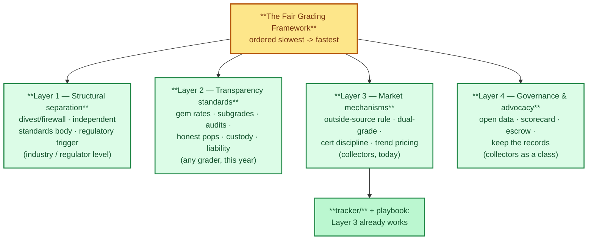
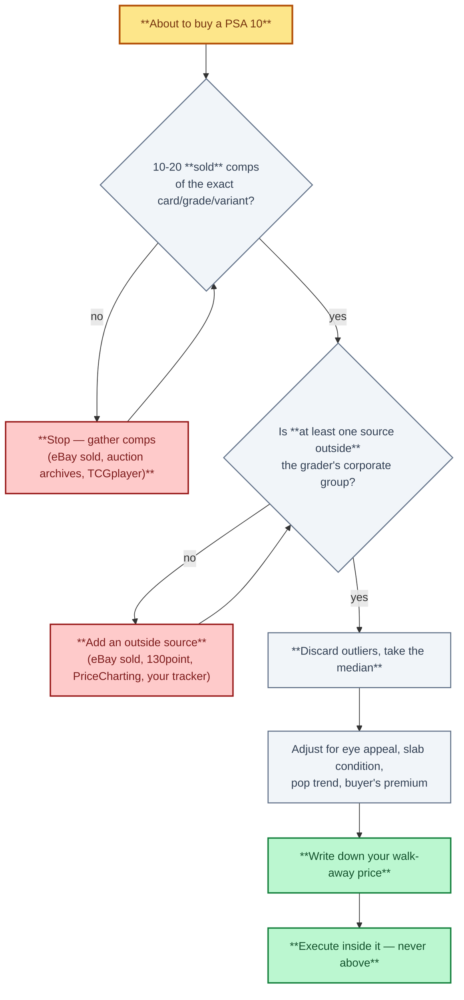
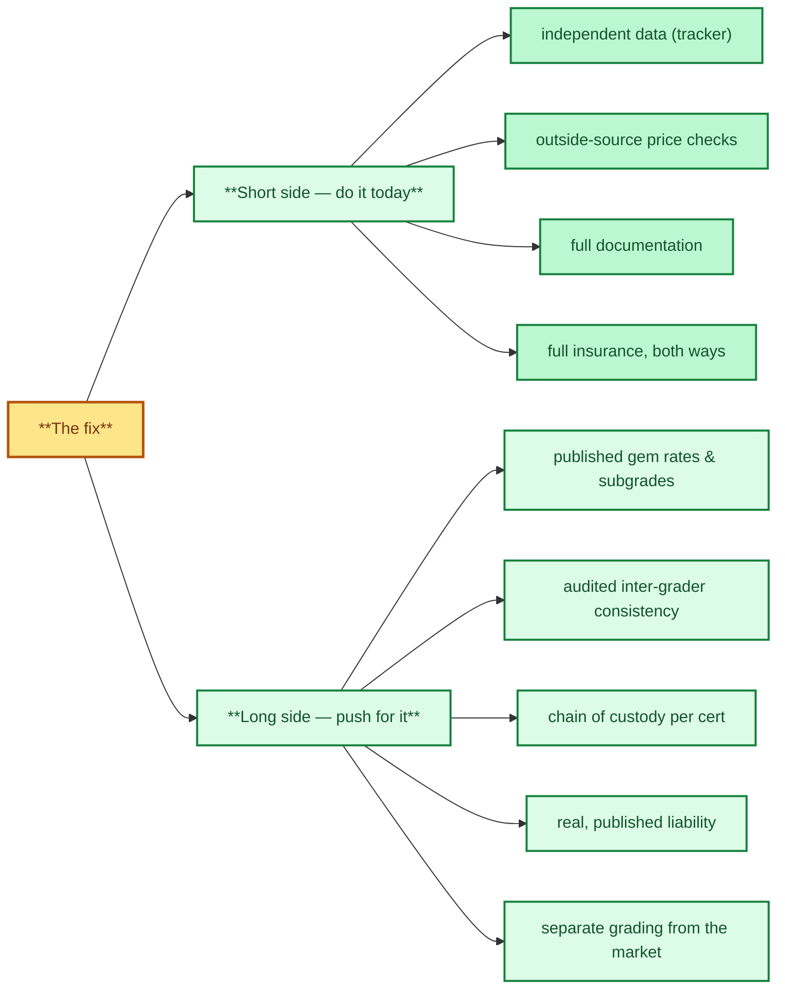

# Act III — The Solution: The Fair Grading Framework

> **Act III — The solution · chapter 10 of 14 — the backbone of the repo.** Act II defined the
> problem: the referee who defines the product now also runs much of the market for
> it. This chapter is the fix, in four layers ordered from slowest to fastest to
> implement — structural separation (the long game), transparency standards (any grader
> can adopt this year), market mechanisms you can use **today**, and governance of
> collectors as a class. The remaining chapters of Act III are the practical chapters:
> how to price and sell in this market, how to avoid the fakes, the full PSA 10
> playbook that puts every rule together per purchase, and — in `open-community-ai-grading.md` —
> the missing middle: a community-owned, open-source AI grading system.

Facts referenced here are sourced in `../act-2-the-problem/grading-conflict.md`
(§4 sources, §5 verification log) and cited by the same `[S#]` tags. **Proposals in
this chapter are mine; the facts are sourced.** Each measure says what it is, why it
is fair to collectors, and how feasible it is.

---

## Layer 1 — Structural separation (the long game; industry/regulator level)

The four layers of the fix, ordered slowest to fastest to implement.

| # | Measure | Why it's fair to collectors | Feasibility |
|---|---------|------------------------------|-------------|
| 1.1 | **Divest or firewall**: the grading entity should not own the marketplace, the vault/instant-sell program, or a price-data tool used as a market benchmark. If ownership stays, a legal information barrier with **annual independent audit** of the barrier. | Removes the referee-in-the-market structure (Act II §2.2) entirely; the 2006 credit-rating reform shows registration + oversight is a workable template [S6]. | Low today (needs divestment or law), but this is the only layer that fixes the problem at the root |
| 1.2 | **Independent standards body**: a consortium (graders, marketplaces, collectors, insurers) that owns the *grading standard* — rubric, tolerance bands, subgrade schema — and accredits grading labs against it, the way testing labs are accredited to ISO standards. The standard is public; the brands compete under it. | No single owner can quietly move the goalposts (tolerances, gem rate, label meanings) without the change being visible and contestable. | Medium: needs industry buy-in; CGC's independence [S3] shows a neutral standard is credible |
| 1.3 | **Regulatory trigger**: if one owner holds three of five major brands *and* marketplaces, document and bring the structure to consumer-protection and antitrust authorities (US: FTC/DOJ; EU: digital-market rules where applicable). This is a recommendation to *use existing channels*, not a prediction. | Collectors individually have no market power against a consolidated owner; organized documentation does. | Medium: depends on evidence accumulation (this repo's tracker is useful here) |

## Layer 2 — Transparency standards (any grader can adopt this year; the core of the fix)

| # | Measure | Why it's fair to collectors |
|---|---------|------------------------------|
| 2.1 | **Publish monthly gem rates** (share of submissions grading 10) per major category, with 12-month trend. | The buyer can finally see the supply forecast the grader already has; "rising gem rate = future pop wave" becomes priced in, not sprung on you (Act II §2.4) |
| 2.2 | **Publish the rubric with tolerance bands** and put **subgrades on every label** (BGS already does; PSA publishes a final number without the components [S4]). | A 10 becomes inspectable: you can see *which* criterion was borderline, which is exactly what eye-appeal pricing depends on (playbook §12) |
| 2.3 | **Inter-grader agreement audit**: an annual, independently run double-grading sample with the agreement rate (e.g. kappa) published — the "lab calibration" that scientific testing already requires. | Subjectivity is fine; *audited* subjectivity is a standard, *unaudited* subjectivity is a black box. The 11.7x one-point gap (Act II §2.3) is what an audited tolerance band constrains |
| 2.4 | **Honest populations**: machine-readable population reports (open API), cert history that flags regrades/reholders/repairs, and a "currently sealed" count that excludes destroyed labels. | Fixes the resubmission distortion (Act II §2.4); your supply estimates stop needing reverse-engineering |
| 2.5 | **Chain of custody**: timestamped intake photos/video per submission, a per-cert custody event log (received, graded, reholder, repair, shipped), visible on the cert page. | The Deoxys-type loss [S9] becomes preventable: every handoff is provable, and the buyer can verify "what happened to my slab while I didn't have it" |
| 2.6 | **Real liability**: full-replacement-value coverage for every card in process (not tiered by declared value), claims handled with an independent third party, terms in plain language, claims statistics published annually. | Turns the "read the liability terms" warning (playbook §3) into a market requirement; the BBB complaints pattern [S5] is what happens when recourse is opaque |

## Layer 3 — Market mechanisms (what collectors can do today; the playbook, codified)

The outside-source rule as a decision path — the single most important habit.

These need no one's permission. They are the existing rules in
`psa10-playbook.md` and `valuation-and-selling.md`, restated as a single standard:

1. **Outside-source rule.** No walk-away price without 10–20 sold comps, and **at
   least one source outside the grader's corporate group** (eBay sold, 130point,
   PriceCharting, auction archives, TCGplayer/Cardmarket, your own tracker log)
   (playbook §8; `valuation-and-selling.md` 7.1).
2. **Dual-grade the grails.** For cards where a point is worth five figures (Act II
   §2.3), submit to a structurally independent grader (CGC [S3] or TAG), and treat any
   PSA↔BGS↔SGC crossover as not independent (Act II §2.1).
3. **Cert-history discipline.** Screenshot the cert page at purchase; re-check before
   selling; any change under the same cert number (regrade, reholder, repair) means
   *ask why before you list* [S9].
4. **Price the trend, not the snapshot.** Monthly gem-rate/pop check on every chase
   card (the tracker's routine already encodes this); a rising gem rate is a pop wave
   in waiting (playbook §4, §7).
5. **Grader-run offers are convenience, not benchmarks.** Compare vault/instant-offer
   prices against open-market sold comps before accepting; you may not know the
   counterparty [S9].
6. **Full documentation, full insurance, every time.** Insure at replacement value
   both ways for grading and reholders; timestamped photos before shipping; video
   every unboxing; protected payment only (playbook §3, §5, §13).
7. **Vote with your wallet.** Prefer graders that publish gem rates and subgrades;
   make transparency a purchase criterion. Layer 2 items are adoptable; adoption
   follows visible demand.

## Layer 4 — Governance and advocacy (collectors as a class)

1. **Open data format for populations and sold comps.** A community standard (JSON;
   the tracker's schema in this repo is a usable seed) so any tool can aggregate
   cross-grader supply without scraping. Independence of data becomes the default
   state of the market.
2. **A collector association with an annual transparency scorecard** per grader:
   did they publish gem rates (2.1), subgrades (2.2), an agreement audit (2.3),
   custody logs (2.5), claims statistics (2.6)? A published scorecard turns Layer 2
   from aspiration into market pressure — and gives Layer 1.3 evidence if it is ever
   needed.
3. **Independent escrow + transit insurance as a product.** For high-value grading
   flows, escrow and full-value coverage provided by parties with no stake in the
   grade outcome. This is a market solution to the single-point-of-failure problem
   (Act II §3.3) that requires no regulation.
4. **Keep the records.** Every purchase, sale, grading fee, and cert event in one log
   (the tracker's export is the format). If the sector ever needs to show a regulator
   what consolidation did to prices and gem rates, organized collectors with data win;
   anecdote does not.

## What this repo already does (and what is missing)

| Piece | Role in the framework |
|---|---|
| [`tracker/`](../../tracker/README.md) | Working prototype of Layer 3 items 1 and 4 and Layer 4 item 1: independent comp data, trend checks, an open schema |
| `psa10-playbook.md` (this act) | The full collector-side playbook (Layer 3 in detail, per purchase) |
| `../act-2-the-problem/monopoly-video-notes.md`, `../act-2-the-problem/hobby-documentary-notes.md` | The evidence layer for Act II §2.2 and §2.5 (reported claims, explicitly unverified) |
| `../act-1-the-hobby/grading-companies.md` 2.7 | The ownership facts (Layer 1's premise), checked against Wikipedia |
| **This chapter** | The missing link: the industry-side fix, and the line between verified fact and proposal |

## The short side and the long side

The short side (do it today) vs the long side (push for it).

The repo's practical answer to the grading issue was always: *document more,
diversify your price data, insure fully* [S9]. This chapter makes explicit that those
three collector behaviors (Layer 3) are the only complete defense available **today** —
and that Layers 1–2 are the industry-side changes that would make the defense
unnecessary. Act II is the case for why they should happen; this chapter is the
specification of what "fair" looks like when they do.

## What I deliberately did not claim

- I did **not** claim Collectors owns Card Ladder — it is a video claim I could not
  verify from a primary source (the site was bot-blocked) [S9][S11].
- I did **not** claim the Deoxys reholder-damage incident is verified — it is a
  community-reported case [S9].
- I did **not** quote current PSA gem-rate figures — no source I could verify
  publishes them per-card, which is precisely Act II §2.4.
- I did **not** make a legal claim that any specific arrangement is anticompetitive —
  Layer 1.3 is a recommendation to use existing regulatory channels with evidence, not
  a conclusion of law.
- The credit-rating analogy is a **structural** analogy [S6], not a claim that card
  grading is a securities market or that Collectors is a rating agency.