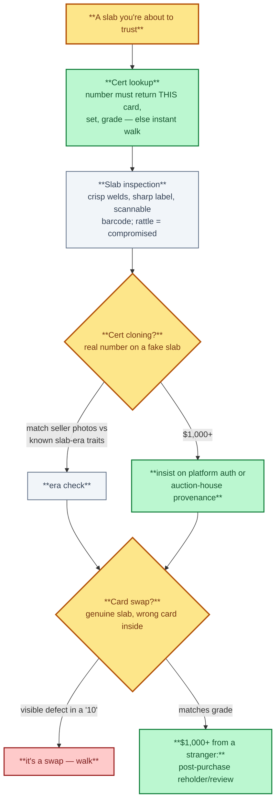
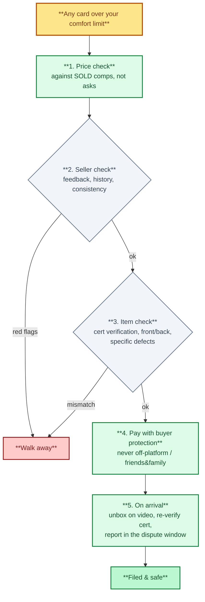

# 6. Fakes, Alterations and Scams

> **Act III — The solution · chapter 14 of 16.** The shadows. Where the money actually goes wrong. The minimum defence
> here is what the guide's authentication section runs on.

## 6.1 Counterfeit raw cards

Checks (use several, never only one):

| Check | How | Catches |
|-------|-----|---------|
| Compare with a known genuine | Same set and print, side by side | Font, color saturation, holo pattern, border width |
| Loupe (30-60x) | Look at printed areas | Genuine offset printing shows a rosette dot pattern; many fakes show inkjet spray or flat color |
| Light test | Shine a phone light through the card | Card stock with an inner layer (black or blue core in MTG/Pokemon WOTC era) blocks more light; fakes may glow evenly |
| Feel and thickness | Calipers, flexibility | Fakes often feel glossy, thin or stiff |
| Weight | Gram scale vs. genuine | Rough screen only |
| Holo / foil | Tilt under light | Wrong holo pattern or holo where there should be none |
| Text and set symbols | Read every line | Typos, wrong copyright years, wrong set symbol |
| Edges | Look at the cut | Uneven or rough cuts |

High-risk cards: WOTC-era Pokemon holos (especially Charizard), Pokemon
Japanese promos, MTG Power Nine and dual lands (Alpha/Beta), Yu-Gi-Oh LOB 1st
Edition, sports rookies of superstars, any card trading above a few hundred
dollars.

## 6.2 Fake slabs and swapped cards

Fake-slab and card-swap detection, in order.

- Counterfeit slabs exist for PSA, BGS, SGC and CGC.
- Always verify the cert online and compare the database image (where
  provided) with the card in the slab: centering, print marks, holo flaws
  match on the real one.
- Check label printing, hologram, the slab seam, tamper evidence (cracks,
  glue, re-welded edges) and slab generation (older slab types should match the
  cert's era).
- If the card is worth the risk, crossover or reholder through the grader
  confirms authenticity.

## 6.3 Alterations

- Trimming: edges cut to sharpen corners. Check dimensions against standard
  size and edge texture; graded "Authentic"/"A" labels may indicate alteration.
- Recoloring: ink on edges/corners to hide whitening; look under angled light.
- Pressing/cleaning: removing dents or dirt. Policies differ by grader; some
  techniques are accepted, others count as alteration.
- Restoration of vintage: rebacking, fill. Usually only disclosed on high-end.

## 6.4 Marketplace scams

| Scam | Red flags | Defense |
|------|-----------|---------|
| Stock photos / wrong item | No photo of the actual card or slab | Ask for photos with your username and date |
| Off-platform payment | "Pay by friends and family, save fees" | Use platform checkout or goods-and-services payments with buyer protection |
| Account takeover | Old seller account suddenly selling grails cheaply | Check feedback history and recent category changes |
| Shill bidding | Bids from new or single-seller accounts | Set walk-away price; ignore bid war |
| Fake grails in social media groups | Price far below market, urgency | Use a trusted middleman or meet with verification |
| Break fraud | Pre-searched or swapped product, hidden case origins, disappearing hits | Use established breakers; watch full uncut video; check case sources |
| Return swap (for sellers) | Buyer returns a different/fake card | Record cert numbers, video packing, use non-returnable listings where allowed |
| Grading-submission middlemen | Holds cards for months, disappears | Submit directly or via long-established, reviewed services |

## 6.5 Minimum process for any card over your comfort limit

The minimum process, as a decision path with walk-away branches.

1. Price check against sold comps (not asking prices).
2. Seller check: feedback, history, consistency.
3. Item check: cert verification, photos front and back, specific defects.
4. Payment with buyer protection.
5. On arrival: unbox on video, verify cert again, compare with photos, report
   problems inside the platform's dispute window.
