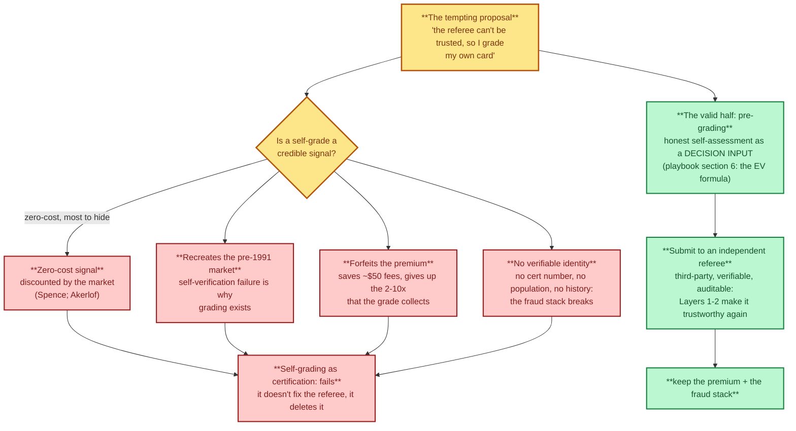

# The self-grading idea — tested against the problem

> **Act III — The solution · chapter 14 of 14.** The obvious counter-proposal to
> Act II's problem: *if the referee can't be trusted, why not just grade the card
> yourself?* This chapter tests that idea seriously — what it would have to
> deliver, where it fails, what part of it is actually valid, and where the
> academic evidence points instead. Verdict up front: **self-grading is not a
> solution to the grading problem. It is the problem with the referee removed.**

## The proposal, charitably stated

Act II says the referee who defines the standard now also runs much of the
market: the population pipeline, the vault, the marketplace, (reportedly) the
price index, and the reholder process. So the tempting move is to stop sending
cards to that referee at all:

1. **You know your cards.** You can pre-grade honestly — the playbook already
   teaches loupe, centering, and exemplar comparison (`psa10-playbook.md` §2, §6).
2. **No fees, no pipeline, no risk.** The card never leaves your hands; no
   reholder, no upcharge, no handling damage (the Deoxys-type loss, problem
   ch. 2.5).
3. **Fairness by construction.** The party assigning the grade is the party who
   benefits from it — the conflict of interest disappears, because the referee
   *is* you.

Points 1 and 2 are true. Point 3 is the trap.

## Why it fails — five mechanisms

The test: self-grading fails as certification, but pre-grading works.

### 1. A self-grade is a zero-cost signal, and markets discount zero-cost signals

Signaling theory (Spence 1973) says a signal is credible only when it is
*differentially costly* — expensive for a low-quality type to fake. The seller
assigning a grade to their own card has the strongest possible incentive to
overstate, and costs nothing to do it. That is exactly the party Akerlof's
lemons result says you cannot trust: the seller who says "this is a 10" is the
seller with the most to hide. The certification literature exists for this
reason — certification is third-party **by definition** ("Quality Signaling
through Certification", 2000/2003; "Quality Disclosure and Certification",
Dranove & Jin 2010, NBER). A self-grade is not a cheaper, fairer certificate.
It is the absence of one.

### 2. It recreates the pre-1991 market — the market failure grading was built to fix

Grading was not invented to make money; it was invented because self-verification
failed. PSA exists in the historical record as a third-party response to
"the prevalence of dishonesty at trade shows" and counterfeit risk
(`psa10-playbook.md` §1; `../act-1-the-hobby/market-overview.md` §1.1). The
field experiment on the grading market measured its function: the incumbent
certifier's grade "offers new information to inexperienced traders" and
"certification may reduce the information asymmetry between informed and
uninformed parties" (Jin, Kato & List 2006, NBER). Act II's problem is that the
referee has a conflict of interest. Removing the referee does not fix the
referee — it deletes the only mechanism that solved the original problem, and
recreates the 1988 show table: you trust the seller, or you don't.

### 3. You give up the entire product — the premium is the reason a grade exists

The PSA 10 premium is not a fee you pay; it is a price you *collect*: graded
copies routinely sell for 2–10x the raw card precisely because a stranger can
buy without re-inspecting (`psa10-playbook.md` §1, §7). The academic literature
measures this: grading premiums in the Pokémon secondary market (Sharma 2026,
SSRN, 2020–2022 boom-bust), and in the closest mature market — diamonds —
significant premiums and discounts attributable to *which laboratory issued the
report*, over 169,483 real-time offers (Lee, Caudill & Mixon 2014, Applied
Economics). A self-graded card captures **zero** of that premium, because zero
buyers can verify it. Run the playbook's own math (§6): self-grading saves the
~$50 all-in grading cost and forfeits a 2–10x premium. That is not a rounding
error; it is the whole product.

### 4. No verifiable identity means no fraud defense

Every anti-fraud mechanism in this repo runs on a verifiable identifier: the cert
number lookup, the population report, the cert-history check, the label-era
match (`psa10-playbook.md` §3, §11; `fakes-and-scams.md` §6.2). A self-graded
card has no cert number, no population entry, no history. To a buyer it is a
stock photo from a stranger — the exact input to the scam table's first rows
(stock photos, wrong item, price far below market, urgency). You would be
selling into the worst corner of the market while calling it independence.

### 5. The empirical evidence on grader subjectivity points the other way

The data on why collectors doubt the referee is real and measurable: across 24
sets, PSA grades a higher share of cards at 9.0+ than an independent AI platform
(85.9% vs 81.0%, statistically significant, small on average, large in some
categories) (Krause 2026, SSRN, "Grading the Graders"). But look at what the
research does *with* that finding: it does not conclude "let sellers grade
themselves." It concludes "make grading **machine-verifiable and independently
audited**" — TCG-AI pipelines (2026), explainable automated grading (2026),
blockchain-backed grading certificates in diamonds and jewelry (2022–2024), and
"Grading Premiums" work on the secondary market itself. The academic direction
of travel is the repo's Layers 1 and 2 — **independent, verifiable grading** —
not its abolition.

## The part of the idea that is valid: pre-grading

The idea is *not* worthless — one half of it is already load-bearing in this
repo, and the distinction matters:

| | Self-**pre**-grading | Self-grading |
|---|---|---|
| What it is | Your honest assessment of a raw card, as a *decision input* | Your grade as a *substitute for certification* |
| Question it answers | "Should I submit this?" (playbook §6) | "What is this worth to a stranger?" |
| Who relies on it | You, before spending fees | The market, after you ask for money |
| Costly to fake? | Irrelevant — no one else uses it | No — that is why it is worth nothing |
| In the framework | Layer 3, item 4 (price the trend, pre-grade honestly) | Outside the framework — it fails at §1 above |

Pre-grading is a private estimation that saves you money; a self-grade is a
public claim that no buyer can verify. The playbook's EV formula
(`expected_value = P(10) x price_10 + ... - cost`) is a pre-grading tool. The
same formula, run with "I call it a 10, so P(10) = 1," is a seller's fantasy
with no signaling power.

## Where the spirit of self-grading survives in the framework

The legitimate demand behind "grade it yourself" is **not being locked out of
the verification process**. The framework answers that without abolishing the
referee:

- **Layer 2 (transparency)** makes the referee's work partially self-checkable:
  published subgrades mean *you* can see which criterion failed; published gem
  rates mean *you* can see the pipeline; custody logs mean *you* can see what
  happened to your slab. The referee's job becomes verifiable from the outside.
- **Layer 4 (governance)** puts the community inside the process: open
  population data, the tracker's independent comp log, a transparency scorecard.
- **Layer 1 (structural separation)** removes the referee's *incentive* to
  distort, so the referee's opinion is worth trusting again.

In one line: **you cannot become the referee, but the referee can be made
verifiable, independent, and — ultimately — replaceable.** That is the fix the
evidence supports.

## Verdict

| Claim about self-grading | Assessment |
|---|---|
| Saves grading fees and handling risk | True — and that is exactly the ~$50 you were saving |
| More fair, because you grade your own card | Inverts the point: fairness requires the grader to *not* be the party with the stake |
| Solves the conflict of interest | No — it deletes the certification that the market needs (Akerlof; Jin, Kato & List 2006) |
| Captures the grade premium | No — the premium exists because the grade is verifiable by a stranger (Sharma 2026; Lee, Caudill & Mixon 2014) |
| Defends against fakes | No — it removes the cert number, the population, and the history that the fraud stack runs on |
| Supported by the grading literature | No — the literature's response to grader subjectivity (Krause 2026) is machine + independent verification, i.e. Layers 1–2 |
| Valid as pre-grading | Yes — and already in the playbook (§2, §6) and Layer 3 |

## Sources (located 2026-10-12 via OpenAlex / CrossRef)

| Tag | Source | DOI / location |
|-----|--------|----------------|
| R1 | Akerlof (1970), "The Market for Lemons" — QJE; Nobel 2001 | en.wikipedia.org/wiki/Market_for_lemons (consensus theory) |
| R2 | Spence (1973) signaling — differentially costly signals | en.wikipedia.org/wiki/Signalling_(economics) |
| R3 | "Quality Signaling through Certification" (2000/2003) | 10.22004/ag.econ.123598 |
| R4 | Dranove & Jin (2010), "Quality Disclosure and Certification: Theory and Practice", NBER | 10.3386/w15644 |
| R5 | Jin, Kato & List (2006), "That's News to Me! Information Revelation in Professional Certification Markets", NBER — field experiments on sportscard grading | 10.3386/w12390 |
| R6 | Krause (2026), "Grading the Graders: AI-Driven vs Human-Based Sports Card Authentication", SSRN | 10.2139/ssrn.7202040 |
| R7 | Sharma (2026), "Grading Premiums and Price Volatility in the Pokémon Card Secondary Market: A 2020–2022 Boom-Bust Case Study", SSRN | 10.2139/ssrn.7515678 |
| R8 | Lee, Caudill & Mixon (2014), "Shine bright like a diamond: a hedonic model of grading and pricing an experience good", Applied Economics | 10.1080/00036846.2014.884707 |
| R9 | "Enhancing Diamond Grading and Certification Through Blockchain Technology" (2024) | 10.1007/978-3-031-76977-1_5 |
| R10 | TCG-AI (2026), Research Square — AI grading for TCGs and sport cards | 10.21203/rs.3.rs-8098898/v1 |
| R11 | Krause (2026), "Tokenized Collectibles: ... Financialization of Sports and Trading Cards", SSRN | 10.2139/ssrn.7288680 |

Cross-references in this chapter: the conflict of interest
(`../act-2-the-problem/grading-conflict.md`), the framework's four layers
(`fair-grading-framework.md`), the grading economics and auth sections
(`psa10-playbook.md` §1, §3, §6, §11), the fraud stack
(`fakes-and-scams.md` §6.2), and the academic context
(`../act-1-the-hobby/what-research-says.md`).