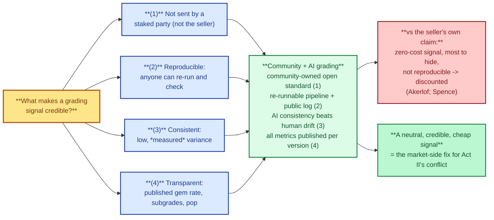
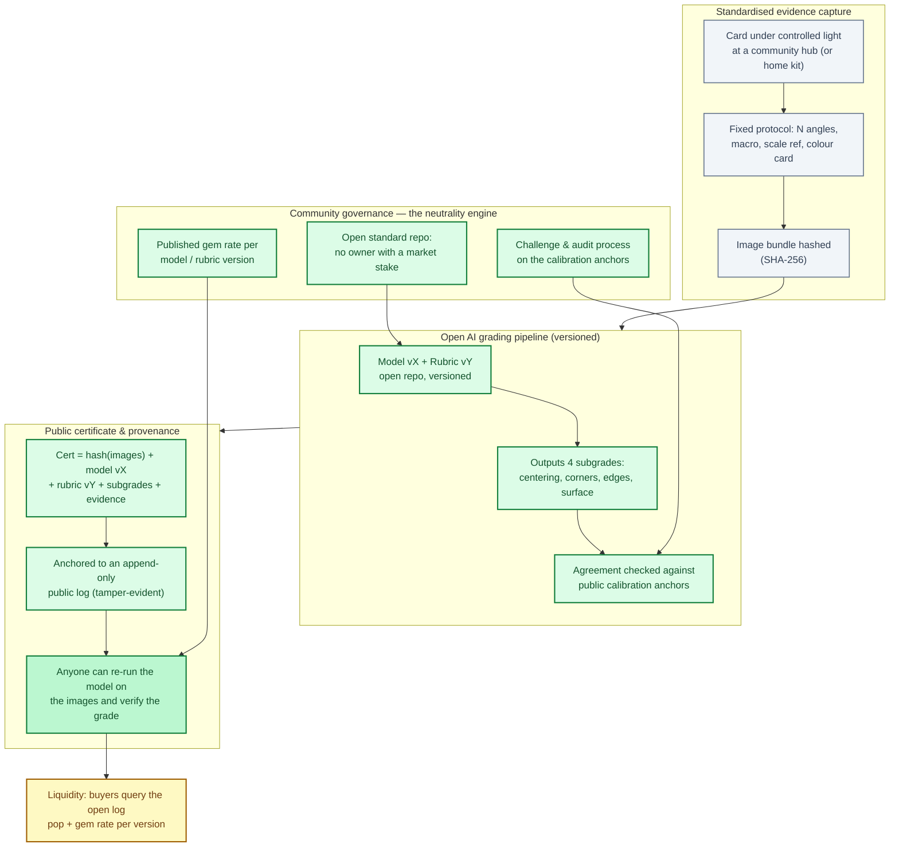

# Open community AI grading — the missing middle between the two bad options

> **Act III — The solution · chapter 17 of 17.** The grading problem has two
> poles, and both of them fail. At one pole sits the incumbent referee —
> neutral *in name only*, because it owns the market it certifies (Act II). At
> the other sits the tempting individual alternative — *grade it yourself* —
> which fails because a seller's word about their own card is a zero-cost
> signal that no buyer can verify (Akerlof; Spence). This chapter argues for
> the option in the middle: **a community-owned, open-source AI grading
> system** — a public standard, a versioned model, and a tamper-evident
> certificate that anyone can re-run and verify. It is not a proposal for
> tomorrow's hype; it is the convergence of five independent research threads
> documented in `../act-1-the-hobby/what-research-says.md`, built to pass the
> exact tests that disqualify both poles.

## 1. The two poles, and why each fails

Before the positive case, the reasoning must start from the two failures,
because the design requirements are *defined by* them.

**Pole A — the incumbent referee (PSA et al.).** Fails the *neutrality*
requirement: the owner of the standard also owns three of the five major
grading brands, the vault, the marketplace, and (reportedly) the price index
(`../act-2-the-problem/grading-conflict.md`). The grade is still *reproducible*
(cert lookup) and still *consistent enough* to carry 2–10x premiums — the
market works — but the standard is movable by a party with a stake in the
price. That is the problem this repo exists to fix.

**Pole B — the seller's own claim ("grade it yourself").** Fails the *credibility*
requirement. Four independent reasons, each with an academic or mechanical
basis:

1. **Zero-cost signal.** Spence's signaling theory: a signal is credible only
   when it is differentially costly. A seller assigning a grade to their own
   card pays nothing to overstate and has the strongest incentive to do so.
   Akerlof's lemons result says the market prices that claim as the worst
   plausible type.
2. **Not reproducible.** No independent process can re-check "I looked at it
   with my loupe and it's a 10." There is no image protocol, no model, no
   log — nothing to re-run.
3. **No identity stack.** No cert number, no population, no history. The
   entire fraud-defence architecture of this repo (`fakes-and-scams.md`
   §6.2) runs on those three things; a self-claim provides none.
4. **Forfeits the product.** The 2–10x graded premium exists *because a
   stranger can buy without re-inspecting*. The literature measures the
   premium in the Pokémon market (Sharma 2026) and in diamonds (Lee, Caudill
   & Mixon 2014); a self-claim captures none of it.

**The design conclusion:** any alternative must be (1) **not controlled by a
staked party**, (2) **reproducible by anyone**, (3) **consistent enough to
carry a premium**, (4) **transparent** (published gem rates, subgrades,
populations), and (5) **able to mint verifiable identity** (cert, population,
history). Neither pole passes all five. The community AI system is the
candidate that can.

The five requirements, and why only the community + AI candidate can pass all of them.

## 2. The requirement that makes everything else follow: reproducibility

Of the five requirements, reproducibility is the keystone — it is the one
that separates *certification* from *opinion*, and it is the one that only
machine grading delivers at scale.

A human grader's opinion is a process output: it happens in a room, on a
card you can't touch, under lighting and attention states nobody records. You
can audit it only statistically (agreement studies — Layer 2.3 of the
framework), never instance-by-instance. The cost of that instance-level
opacity is exactly what Act II documents: you must trust the institution
because you cannot check the card.

An AI grading pipeline changes the epistemic structure:

- The **input** (a standardised image bundle) is public and hashable.
- The **model and rubric** are public code, versioned — "model vX under
  rubric vY".
- The **output** (subgrades + decision trace) is deterministic given
  (input, model, rubric) — or, for stochastic models, published with a fixed
  seed and confidence interval.

Therefore: **anyone, at any time, can re-run the pipeline on the images and
verify the grade.** The certificate is not "trust the company that says this
card is a 10"; it is "here are the images, here is the public model version,
here is the hash chain — re-run it and get the same answer." That is the
strongest form of certification a card can have, and it is the reason the
AI-grading literature exists at all (TCG-AI 2026; explainable automated
grading 2026; "Grading the Graders" 2026).

Note what reproducibility does *not* require: that the AI is *better* than a
human grader at card condition. It requires only that the process be
*public and re-runnable*. An imperfect but public standard is a different
animal from a perfect-but-opaque one — because its errors are auditable, its
gem rate is publishable, and its drift is visible.

## 3. Why the community owns it — the neutrality requirement

The second keystone is who holds the standard. The failure mode of Pole A was
not "a company grades cards" — it was "a company grades cards *and owns the
marketplace*." So the ownership rule is narrow but strict:

> **The grading standard, the model, and the public log must be controlled by
> an entity with no stake in card transactions.**

A community — a grant-funded, contributor-governed, open-repo standard (the
model of ISO accreditation bodies, IETF protocols, or open-source projects
with a neutral steward) — is the existing, proven structure for exactly this:
many participants, no single owner with a market position, changes made by
public vote rather than by a board that profits from the price. This is
framework Layer 1.2 (independent standards body) implemented as a community
instead of a consortium of corporations — same neutrality property, lower
barrier to entry.

Why a community specifically, and not (a) a state regulator, (b) a nonprofit
foundation, or (c) an open-source repo with no governance:

- **Not a regulator first.** Regulation is the enforcement layer (Layer 1.3),
  the backstop when the market won't self-correct. A community standard
  exists and is used *before* anyone needs to sue; the regulator's role
  shrinks to certifying the certifier, which is precisely how the credit
  market ended up after 2006 (registration + minimum criteria + oversight).
- **Not a single foundation** with a board: one trusted intermediary is still
  a single point of capture. A multi-party community with published
  governance is what makes "no stake" durable.
- **Governance is mandatory, not optional.** An ungoverned repo is a code
  dump: no decision process for rubric changes, no audit of calibration
  anchors, no appeal process. The hard problems (§5) are governance problems,
  so the governance is part of the spec, not an afterthought.

The neutrality check is simple and *re-runnable itself*: publish the
governance charter, the funding sources, and the conflict-of-interest
disclosures of the maintainers. If a maintainer owns card inventory or a
marketplace, the community sees it. Compare: PSA's ownership chain required
Wikipedia and a research pass to establish; a community charter is read in
ten minutes.

## 4. The system, component by component

The system: capture -> open pipeline -> public certificate log -> liquidity, with community governance holding the neutrality levers.

(See the architecture diagram above.)

### 4.1 Standardised evidence capture

The input must be a **standardised image bundle**: fixed lighting protocol,
fixed number and angles of shots (front, back, label-free raw card, corners
macro, edges, under raking light), a scale reference and colour card in
frame, shot at a community hub or with a home kit to the same protocol. The
bundle is **hashed (SHA-256)** at capture. The hash does three jobs: it pins
the evidence (no re-shooting "to make the print line disappear"), it is the
identity that the certificate references, and it is the unit that gets
logged.

This is deliberately *evidence-first*. The card's physical truth is reduced
to a public, immutable, inspectable record — the same move as document
authentication in legal tech, and the reason the diamond industry's
blockchain work (2022–2024, `../act-1-the-hobby/what-research-says.md` §5)
is the right template: provenance is solved by making the evidence
checkable, not by making the grader more trustworthy.

### 4.2 The open pipeline

A versioned model (vX) implementing a versioned rubric (vY) that outputs the
four subgrades — centering, corners, edges, surface — with a decision trace
(confidence per subgrade, borderline flags, nearest-calibration-anchor
distance). Public repo. Two engineering commitments follow from the
requirements, not from fashion:

- **Subgrades are the output, the final number is a rule.** The rubric
  (including the combining rule and tolerance bands) is data in the repo.
  This is the entire content of framework Layer 2.2 (publish the rubric with
  tolerance bands and subgrades on every label) — but here it is trivially
  true because the rubric *is* the code.
- **Explainability is a feature, not a nice-to-have.** Borderline decisions
  must point at pixels (the explainable-grading line of work, 2026). A
  card that is "9 because of a surface mark" must show *which* mark. This
  converts the most common real-world dispute — "is that a print line or a
  scratch?" — from an argument about institutions into an argument about
  pixels that anyone can look at.

### 4.3 The certificate and the public log

The certificate is a data record, not a plastic slab:
`certificate = hash(image bundle) + model version + rubric version +
subgrades + decision trace + timestamp + anchor set`. It is anchored to an
**append-only public log** (a blockchain is one implementation; an
append-only log with periodic hash publication in multiple independent
outlets is another — the point is tamper-evident public anchoring, not
crypto ideology).

From the log, the market gets what made grading valuable in the first place
(`../act-1-the-hobby/grading-companies.md`, `what-research-says.md` §1):

- **Population** = count of certificates per (card, grade, model version).
- **Gem rate** = the share of submissions that come back a 10, *per model
  and rubric version* — the metric Act II §2.4 says no incumbent publishes,
  made publishable by construction because the pipeline is public.
- **History** = the full chain for a given card: captures, grade changes
  under model upgrades, re-anchors. The cert-history discipline of
  framework Layer 3 (screenshot before and after, ask why on changes)
  becomes a query.

**Versioning semantics matter** and are specified: a model upgrade (vX →
vX+1) does not silently re-grade the population. Old certificates remain
valid *as issued* ("graded under model vX"); cards can be re-captured and
re-graded under the new version, and the log shows both. This is how you get
drift *visibility* instead of drift *surprise* — the population report that
matters is "how many v9-model 10s exist, and how would they grade under v10,"
and both columns are public.

### 4.4 The community's institutional roles

- **Calibration governance.** A standing process maintains the public
  calibration anchor set (reference cards with community-agreed reference
  grades, re-anchored on schedule), runs agreement statistics against the
  incumbent graders (the Krause-2026 comparison, but continuous and
  public), and publishes them. "AI consistency beats human drift" is not an
  assertion — it is a measured, versioned, public statistic (requirement 3
  enforced continuously, i.e., framework Layer 2.3 made permanent).
- **Audit and appeal.** Anyone can file a challenge against a specific
  certificate (usually a borderline decision) with their own analysis; a
  public review produces a public outcome that either upholds the decision
  or flags it. The dispute that today is "my dealer says / the grader says"
  becomes "the community log says, here is the trace."
- **Capture quality.** Hubs are the analog of assay offices: staffed,
  calibrated imaging stations (the PSA submission pipeline minus the
  black box). A home kit is a second tier with a "community-verified
  capture" flag, priced accordingly.
- **Identity issuance.** Only the log issues certificate IDs; the
  certificate is portable metadata on the slab (QR/NFC), not the slab
  itself. The slab is *packaging*; the certificate is *public state*.

## 5. The hard problems, honestly

A proposal that lists no hard problems is a pitch. Here are the real ones,
in order of how they bite:

1. **AI accuracy on the 9/10 boundary is not solved.** The whole value is in
   the top of the band, and that is exactly where current models are
   weakest — a print line vs a micro-scratch at specific angles is a
   genuinely hard vision problem. Mitigation is structural, not heroic:
   publish per-version accuracy *on the boundary specifically* (holdout
   benchmark of disputed cards), mark borderline certificates with low
   confidence so the market can price the uncertainty, and keep humans in
   the loop only as *independent auditors* of borderline cases (not as the
   standard). The claim to defend is "measurably and publicly consistent,"
   not "never wrong."
2. **Capture gaming.** A sophisticated seller can light, angle, or clean a
   card to flatter the camera. Mitigations: protocol enforcement at hubs,
   the hash pinning the *evidence as captured* (cleaning is still gaming —
   the community's rubric would treat "capture-optimised" as a flag, which
   is itself the transparency working: it converts hidden manipulation into
   priced, visible manipulation), and the market discount for
   home-captured vs hub-captured bundles.
3. **The liquidity cold start.** A new standard with zero buyers is
   worthless; this is the real reason the incumbent's moat is not grading
   quality but network effects. The honest path is a *coexistence* phase:
   certificates are issued alongside incumbent grades (dual-grade, exactly
   the grail rule in framework Layer 3), the open log accumulates population
   and gem-rate history, and the market forms a visible **community-grade
   discount/premium** — measurable, like the GIA-vs-EGL diamond spread
   (Lee, Caudill & Mixon 2014). The day the open log's population and
   history are deeper than the incumbents' opacity, the premium question
   becomes an empirical market outcome instead of a faith question.
4. **Capture of the standard.** A community standard can be bought,
   captured, or forked. Mitigations are the governance itself: neutral
   stewardship, published funding, contributor base with no single
   majority, and — the structural fact that makes capture unattractive — a
   *fork is the sanction*. If the standard is corrupted, the community forks
   to a new log; the brand value is in the trust, and trust follows the
   fork. No single owner of a community standard can be sued into giving
   up the market, because there is no owner to give it up.
5. **Adversarial pressure.** When a public standard starts carrying real
   premiums, it gets attacked: forged image bundles, model poisoning
   attempts via contribution pipelines, sybil challenges. Mitigations are
   the standard toolkit of public infrastructure (signed releases, reviewed
   contribution process, anchor audits) plus the market's own defense: a
   forged bundle fails the re-run test, which is the entire point of
   reproducibility.

## 6. Why this is a *solution* to Act II and not just a different product

The difference is in who holds each failure lever:

| Requirement | Incumbent (Pole A) | Self-claim (Pole B) | Community AI |
|---|---|---|---|
| Not controlled by a staked party | Fails (owns market + price data) | N/A (no standard exists) | **Passes** (charter, public funding, fork sanction) |
| Reproducible by anyone | Fails (process is private; cert is lookup-only) | Fails (no process at all) | **Passes** (re-run the pipeline on the images) |
| Consistent enough to carry a premium | Passes (market-proven) | Fails (unbounded drift) | **Measured per version, published** |
| Transparent (gem rate, subgrades, pop) | Fails (Act II §2.4) | Fails (nothing to publish) | **Passes by construction** |
| Mints verifiable identity (cert, pop, history) | Passes | Fails (no identity) | **Passes** (public append-only log) |
| Disputes | Private, institution vs collector | None (no one to dispute with) | Public log + community review |

Note the shape of the table: **Pole B fails everything on the right, Pole A
fails the left, and the community system is the first candidate that passes
both halves.** That is the whole argument in one table. It is also precisely
why the academic literature points this direction without naming it: the
certification-economics literature says a standard needs an independent
holder (Dranove & Jin 2010); the AI-grading literature demonstrates
re-runnable, explainable pipelines (TCG-AI 2026; explainable grading 2026;
Krause 2026); the provenance literature shows how to make evidence
tamper-evident (diamonds/jewelry, 2022–2024); the platform literature shows
why the holder's incentives are the whole game (Jin, Kato & List 2006).
Open community AI grading is the intersection of all four.

## 7. What a collector does about it today

The system above is a multi-year build; it is Layer 1–2 of the framework in
prototype form. Nothing about the framework is paused while it matures —
this is what the chapter contributes to *now*:

1. **Dual-grade with independent graders** (framework Layer 3, rule 2) is the
   manual approximation of the coexistence phase: every grail gets a second
   opinion from a structurally independent lab, and the log of both opinions
   *is* the seed population.
2. **Standardise your own evidence capture.** The image-protocol discipline
   (fixed angles, raking light, hash the bundle) is useful *today* for every
   purchase, sale, insurance claim, and dispute — the playbook's photo
   requirements, upgraded to a repeatable spec. The tracker stores the
   hashes.
3. **Watch the metric.** The single number to track is the **community-grade
   premium/discount** versus incumbent grades for identical cards — the
   diamond spread, but for cards. When it appears and narrows, the cold
   start (§5.3) is working.
4. **Fund and join it.** Open standards live or die on contributors and
   funding. A collector who wants this fix owns a stake in it the only way
   it can be had: as a participant, not a customer.

## Verdict

Self-grading was tested and failed: a zero-cost signal with no identity
stack, which is why the market discounts it to the lemon price. Open
community AI grading is the design that satisfies the five requirements the
two failures jointly define — **neutrality by governance, credibility by
reproducibility, premium by measured consistency, trust by transparency, and
identity by a public log** — while keeping its hard problems in the open. It
is the missing middle: a referee with no stake, a standard anyone can
re-run, and a market that prices the standard instead of trusting the
company.

## Sources (located 2026-10-12; see `../act-1-the-hobby/what-research-says.md` for the full map)

| Tag | Source | Used for |
|-----|--------|----------|
| R1 | Akerlof (1970), "The Market for Lemons" — QJE; Nobel 2001 | Why self-claims are priced as lemons (§1, §2) |
| R2 | Spence (1973) signaling — differentially costly signals | Why a zero-cost self-grade fails; what makes a signal credible (§1, §2, diagram) |
| R3 | Dranove & Jin (2010), "Quality Disclosure and Certification: Theory and Practice", NBER (10.3386/w15644) | Independent-holder requirement; certification as market institution (§3, §6) |
| R4 | Jin, Kato & List (2006), "That's News to Me! Information Revelation in Professional Certification Markets", NBER (10.3386/w12390) | The incumbent's informational role and its limits; holder incentives as the whole game (§6) |
| R5 | Krause (2026), "Grading the Graders" (10.2139/ssrn.7202040) | Measurable inter-grader divergence; the continuous-public-agreement idea (§4.2, §4.4) |
| R6 | TCG-AI (2026, 10.21203/rs.3.rs-8098898/v1); "A Multistage Hybrid AI Framework for Explainable Automated Trading Card Grading" (2026) | Re-runnable, explainable pipelines (§2, §4.2) |
| R7 | Lee, Caudill & Mixon (2014), "Shine bright like a diamond: a hedonic model of grading and pricing an experience good", Applied Economics (10.1080/00036846.2014.884707) | Grader-brand premium/discount is measurable; the cold-start metric (§4.4, §5.3, §7) |
| R8 | "Enhancing Diamond Grading and Certification Through Blockchain Technology" (2024, 10.1007/978-3-031-76977-1_5); "NFT Certificates and Proof of Delivery for Fine Jewelry and Gemstones" (2022, 10.1109/access.2022.3208698) | Provenance by checkable evidence; tamper-evident anchoring (§4.1, §4.3) |
| R9 | Krause (2026), "Tokenized Collectibles" (10.2139/ssrn.7288680) | Digital claims on physically custodied cards; market structure (§4.3 context) |
| R10 | Sharma (2026), "Grading Premiums and Price Volatility in the Pokémon Card Secondary Market" (10.2139/ssrn.7515678) | The premium at stake that any viable standard must be able to carry (§1, §4.4) |

Cross-references: the problem this solves
(`../act-2-the-problem/grading-conflict.md`), the framework layers this
implements (`fair-grading-framework.md` Layers 1–4), the pre-grading method
that survives from the self-grade idea (`psa10-playbook.md` §2, §6), the
fraud stack the identity log serves (`fakes-and-scams.md` §6.2), the
academic map (`../act-1-the-hobby/what-research-says.md`), and the
independent-data instrument (`../../tracker/`).