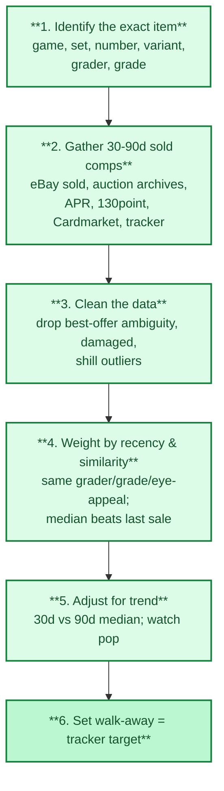

# 7. Valuation and Selling

> **Act III — The solution · chapter 12 of 15.** The value. The method the deep dive runs on: fair value from *sold*
> comps, at least one source outside the grader's group, and a walk-away price. A
> prerequisite to the PSA 10 guide.

## 7.1 Building a fair value for any card

Building a fair value, step by step.

1. Identify the exact item: game/sport, set, number, variant (1st Ed,
   parallel, serial number, language), grader, grade.
2. Gather sold comps from the last 30-90 days:
   - eBay sold listings (filter "Sold items")
   - Auction house archives (Goldin, Heritage, PWCC/Fanatics Collect, REA)
   - PSA Auction Prices Realized, 130point, Card Ladder, PriceCharting.
     PSA APR is run by the grader, and Card Ladder is reported to belong to the
     same group (Collectors). Always include at least one source outside it,
     such as eBay sold, 130point, an auction archive or your tracker log
     (`../act-1-the-hobby/grading-companies.md` 2.7).
   - TCG-specific: TCGplayer market price (US), Cardmarket (EU), Japanese
     shops/marketplaces for Japanese prints
3. Clean the data: remove best-offer ambiguity (look up accepted offer when
   possible), damaged/autograph variants, shill-looking outliers.
4. Weight by recency and similarity: same grader, same grade, similar eye
   appeal. A median of recent sales beats the single last sale.
5. Adjust for trend: compare 30-day median with 90-day median; watch the
   population trend.
6. Set a walk-away price and log it as `--target` in the tracker.

## 7.2 Selling channels

| Channel | Best for | Costs (indicative, verify) | Notes |
|---------|----------|----------------------------|-------|
| eBay | Most cards | Final value fee in the low-teens percent, plus payment/shipping | Largest audience; authenticity guarantee program for high-value cards |
| TCGplayer / Cardmarket | Raw and graded TCG cards | Marketplace commission plus payment fees | Price-driven; expects accurate condition |
| Auction houses | High-end graded cards | Seller commission (negotiable at high value) plus buyer's premium on the buyer side | Wider reach for grails; consignment wait times |
| Whatnot and live apps | Mid-range, entertainment-led | Platform commission plus processing | Fast sales; prices depend on audience on the day |
| Card shows and shops | Quick cash, trades | Dealers pay roughly 60-85% of market | No fees, but lower price |
| Consignment / vault platforms | Hands-off selling | Commission plus storage/withdrawal fees | Check withdrawal rules before vaulting |
| Social media groups | Low fees | Trust risk | Use protected payment only |

Fee levels change; check the platform's fee page before listing.

## 7.3 Pricing your listing

- Fixed price at about the recent median for quick sales; slightly above with
  best offer for patience.
- Auctions work best for cards with deep demand; set a reserve or starting
  price you can live with.
- Show the cert number and full front/back photos; mention flaws.

## 7.4 Taxes and records (general, not tax advice)

- Many jurisdictions treat collectibles gains differently from stocks (for
  example, the US taxes collectibles at a special long-term rate up to 28%).
- Marketplaces issue reporting forms above thresholds that change by year and
  country.
- Keep for every card: purchase date, price, fees, grading costs, shipping,
  sale price, platform. The tracker's `export --csv` can hold your price
  history; keep cost basis records separately or in notes.
- Ask a tax professional in your country before selling at scale.
