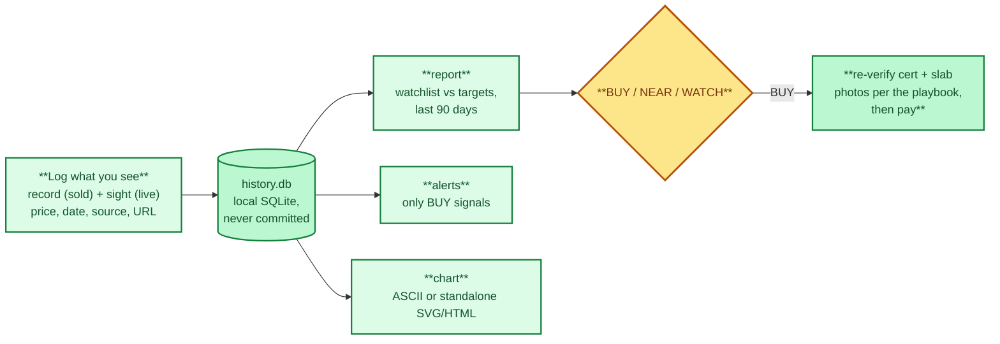

# Price Tracker

> **The instrument.** Your own price log, independent of the grader's corporate
> group — the practical answer to the conflict of interest raised in the grader chapters.

Own-data PSA 10 price tracker. No third-party APIs, no accounts, no tokens:
you log the prices you observe and `tracker.py` stores them, computes
statistics, draws its own charts, and flags buy signals against your targets.

- Storage: local SQLite (`history.db`, git-ignored). Standard library only,
  no dependencies to install (Python 3.8+).
- `record` logs a **sold** comparable (eBay sold, auction result, private sale).
- `sight` logs a **live listing** you spotted (shop, show, Buy It Now).
- Charts are drawn locally: ASCII in the terminal, or a standalone HTML page
  with inline SVG (no JavaScript, no network calls).

## Quick start


The tracker's loop: log -> store -> report/alert/chart -> act.



```bash
cd tracker
python3 tracker.py selftest        # offline checks, always passes without network
python3 tracker.py import --json watchlist.example.json
python3 tracker.py list
python3 tracker.py record "Charizard #4 Base" 8800 --date 2026-08-15 --source "Goldin"
python3 tracker.py sight "Charizard #4 Base" 8950 --source "LCS" --note "firm"
python3 tracker.py report          # watchlist vs targets, last 90 days
python3 tracker.py alerts          # only buy signals
python3 tracker.py chart "Charizard #4 Base" --kind sold
python3 tracker.py chart "Charizard #4 Base" --html zard.html
python3 tracker.py export --csv comps.csv
python3 tracker.py remove "Charizard #4 Base" --yes   # asks first without --yes
```

## Signals

`report` and `alerts` look at the last 90 days per card:

- **BUY**: cheapest recent listing or median of recent solds is at or under
  your target.
- **NEAR**: either is within 10% above your target.
- **WATCH**: everything else, or no recent data.

## Routine (5 minutes a week)

1. After checking eBay solds / auctions / shops, log what you saw with
   `record` and `sight` (price, date, source, URL when available).
2. Run `report`. When a card flips to BUY, re-verify the cert and slab photos
   per `docs/act-3-the-solution/psa10-playbook.md` before paying.
3. Monthly: `chart --html` for cards you are close on, and re-check population
   trends.

To run `alerts` on a schedule, add a cron line (macOS/Linux) that appends to a
log file you review:

```cron
0 19 * * 0 cd /path/to/trading-card-collector/tracker && python3 tracker.py alerts >> alerts.log 2>&1
```

## Files

- `tracker.py` — the whole tool.
- `watchlist.example.json` — starter entries for `import`.
- `history.db` — your data (local only, never committed).
